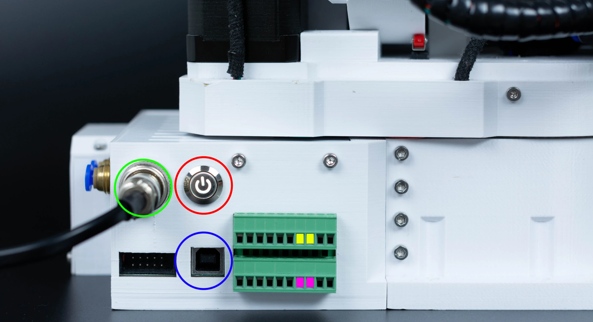
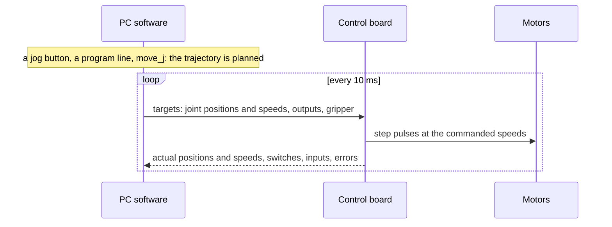

# The robot system

A working PAROL6 is three things: the arm, the control board inside its base, and a PC running the high-level
software. Each does a part of the job.

{ width="700" }

## The arm

Six revolute joints, driven by NEMA 17 stepper motors through planetary gearboxes and belts, in PETG printed links.
Joints 1, 2 and 3 position the wrist; joints 4, 5 and 6 form a spherical wrist that orients the tool. Joint 6
ends in the flange the tool mounts on. The tool connections are on the forearm: an M8 connector for an electric
gripper and two push-in fittings for pneumatic lines. Each joint has a limit switch or an inductive sensor that
gives it a reference when the robot homes.

{ width="760" }
{ width="760" }

1. Base, with the control board inside
2. Joint 1 motor
3. Shoulder, turned by joint 1
4. Joint 2 motor
5. Upper arm
6. Joint 3 motor
7. Elbow
8. Forearm, also called the lower arm, turned by joint 4
9. Wrist, turned by joint 5
10. Flange, turned by joint 6
11. Air fittings for a pneumatic tool
12. Gripper, here the standard pneumatic gripper

The robot model (the URDF and MuJoCo files in `robot_descriptions`) uses the standard ROS link names, which count
the parts differently: the elbow is `forearm_link`, the forearm `wrist_1_link` and the wrist `wrist_2_link`.

The arm has no brakes and no joint encoders. The motors hold the arm while they are powered; the position is
counted in steps from the homing reference. Both facts shape how the robot is used, and the
[Safety](../02-safety/index.md) chapter returns to them.

## The control board

The [PAROL6 control board](../board/index.md) sits in the base: an STM32F446 microcontroller, six TMC5160 stepper
drivers, two isolated inputs and two isolated outputs, the E-stop input, a CAN bus for electric grippers, and USB
to the PC. Its firmware generates the step pulses, runs the homing sequence, reads the switches and the inputs,
drives the outputs and the gripper, and exchanges a packet with the PC at 100 Hz. It does not plan motion: it
executes the joint speeds and positions the PC sends it, 100 times a second.

## The PC software

The PC does the thinking: kinematics, trajectory planning, the simulator, the program interpreter, the interface.
There are two first-party programs, and others:

| | What it is | For |
|---|---|---|
| [Commander software](../gui/commander/index.md) | A desktop GUI with jogging, a 3D simulator, a program editor for RBTscript, I/O and gripper tabs | Using the robot by hand, teaching points, simple programs |
| [Python API](../programming/02-python-api/index.md) | A controller process that talks to the board, and a Python client library with blocking and asynchronous calls, planned and streamed motion, tools, collision checking | Programs, integrations, research, teleoperation, AI agents |
| [ROS 2 and MoveIt](../programming/04-ros2.md) | A MoveIt configuration and a `ros2_control` hardware interface that drive the Python API's controller | ROS users |
| [Community interfaces](../programming/05-other-interfaces.md) | Web GUIs, alternative firmware, vision demos | |

All of them speak the same [serial protocol](../board/10-serial-protocol.md) to the control board, so a board with
the main firmware works with any of them.

## How a move happens

1. You press a jog button, run a program line or call `move_j`.
2. The PC software computes the trajectory: the joint angles over time, with the speed profile you chose, within
   the joint limits.
3. One hundred times a second it sends the control board a packet with the target position and speed of each
   joint, the output states and the gripper command.
4. The board sets the stepper speeds and runs the steps; the drivers turn the motors.
5. The board answers with the actual position and speed of each joint, the switch and input states, the errors and
   the gripper's status, which the PC software shows and uses for the next cycle.

## Where everything is published

| | |
|---|---|
| Mechanical files, BOM, building instructions, control board firmware, URDF | [PAROL6-Desktop-robot-arm](https://github.com/Source-Robotics/PAROL6-Desktop-robot-arm) |
| Commander software | [PAROL-commander-software](https://github.com/Source-Robotics/PAROL-commander-software) |
| Python API | [PAROL6-python-API](https://github.com/PCrnjak/PAROL6-python-API) |
| ROS 2 MoveIt configuration | [PAROL6-ROS2-MOVEIT](https://github.com/Source-Robotics/PAROL6-ROS2-MOVEIT) |
| This documentation | [PAROL-docs](https://github.com/Source-Robotics/PAROL-docs) |
| Shop, videos, community | [source-robotics.com](https://source-robotics.com/), [YouTube](https://www.youtube.com/@source-robotics), [Discord](https://discord.gg/prjUvjmGpZ) |

The full list is on [Downloads and files](../cad-files.md).
