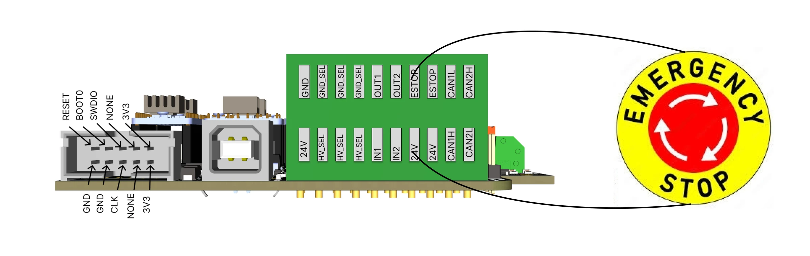

# Emergency stop

The E-stop is the red button on the base, a normally closed contact wired to the control board's E-stop input.
It must be connected for the robot to run.

{ width="800" }

## What pressing it does

The control board reads the E-stop input in every command cycle and reports it to the PC in every packet. The PC
software acts on it:

- the **commander software** disables the robot: it sends the disable command, the firmware stops accepting
  motion commands, and the log shows *Robot disable; button or estop*. The motors stay energised and hold the
  arm. Release the button and press **Enable** to continue.
- the **Python API's controller** stops all motion and latches a protective stop; every motion command is refused
  with `SYS_ESTOP_ACTIVE` until the button is released and `reset()` is called.

!!! danger "The E-stop is a software stop"
    The control board's firmware (release 1) reports the E-stop and does not itself cut the motor power or the
    step pulses: the PC software stops the motion. A PC that has crashed, a program that has frozen, or a USB
    cable that has fallen out leaves the E-stop without effect. For those cases the hard stop is the **power
    supply**: a switch on the supply's mains side within reach, and the knowledge that the arm will fall when
    you use it.

## What it does not do

- It does not cut power to the motors, so the arm does not fall when it is pressed.
- It does not stop the gripper: an electric gripper keeps its grip, a pneumatic one stays where the valve left it.
- It does not stop a program that runs on the PC: the program waits; stop it as well before you release the
  button.

## The contact

Normally closed, so that a cut wire, a loose terminal or an unplugged button is read as a stop. A normally open
button does not work. The control board has two E-stop connectors on the same input: a second button can be
wired in series, or a safety relay's contact. [Inputs, outputs and E-stop](../board/06-io-and-estop.md) has the
wiring.
