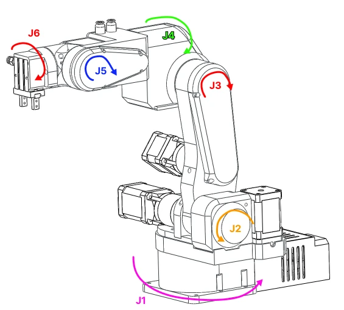
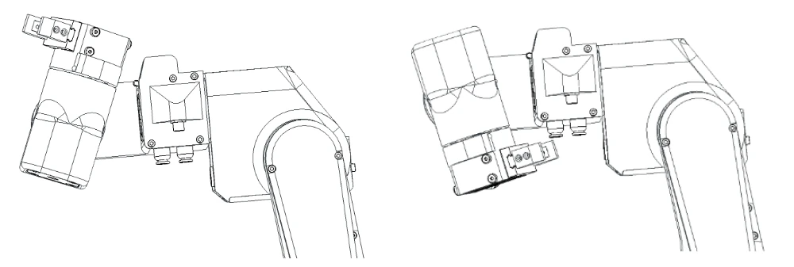

# Joint limits and directions

## Joint numbering and positive directions

Joints are numbered from the base up. Joints 1, 2 and 3 are also called the base, shoulder and elbow joints, and
joints 4, 5 and 6 wrist 1, wrist 2 and wrist 3, the names the robot model and ROS use. Each picture shows one joint
turned 30° in its positive direction, in colour, over the pose in grey. The arrow at the joint points the same
way, and the commander software's left arrows jog in that direction.

{ width="900" }
{ width="900" }

## The standby pose

The pose the robot takes after homing, and the reference for the limits below. In the kinematic model's
Denavit-Hartenberg convention this pose has joint 1 at 0°; the firmware homes joint 1 to +90° so that the arm
stands square to the base, and the software reports the standby pose as follows.

| Joint 1 | Joint 2 | Joint 3 | Joint 4 | Joint 5 | Joint 6 |
|---|---|---|---|---|---|
| 90° (0° in the DH table) | −90° | 180° | 0° | 0° | 180° |

{ width="500" }

## Limits

The joint limits of PAROL6's model in [robot_descriptions](https://github.com/Source-Robotics/robot_descriptions)
(version 2.13.0), in degrees, in the angles the software shows (the standby pose above).

| Joint | Negative limit | Standby | Positive limit | Range |
|---|---|---|---|---|
| J1 | −97.40° | 0° (DH) | +97.40° | 194.8° |
| J2 | −146.15° | −90° | −32.70° | 113.4° |
| J3 | 105.52° | 180° | 294.59° | 189.1° |
| J4 | −114.59° | 0° | +114.59° | 229.2° |
| J5 | −120.32° | 0° | +120.32° | 240.6° |
| J6 | | 180° | | one turn: the model has no limit, the cables do |

!!! note "The firmware and the commander still use the earlier limits"
    Firmware 1 and the commander software enforce the limits of the earlier model until they are updated: J1
    ±123.05°, J2 −145.01° to −3.38°, J3 107.87° to 287.87°, J4 ±105.47°, J5 ±90°, J6 0° to 360°. A target
    between the two is accepted by them; keep to the table above.

Joints 2 and 3 are limited in both directions by their geometry and their switches; joints 1 and 4 by printed
blockers; joint 5 by the length of its belt path; joint 6 only by the cables and tubes that run through the wrist.

!!! warning "Grippers and bases change the limits"
    A gripper changes where joint 5 can go without colliding with the forearm, and a riser under the base changes
    what joint 2 can reach. The software limits do not know about either: check the real clearances with a slow
    jog before you run a program near a limit.

!!! danger "Joint 5 and joint 6"
    Joint 5 must never be turned more than one rotation, by hand or by software; joint 6 and joint 1 must never
    be spun more than one turn. The cables and pneumatic tubes that pass through them wrap and tear.
    [Moving the robot by hand](../02-safety/moving-by-hand.md) has the figure.

{ width="700" }
