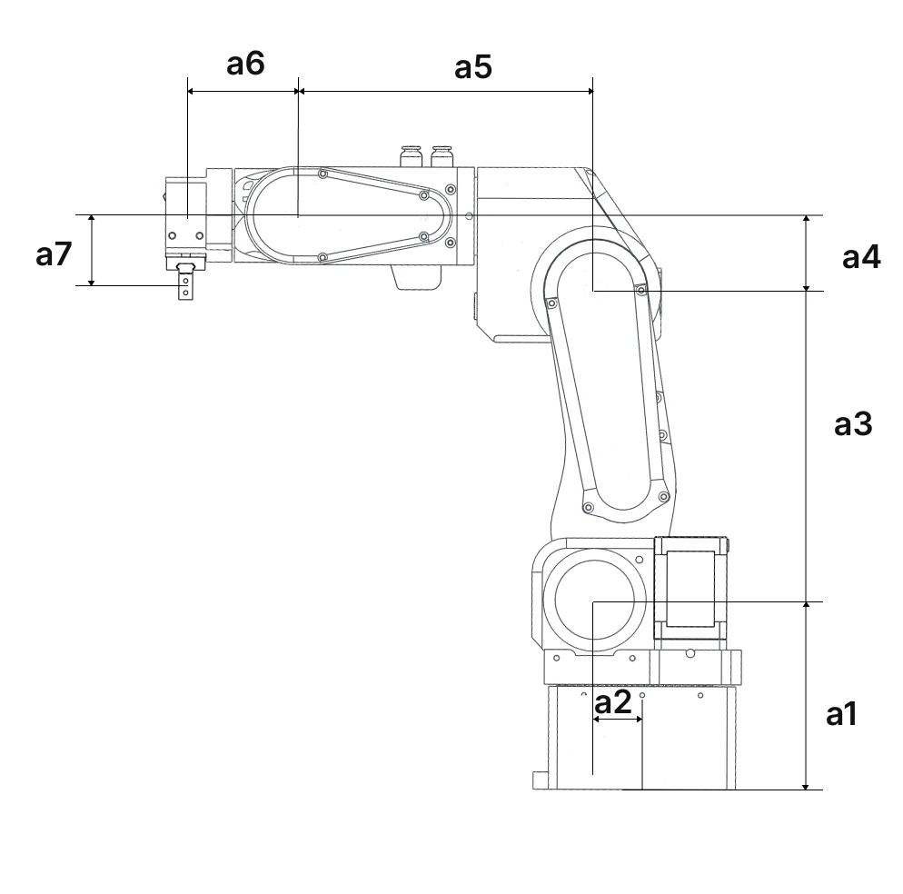
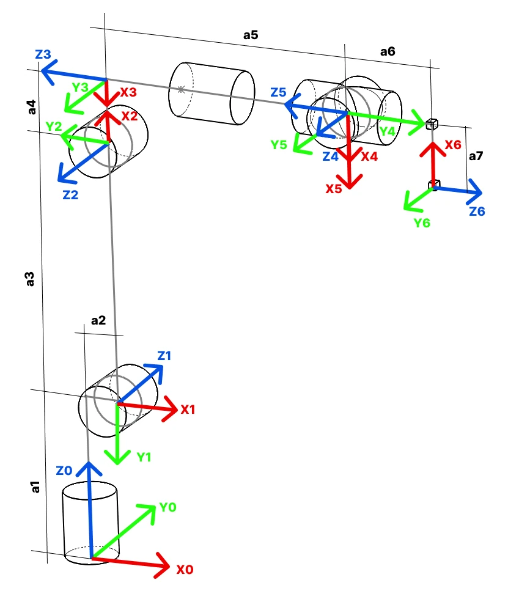

# Dimensions and kinematics

  <canvas class="arm-viewer__canvas" aria-label="PAROL6 in 3D: drag to turn, scroll to zoom"></canvas>
  

    

    <label class="arm-viewer__field">Printed parts <input type="color" name="body" value="#c9c9c6" title="Any colour"></label>
    <button type="button" name="reset" class="md-button">Reset</button>
  

  
Drag to turn the robot, scroll to zoom, move each joint with its slider, try a colour for the printed parts. The model is the
repository's <a href="https://github.com/Source-Robotics/PAROL6-Desktop-robot-arm/tree/main/PAROL6_URDF">URDF</a>; the sliders run over its joint limits.

## Dimensions

{ width="700" }

| Dimension | Value |
|---|---|
| a1 | 110.50 mm |
| a2 | 23.42 mm |
| a3 | 180.00 mm |
| a4 | 43.50 mm |
| a5 | 176.35 mm |
| a6 | 62.8 mm |
| a7 | 45.25 mm |

The dimensions are for the standard pneumatic gripper. A different tool changes a6 and a7, and a riser under the
base changes a1; update the tool in the software ([Tools and the TCP](../programming/02-python-api/tools-and-tcp.md))
or the DH table, or the reported poses will be wrong.

## Kinematic diagram

{ width="600" }

The first three joints place the wrist centre; the axes of joints 4, 5 and 6 intersect in one point, a
spherical wrist, which is what makes the inverse kinematics tractable. The
[Concepts](../theory/kinematics.md) chapter explains what the diagram means.

## Denavit-Hartenberg parameters

The DH table describes the robot in the standby pose with joint 1 at 0°, as the diagram shows it.

{ width="600" }

The Python API does not use this table directly: it loads the robot's URDF model and computes the kinematics
numerically. The commander software uses a Robotics Toolbox model with these parameters. Both agree on the poses
they report.

## Mounting holes

Six holes in the base, on a pattern made for 30×30 mm aluminium profiles. The mounting plates folder of the
repository has STEP drawings of a small and a big base plate: [Mounting the robot](../04-installation/mounting.md).
