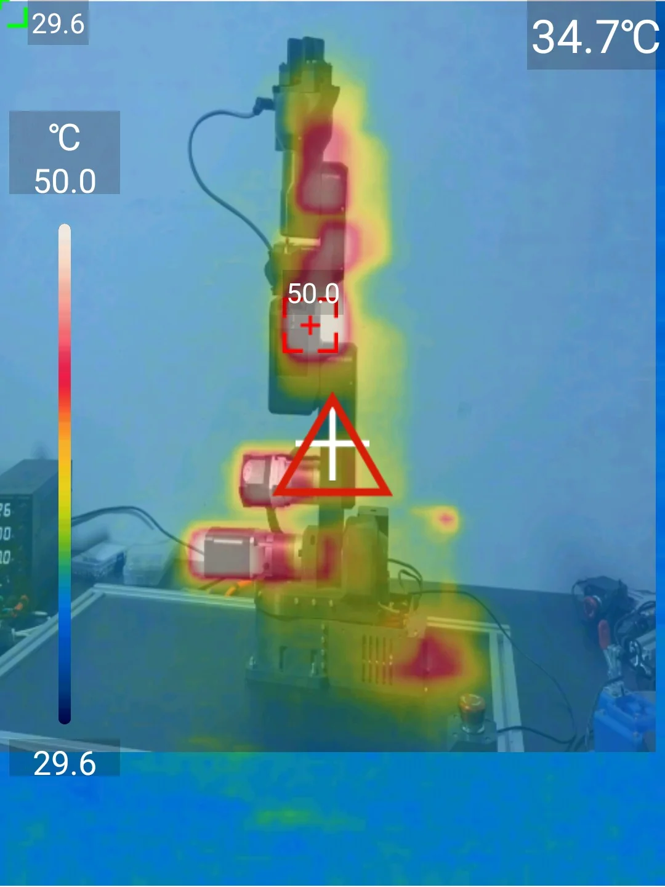

# Currents and temperatures

## Motor currents

The control board sets each motor's running current in the firmware. The values are chosen for the motors of the
BOM and for the printed parts around them; joints 4 and 5 run below their motors' rating because their motors are
enclosed in the forearm.

| Joint | Maximum current (`constants.h`) | Current while moving | Holding current |
|---|---|---|---|
| Joint 1 | 2000 mA | 85 % of the maximum: 1700 mA | 70 % of that: 1190 mA |
| Joint 2 | 2000 mA | 1700 mA | 80 %: 1360 mA |
| Joint 3 | 1900 mA | 1615 mA | 80 %: 1292 mA |
| Joint 4 | 1700 mA | 1445 mA | 80 %: 1156 mA |
| Joint 5 | 1700 mA | 1445 mA | 80 %: 1156 mA |
| Joint 6 | 965 mA | 820 mA | 80 %: 656 mA |

The firmware calls `rms_current(MOTORx_MAX_CURRENT * 0.85, hold_multiplier)`; the hold multiplier is 0.7 for
joint 1 and 0.8 for the others ([Firmware parameters](../reference/firmware-parameters.md)). Lower currents give
less torque, which means lower reachable speeds and accelerations and a higher chance of lost steps; higher
currents heat the motors and the plastic around them.

## Temperatures

Stepper motors are rated for 100 °C and more, but PAROL6 is plastic, and PETG softens around 80 °C. These are the
motor case temperatures measured on a robot at the default currents, at room temperature:

| Joint | Holding position for 5 h | Moving for 2 h |
|---|---|---|
| Joint 1 | 51 °C | 64 °C |
| Joint 2 | 54 °C | 64 °C |
| Joint 3 | 48 °C | 52 °C |
| Joint 4 | 60 °C | 73 °C |
| Joint 5 | 60 °C | 72 °C |
| Joint 6 | 61 °C | 65 °C |

Through a thermal camera, a powered PAROL6 shows where the heat is: the motors of joints 2 and 3 beside the
shoulder, the elbow (the hottest point in this picture, 50 °C) and the wrist motors in the forearm, and the control
board at the back of the base. The scale runs from 29.6 to 50.0 °C.

{ width="420" }

!!! danger "Long runs"
    Joints 4 and 5 come within 10 °C of the plastic's limit after two hours of continuous motion. For a robot that
    runs for hours, reduce the currents in the firmware (`MOTORx_MAX_CURRENT` in `constants.h`, or the
    `hold_multiplier` in `motor_init.cpp`), lower the duty cycle, or let it rest in a pose that does not load the
    motors. A deformed forearm is not repairable.

The stepper drivers themselves report a temperature warning at 100 °C and shut down at 120 °C, with the fan in the
base keeping them well below that ([Control board technical data](../board/03-technical-data.md)). The driver
temperature is not the motor temperature.
