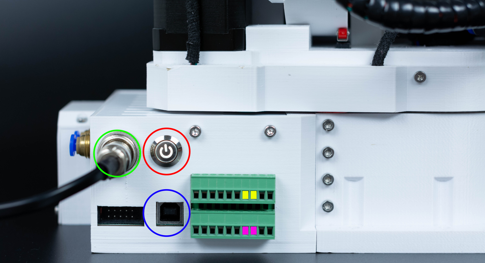

# Connecting

The robot needs three connections to run. They are on the back of the base.

{ width="700" }

| Connection | Connector | Notes |
|---|---|---|
| **24 V power** | GX16 2-pin | From the 24 V 5 A supply. Mind the polarity when you wire your own cable: the board has no reverse-polarity protection |
| **USB** | USB type B | To the PC. USB does not power the board |
| **E-stop** | Two screw terminals | A normally closed contact between them. Open means stop |

## The E-stop

The E-stop must be a normally closed contact: pressing it, unplugging it or cutting its wire opens the circuit,
and all of these stop the robot, which is what you want. A normally open button does not work. The control board
has two E-stop connectors on the same input, so a second button can be wired in series.

The kit's button comes with a printed housing and a PG7 cable gland. [Emergency stop](../02-safety/emergency-stop.md)
says what happens when it is pressed, and the [Control Board Manual](../board/06-io-and-estop.md) has the wiring
diagram.

## The gripper

An electric gripper (SSG-48, MSG) plugs into the M8 connector at the forearm, which carries 24 V and CAN:
[Electric grippers](../06-tools/electric-grippers.md). Pneumatic tubes from the valve go to the two push-in
fittings at the base: [Pneumatics](../07-peripherals/pneumatics.md).

## Inputs and outputs

The two inputs, two outputs and their supply terminals are on the side of the control board, reachable through
the base: [Inputs and outputs](../07-peripherals/io.md).

!!! warning "Nothing else on the programming port"
    The 2×5-pin programming header next to the USB port is for the ST-Link programming adapter only. An ST-Link
    connected with plain jumper wires without the adapter has destroyed boards. See [Firmware](../board/08-firmware.md).
