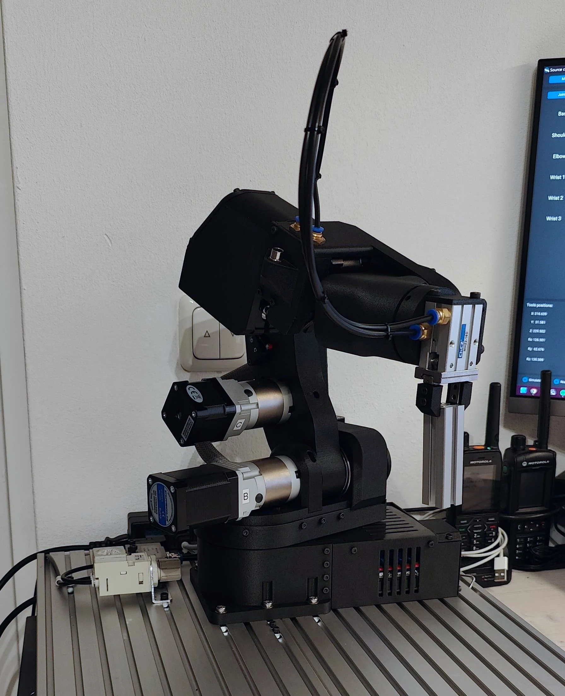
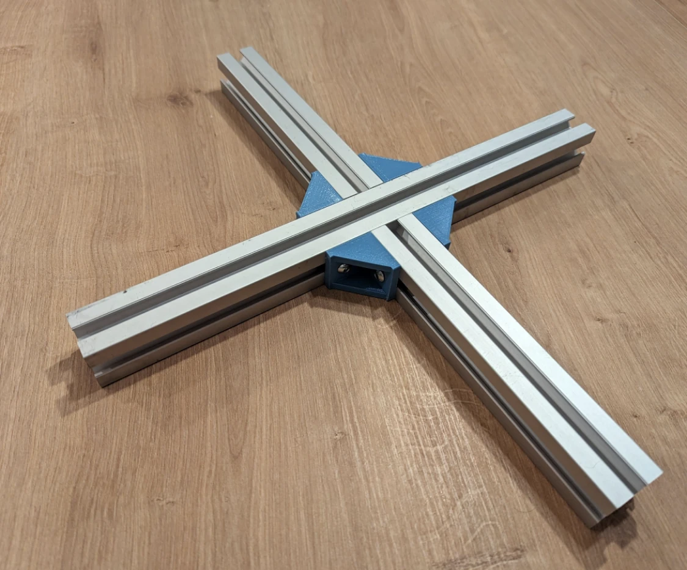

# Mounting the robot

!!! danger "An unanchored robot falls over"
    When the arm extends, the centre of gravity leaves the base. Never run PAROL6 free-standing, not even for a
    test.

Four ways to fix the base:

| Way | What you need | More |
|---|---|---|
| Bolted to a plate or a profile frame | Six M5 × 16 mm socket head screws (DIN 912, in the kit), T-nuts on a profile, a 4 mm hex key | [The base holes](#the-base-holes) |
| Clamped to a desk | Two screw clamps | [Clamps](#clamps) |
| On a printed-connector profile frame | 30×30 profiles, the printed corner connectors, M5 T-nuts and screws | [A profile frame](#a-profile-frame) |
| On a machined or cut plate | The STEP files of the base plates | [Mounting plates](#mounting-plates) |

## The base holes

The base has six holes, spaced for 30×30 mm aluminium profiles.

{ width="600" }

1. On a profile, put an M5 T-nut under each hole.
2. Bolt the base to the plate or the profile frame with the six M5 × 16 mm socket head screws (DIN 912, in the kit).
   They take a 4 mm hex key.

!!! success "Check"
    Push the top of the base sideways, firmly: it must not lift or slide.

## Clamps

For a desk:

1. Clamp the base to the edge with two screw clamps over the base's rim.
2. Check that the clamps do not interfere with the fan intake and the connectors at the back.

## A profile frame

The repository's [`STL/UTILITY`](https://github.com/Source-Robotics/PAROL6-Desktop-robot-arm/tree/main/STL/UTILITY)
folder has `connectors_4_alu_profiles.STL`. It prints a set of corner connectors for a frame of 30×30 profiles, as
in the figure.

{ width="600" }

| You need | For |
|---|---|
| M5 T-nuts | The connectors and the base |
| M5 × 12 mm screws | The connectors |
| The six M5 × 16 mm screws | The base |

## Mounting plates

The `mounting plates` folder of the repository has STEP files of a small and a big base plate, with the hole
pattern, for a plate you have machined or cut.

The small plate has more holes than PAROL6 uses: two more M5 and six M4. They were made for other robots and
designs, and stay empty under PAROL6.

## Orientation

PAROL6 is designed to stand upright on its base. Wall and ceiling mounting are not supported:

- the payload, the motor currents and the speed limits are set for an upright arm;
- with no brakes, the arm would fall into the mount when powered off.
