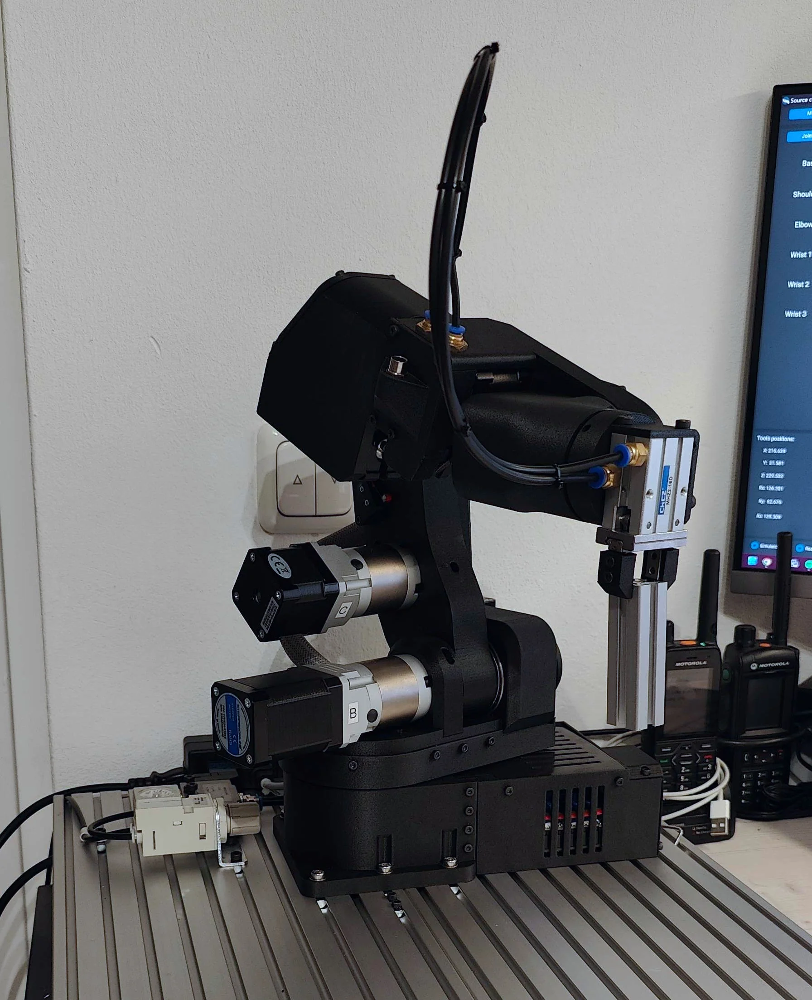
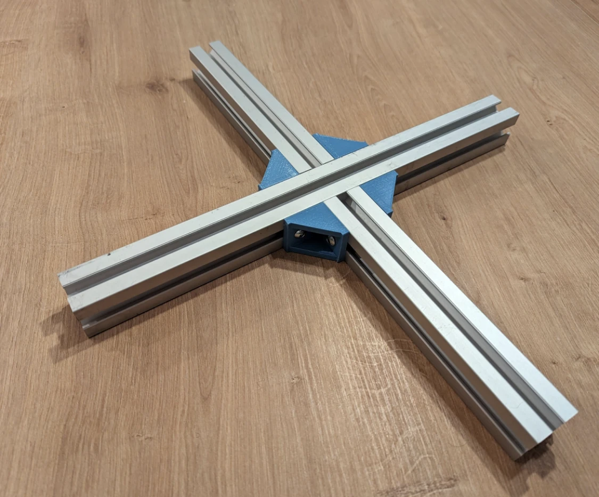

# Mounting the robot

!!! danger "An unanchored robot falls over"
    When the arm extends, the centre of gravity leaves the base. Never run PAROL6 free-standing, not even for a
    test.

## The base holes

Six holes in the base, spaced for 30×30 mm aluminium profiles. Bolt the base to a plate or a profile frame with
M5 screws and T-nuts.

{ width="600" }

## Clamps

For a desk, clamp the base to the edge with two screw clamps over the base's rim. Check that the clamps do not
interfere with the fan intake and the connectors at the back.

## A profile frame

The repository's `UTILITY/connectors_4_alu_profiles.STL` prints a set of corner connectors for a frame of 30×30
profiles, as in the figure. You need M5 T-nuts, M5 × 12 mm screws for the connectors and M5 × 18 to 20 mm screws
for the base.

{ width="600" }

## Mounting plates

The `mounting plates` folder of the repository has STEP files of a small and a big base plate, with the hole
pattern, for a plate you have machined or cut.

## Orientation

PAROL6 is designed to stand upright on its base. Wall and ceiling mounting are not supported: the kinematic model
assumes gravity along the base's axis, and the arm would fall into the mount when powered off.
