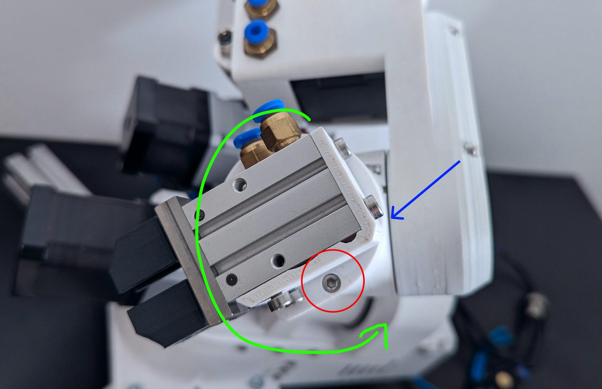

# Homing

After power-up the robot does not know where its joints are: the motors count steps, and the count starts at
zero wherever the arm happens to stand. Homing gives each joint a reference by driving it to its limit switch or
sensor, then moving a known number of steps to the standby pose. It must be done after every power-up, and again
after a collision, a stall or any move by hand.

## Before you press Home

- The arm can move freely to every limit: nothing on the table in the way, no cable caught.
- The tool is mounted: joint 5 homes against the tool's feature on the SSG-48 and the pneumatic gripper, and
  the homing offset in the firmware matches the tool ([Electric grippers](../06-tools/electric-grippers.md)).
- Joint 6 stands so that it finds its sensor within one turn in the negative direction, with the cables and
  tubes not already wound up. The figure shows the pose: the gripper as drawn, the sensor (blue) and the homing
  pin (red); joint 6 turns along the green arrow.
- You are at the E-stop.

{ width="700" }

## The sequence

The firmware runs the sequence; the PC only starts it and watches.

1. **Joints 1, 2 and 3 move together** toward their switches: joint 1 to its inductive sensor, joints 2 and 3 to
   their limit switches. Each stops when it triggers.
2. Each backs off a few hundred steps and approaches again slowly, and the position where it triggers the second
   time is the reference: the first hit may have pressed the switch too far.
3. Joints 1, 2 and 3 move from the reference to their standby positions (13500, 19588 and 23020 steps away).
4. **Joint 4** does the same against its inductive sensor and moves to standby.
5. **Joint 6** turns in the negative direction until its sensor sees the homing pin, backs off, re-approaches,
   and moves on to the position from which joint 5 can home.
6. **Joint 5** homes against its switch, and joints 5 and 6 move to standby together.
7. The firmware sets every joint's counter to its standby value, and reports all six joints as homed.

A video of a correct homing: [Homing reference](https://www.youtube.com/watch?v=OCCQkIWPWwo). It takes about half
a minute. The result is the standby pose with joint 1 at +90°: the arm standing square to the base.

=== "Commander software"
    Press **Home**. The response log reports the joints as they home; the position display and the simulator are
    right once all six are homed.

=== "Python API"
    ```python
    rbt.home(wait=True)
    ```
    The first `home()` after power-up runs the referencing sequence. A later `home()` on a referenced robot is a
    planned, collision-checked joint move back to standby; `home(calibrate=True)` runs the sequence again.
    Planned motion is refused with `MOTN_NOT_HOMED` until the robot is referenced.

## If it goes wrong

Press the E-stop when a joint grinds at its end without stopping: its switch does not trigger. Joints 1, 4 and 6
use inductive sensors whose LED lights when they see metal; a sensor that does not light needs its trigger screw
adjusted. If joint 6 keeps turning, its homing pin is not where the sensor looks. [Homing failures](../09-troubleshooting/homing-failures.md)
has the cases.

## Mastering

A homed robot stands within a few steps of the standby pose. The exact number of steps from each switch to the
witness marks differs between builds; [Mastering](mastering.md) says how to measure and set it.
