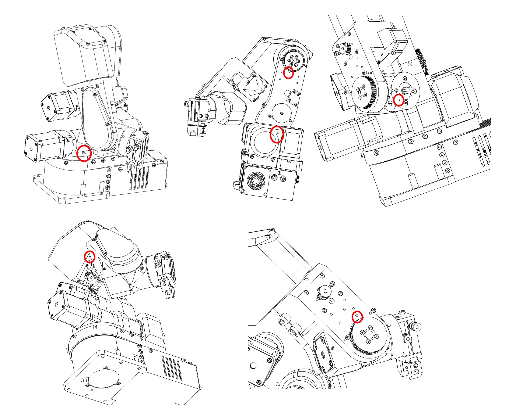

# Mastering

Homing brings each joint to its switch, and then a fixed number of steps to the after-homing pose. That number is
in the firmware, measured on the reference robot.

Printers and parts differ, so on your robot the homed pose may be off by a fraction of a degree per joint.
Mastering measures the difference and corrects the number, so that a homed robot stands exactly at its witness
marks.

## Witness marks

Witness marks are holes in neighbouring links. They line up when the joint stands where homing should leave it,
in the after-homing pose (90°, −90°, 180°, 0°, 0°, 180°). A pin pushed through them proves the pose. PAROL6 has
them on every joint.

{ width="800" }

## What you change, per joint

| Joints | What you change | Where |
|---|---|---|
| [1 to 4](#the-procedure) | The joint's `homed_position` | `motor_init.cpp` |
| [5](#joint-5-and-the-tool) | `j5_homing_offset`, which depends on the tool | `main.cpp` |
| [6](#joint-6) | Nothing in firmware 1: its sensor or its homing pin | On the robot |

## The procedure

For joints 1 to 4. Joints 5 and 6 work differently, below.

1. Home the robot.
2. Jog the joint in small steps until the pin fits through its witness marks. Jog at the lowest speed.
3. Read the joint's position from the commander's position display or `rbt.angles()`.
4. Convert the angle you jogged by to motor steps with the joint's ratio
   ([Drives, ratios and resolution](../03-technical-data/drives-and-ratios.md)), or read the step count from the
   firmware's telemetry.
5. In `motor_init.cpp`, add that number of steps to the joint's `homed_position`. Subtract it if you jogged in the
   negative direction.

    ```cpp
    /// @brief Number of steps from when the limit switch is hit to the standby position
    Joint__->homed_position = 13500;   // joint 1: raise or lower by the steps you measured
    ```

6. Upload the firmware.
7. Home again.

!!! success "Check"
    The pin fits through the witness marks without jogging.

The values of the reference robot are on [Firmware parameters](../reference/firmware-parameters.md).

## Joint 5 and the tool

Joint 5 homes against a feature of the tool, so its number depends on the tool. It is set as `j5_homing_offset`
in `main.cpp`:

| Tool | `j5_homing_offset` |
|---|---|
| The pneumatic gripper holder | 8900 steps |
| The SSG-48 | 8035 steps |
| A custom tool | Its own value, found the same way |

Master joint 5 by changing that value, not its `homed_position`.

## Joint 6

Joint 6 has no offset to master in firmware 1. Its `homed_position` (15900) is only the position from which
joint 5 homes. When joint 5 is done, joint 6 turns back to the point where its sensor saw the homing pin, and that
point is its after-homing position.

If joint 6 does not line up with its witness marks after homing, move its sensor or its homing pin.

## When to master again

- After replacing a belt, a switch, a sensor or a printed part of a joint.
- When the robot's absolute accuracy matters more than its repeatability.

The repeatability does not depend on mastering. A homed robot returns to the same place every time, whether or
not that place is exactly the witness mark.
