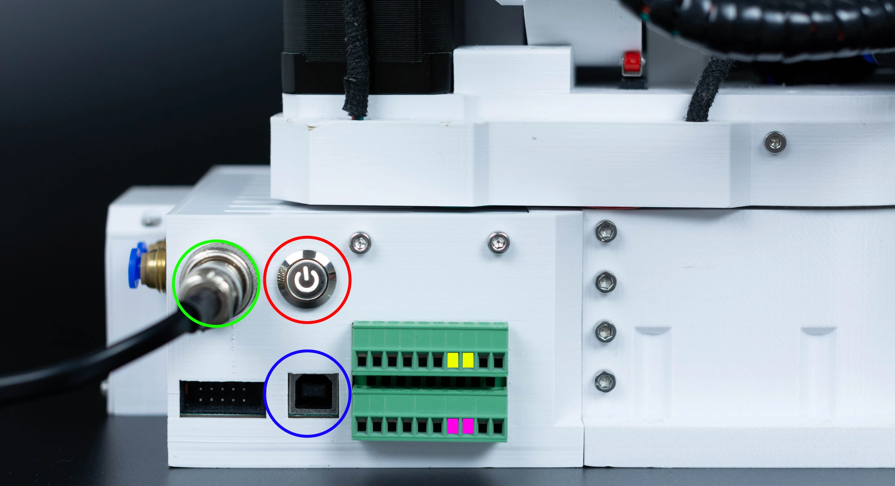

# Switching on and off

## Switching on

Before you start: the E-stop is connected and released, the power supply is on, and the USB cable goes to the PC.

{ width="640" }

1. Hold the arm by the forearm.
2. Press the power button on the base.
3. The fan starts, the six drivers initialise with a click each, and the motors hold the arm.
4. Start the PC software and connect.

!!! success "Check"
    The robot is enabled and not homed. Nothing moves until you command it. Before anything else, home it:
    [Homing](homing.md).

The firmware energises the motors at the moment the 24 V stage comes up, whether or not a PC is connected. From
then on it holds them with the holding current.

## Switching off

!!! danger "Not while it moves"
    Never switch the robot off while it is running a program or carrying something. If it behaves unexpectedly,
    press the E-stop; if the E-stop has no effect, switch off the power supply. The power button is the last
    resort, and only with the arm held.

1. Stop the program.
2. Bring the arm to the **parked pose**: folded in over the base, where it has the least distance to fall.

    { width="420" }
    { width="420" }

    === "Commander software"

        Press **Park**: it writes a three-line program into the program window that moves there. Press **Start**
        to run it.

    === "Python API"

        ```python
        rbt.move_j([90, -144.683, 108.171, 2.222, 25.003, 180], speed=0.3)
        ```

        This moves to the same pose.

3. Disconnect in the software, or stop the controller.
4. Hold the forearm.
5. Press the power button. The motors release at once and the arm goes limp in your hand.

## The button and the programming adapter

The button does not switch the power line: it tells the firmware to turn the 24 V stage on and off. The
microcontroller itself runs from 3.3 V, derived from that stage or from the programming header.

!!! warning "While the programming adapter is connected"
    While an ST-Link or the programming adapter is connected, the board has 3.3 V, turns on by itself when the
    supply is plugged in, and cannot be switched off with the button.

To upload firmware ([Firmware](../board/08-firmware.md)):

1. Disconnect the 24 V supply.
2. Upload the firmware.
3. Unplug the adapter.
4. Plug the supply in and press the button.

## After a power failure

The arm has fallen, and the position is lost.

1. Check that nothing is damaged and nothing is trapped under it.
2. Switch on as above.
3. Home before anything else.
