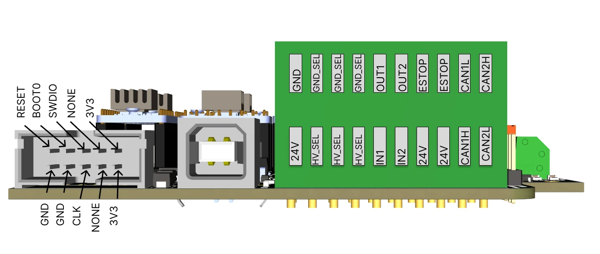

# 6. Peripherals

Everything the robot talks to besides the PC and the tool: switches and sensors on its inputs, valves and lamps on
its outputs, the air for the pneumatic gripper, and the CAN bus for the electric grippers.

{ width="800" }

## In this chapter

| Page | What it covers |
|---|---|
| [Inputs and outputs](io.md) | The two inputs and two outputs, their supply, wiring them, using them in the software |
| [Pneumatics](pneumatics.md) | The pressure, the valve, the tube routing, a vacuum gripper |
| [CAN bus](can-bus.md) | The bus to the electric grippers: bit rate, node ID, termination |

The electrical details of the connectors are in the [Control Board Manual](../board/06-io-and-estop.md).
