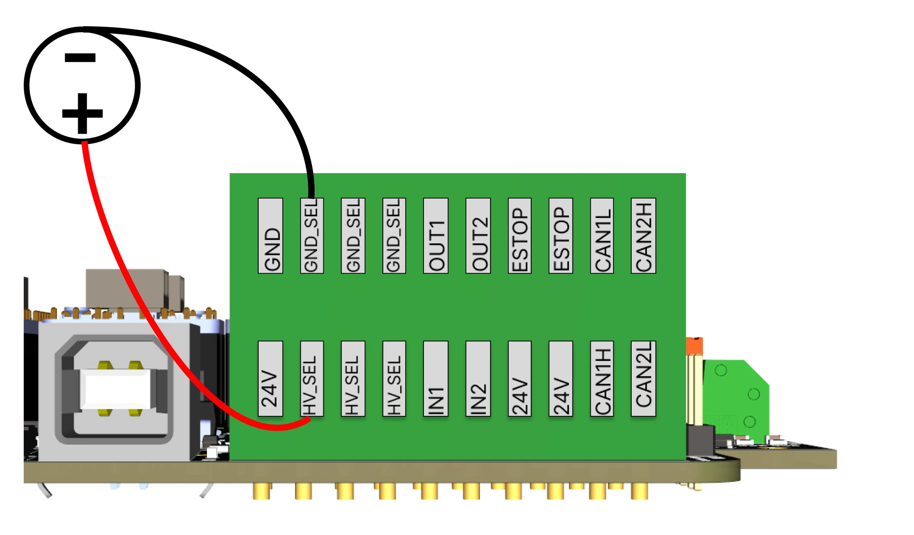
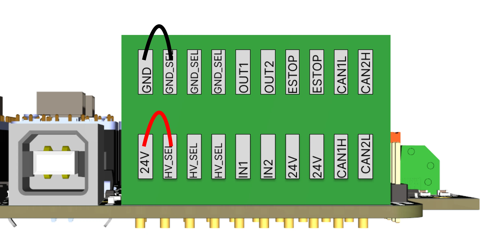

# Inputs and outputs

The control board has two isolated inputs and two isolated outputs, on screw terminals at the side of the board,
reachable through the base. Optocouplers isolate them from the robot's electronics, and they share a supply that
you choose.

| | Inputs | Outputs |
|---|---|---|
| Terminals | **IN1**, **IN2** | **OUT1**, **OUT2** |
| For | Switches, push buttons, light barriers and sensors | Relays, valves, lamps, small actuators |
| Voltage | 12 to 50 V, 24 V nominal | 48 V maximum |
| Current | | Up to 0.5 A each (1 A peak) |

## The supply

Choose one:

| | Isolated | Not isolated |
|---|---|---|
| Wiring | An external supply's negative to **GND_SEL**, its positive to **HV_SEL** | The robot's own 24 V and GND linked to HV_SEL and GND_SEL |
| Voltage | That supply's: 12 or 24 V (the inputs need at least 12 V) | 24 V |
| Protection | A fault on the inputs and outputs cannot reach the robot | A 2 A fuse protects the outputs |

Not isolated is simpler, and the valve of the pneumatic gripper is usually wired this way.

=== "Isolated"

    { width="650" }

=== "Not isolated"

    { width="650" }

The E-stop is not part of this: it is wired to the robot's own supply whichever option you choose.

## Inputs

| Device | Wiring |
|---|---|
| A switch | Between **HV_SEL** and **IN1** or **IN2** |
| A three-wire sensor | HV_SEL and GND_SEL for its supply; its signal to the input |

The robot reports the inputs in every packet:

| Program | Shows the inputs |
|---|---|
| Commander software | In the **IO** tab |
| Python API | `io()` returns `[in1, in2, out1, out2, estop]` |

!!! warning "RBTscript's Input() does not work yet"
    RBTscript's `Input()` has no action yet: a program stops on it
    ([Known issues](../08-troubleshooting/known-issues.md)).

## Outputs

A load goes between **GND_SEL** and **OUT1** or **OUT2**; the output switches it to the supply.

!!! tip "A flyback diode on an inductive load"
    An inductive load, a valve or a relay coil, gets a flyback diode across it.

=== "RBTscript"
    ```
    Output(1,HIGH)
    Output(1,LOW)
    ```

    Only output 1: in the current commander version `Output(2,...)` is refused by a bug in its check and stops
    the program ([RBTscript](../programming/03-commander/rbtscript.md)).

=== "Python API"
    ```python
    rbt.write_io(0, 1)       # output 1 high (logical index 0)
    rbt.write_io(1, 0)
    ```

The commander's **IO** tab switches the outputs by hand.

{ width="700" }
