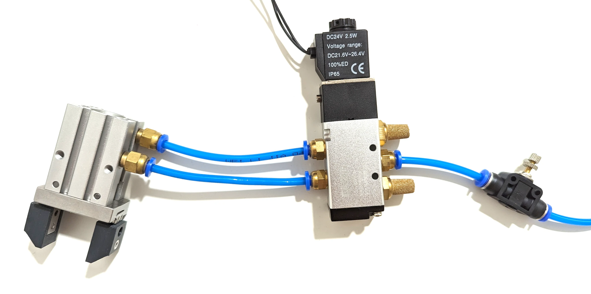

# Pneumatics

Two 4 mm tubes run inside the arm from the push-in fittings at the base to the forearm, where the pneumatic or
vacuum gripper connects. A 5/2 solenoid valve at the base, driven by an output, switches the air.

## Pressure

6 to 8 bar, the usual industrial range; every pneumatic example in the videos runs in it. The MHZ2-16D gripper
is rated for it; the tubes and fittings are standard 4 mm pneumatic parts.

## The valve

A 5/2 valve, 24 V coil, 4 mm ports: one port from the compressor, two to the base fittings, the exhausts open.
The coil goes between **GND_SEL** and **OUTPUT1** ([Inputs and outputs](io.md)). Which of the two outputs is
pressurised when the coil is off decides whether the gripper is normally open or normally closed: swap the two
tubes to change it.

{ width="700" }

## Routing

The tubes pass through joints 5 and 6 with the gripper cable; the joints' one-turn rule exists because of them.
Outside the base, give the tubes a loop so the arm cannot pull them.

## A vacuum gripper

Needs one line only: block the valve's second port ([Vacuum gripper](../end-effectors/vacuum-gripper.md)).
