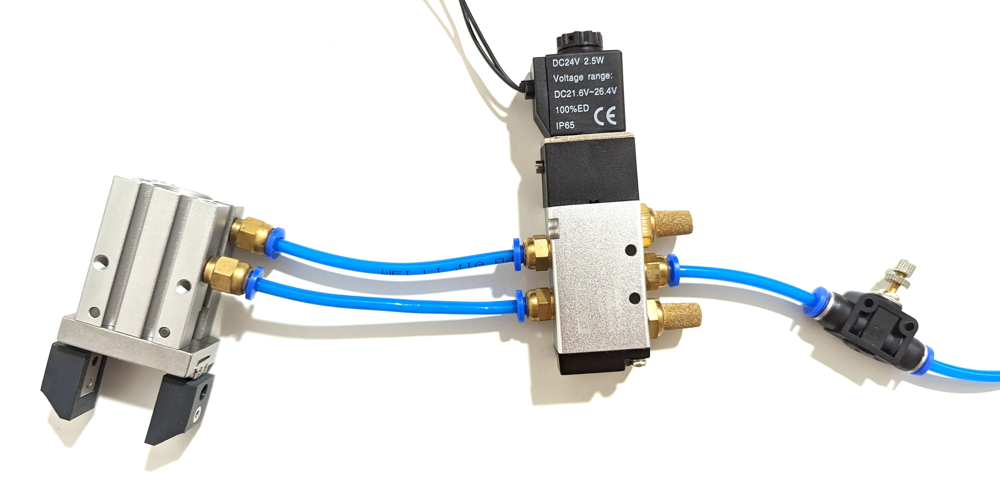

# Pneumatics

Two 4 mm tubes run inside the arm, from the push-in fittings at the base to the forearm, where the pneumatic or
vacuum gripper connects. A 5/2 solenoid valve at the base, driven by an output, switches the air.

{ width="700" }

## Pressure

5 to 7 bar. Check your gripper's rating, and stay below the lowest rating of the gripper, the valve and the
fittings. The tubes and fittings are standard 4 mm pneumatic parts.

## The valve

A 5/2 valve, 24 V coil, 4 mm ports:

| Port | Goes to |
|---|---|
| One port | The compressor |
| Two ports | The two base fittings |
| The exhausts | Open |

The coil goes between **GND_SEL** and **OUTPUT1** ([Inputs and outputs](io.md)).

!!! note "Normally open or normally closed"
    Which of the two outputs is pressurised when the coil is off decides whether the gripper is normally open or
    normally closed: swap the two tubes to change it.

## Routing

| Where | The tubes |
|---|---|
| Inside the arm | They run from the base to the push-in fittings on the forearm. They are one reason for the one-turn rule of the joints. |
| From the forearm fittings | The gripper's own tubes cross joints 5 and 6 outside the arm, like an electric gripper's cable. Give them enough slack for the range you use, since they, not the flange, limit joint 6. |
| Outside the base | Give the tubes a loop so the arm cannot pull them. |

## A vacuum gripper

It needs one line only: block the valve's second port ([Vacuum gripper](../end-effectors/vacuum-gripper.md)).

!!! note "open() and close() in the Python API"
    In the Python API, a pneumatic or vacuum tool's `open()` switches output 1 high and `close()` switches it low,
    whatever the tubing does: lay the tubes so the two match ([Pneumatic gripper](../end-effectors/pneumatic-gripper.md)).
