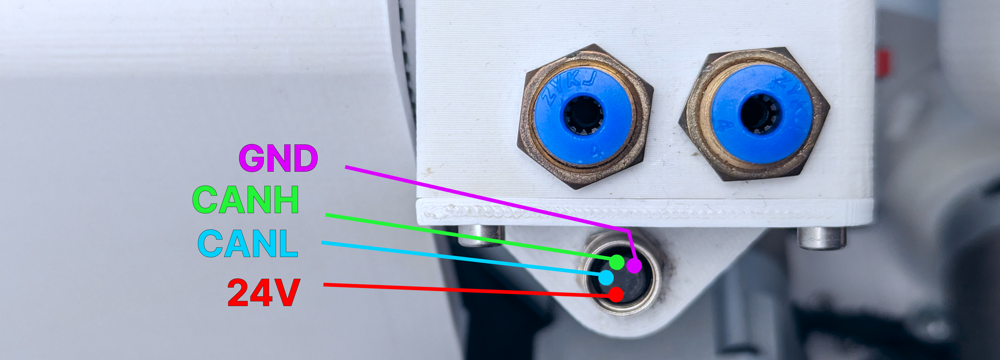

# SSG-48 and MSG electric grippers

Source Robotics' two electric grippers plug into the M8 connector at the forearm and are driven by the control
board over CAN. The commander software and the Python API both drive them without configuration.

| | SSG-48 | MSG |
|---|---|---|
| Driver inside | Spectral Micro BLDC controller | STEPFOC stepper driver |
| Stroke | 48 mm | 100, 150 or 200 mm rail |
| Grip force | up to about 80 N | by variant |
| Manual | [SSG48-gripper-docs](https://docs.source-robotics.com/SSG48-gripper-docs/) | [MSG-gripper-docs](https://docs.source-robotics.com/MSG-gripper-docs/) |
| Shop | [compliant gripper](https://source-robotics.com/products/compliant-gripper) | [MSG gripper](https://source-robotics.com/products/msg-gripper) |

Both speak the same CAN gripper protocol, so the robot drives them with the same commands: position 0 to 255,
speed 0 to 255, current limit in milliamps, and the activate, calibrate and E-stop bits.

{ width="600" }

## Mounting

The coupler connector for PAROL6, in each gripper's repository, clamps onto the joint 6 shaft. **Use the cable
made for PAROL6**: PAROL6 and PAR6 have different gripper cable pinouts, and the wrong cable destroys the
gripper's driver. The gripper manual's cable page has the pinout to check your own against.

Get the robot working first, then attach the gripper. Troubleshooting both at once is hard.

## The joint 5 homing offset

Joint 5 homes against the tool, and the SSG-48's coupler sits differently from the pneumatic holder. With the
SSG-48, set `j5_homing_offset` in `main.cpp` of the control board firmware to **8035** (the default, for the
pneumatic gripper, is 8900) and upload. The MSG uses the same coupler connector as the SSG-48 for PAROL6; check
with the pin through the joint 5 witness marks after homing, and master if needed ([Mastering](../05-operation/mastering.md)).

## Driving them

The gripper is calibrated after every power-up: it opens fully and closes fully to find its end stops.

=== "Commander software"
    The **Gripper** tab: after homing the robot press **Calibrate Gripper**, then **Clear Gripper Error**, set
    position, speed and current with the sliders and press **Move GoTo**. The feedback section shows the current,
    the position and the status. In RBTscript: `Gripper_cal()` then `Gripper(position, speed, current)`
    ([RBTscript](../programming/04-commander/rbtscript.md#gripper)).

=== "Python API"
    ```python
    rbt.select_tool("SSG-48")               # or "MSG", variant_key="150mm"
    rbt.tool.calibrate()                    # queued; lasts two seconds
    rbt.tool.set_position(0.8, speed=0.5, current=0.4)   # fractions of the ranges
    rbt.tool.close(current=0.6)
    rbt.tool.open()
    rbt.tool.release()                      # drop the grip, jaws stay
    rbt.tool.stop()                         # immediate: halt where the jaws are
    ```
    Tool actions are queued with the motion, so a move after `close()` waits for the grip. A `move` on a gripper
    that was never calibrated is refused when its turn comes ([Tools and the TCP](../programming/03-python-api/tools-and-tcp.md)).

## Current and force

The current limit is the grip force. Start low, 300 to 400 mA, and raise it for a firmer grip. A high current
with a high speed slams the jaws into the part and the fingers into each other; the gripper manuals give the
force per ampere and the safe ranges.

## Status

The robot passes the gripper's status through: calibrated, in motion, object detected (while closing, while
opening, or none), and its error bits. The commander shows them in the Gripper tab; the Python API in
`tool.status()` and the status stream's `tool_status`.
