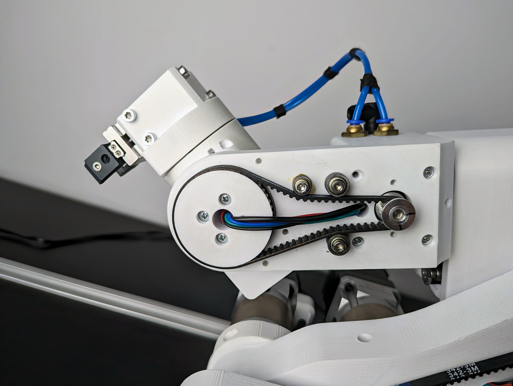
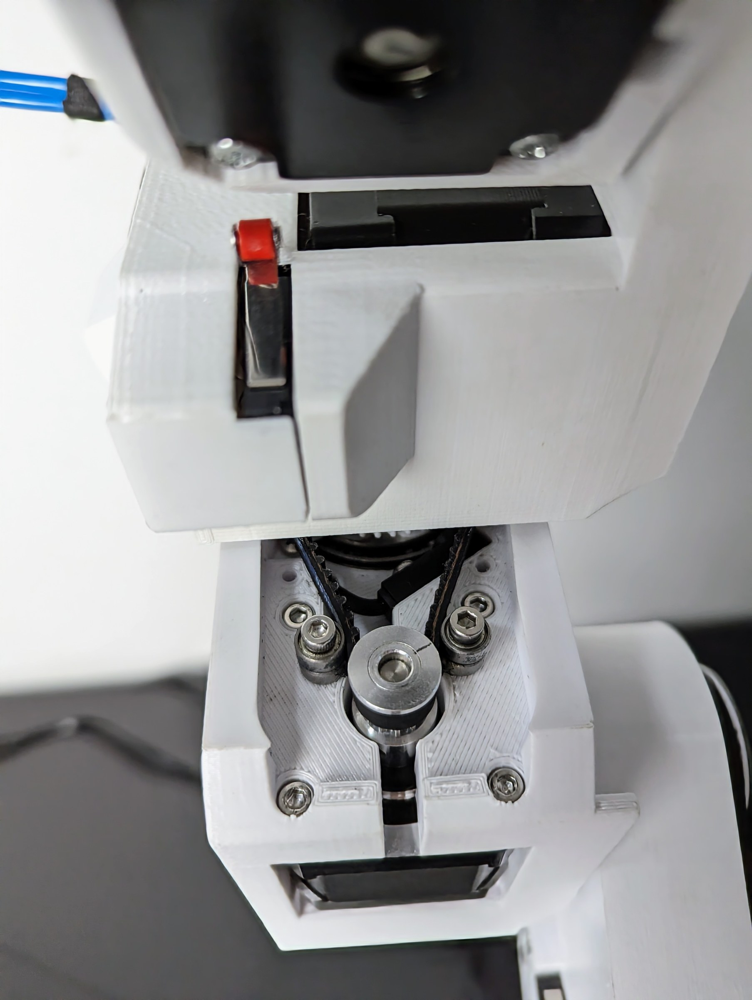
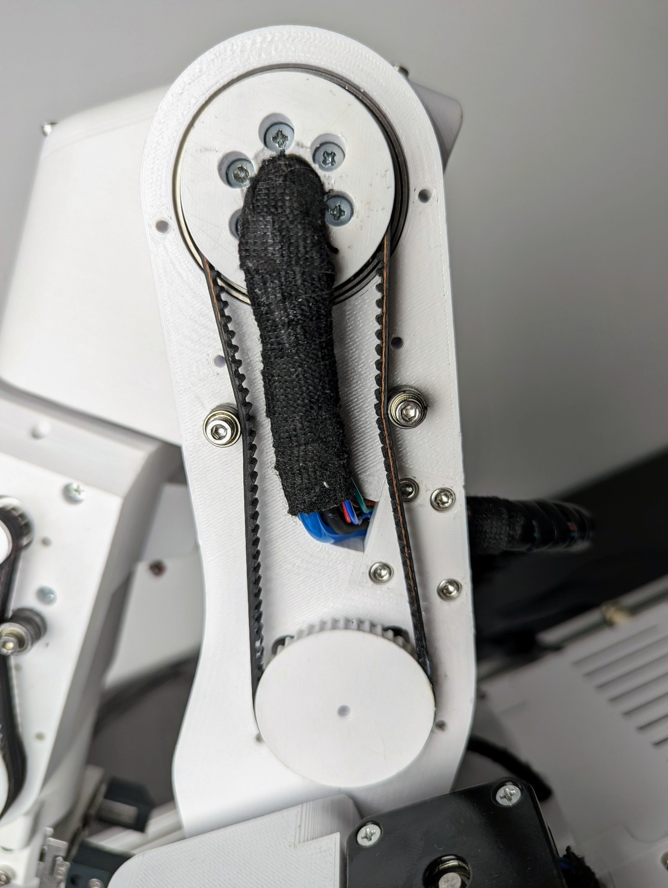
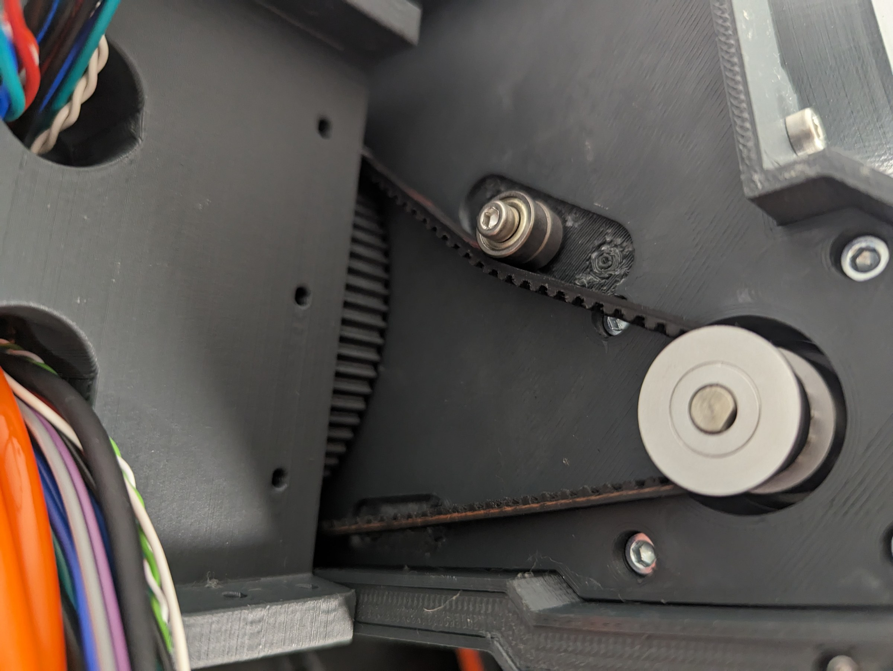

# Belts

Belts drive joints 1, 3, 4 and 5. Over time they stretch a little and the joint loses stiffness; a belt that slips
a tooth loses the robot's position.

## Tension

The reference is the [belt tension video](https://www.youtube.com/watch?v=v0PYfEoIr3k): in it, maximum hand force
is applied to the belt, and that is the tension to aim for on joints 3 and 5. Joints 1 and 4 take slightly less.
A belt is tensioned by adding or moving the small tension bearings (3 × 8 × 4 mm and 3 × 10 × 4 mm) that press
on its back; if a belt is not tight enough, add another bearing as in the photos.

### Joint 5 belt

{ width="550" }

### Joint 4 belt

{ width="450" }

### Joint 3 belt

{ width="450" }

### Joint 1 belt

{ width="550" }

## Grease

A thin film of grease on the belts' teeth reduces noise and wear. Reapply when it dries out.

## Replacement

| Joint | Belt |
|---|---|
| Joint 1 | HTD3 396 mm, 6 mm wide |
| Joint 3 | HTD3 342 mm |
| Joint 4 | HTD3 201 mm |
| Joint 5 | HTD3 246 mm |

Replacing a belt means opening the joint as in the assembly manual; afterwards home the robot and check the
witness marks, and master if they do not line up.
