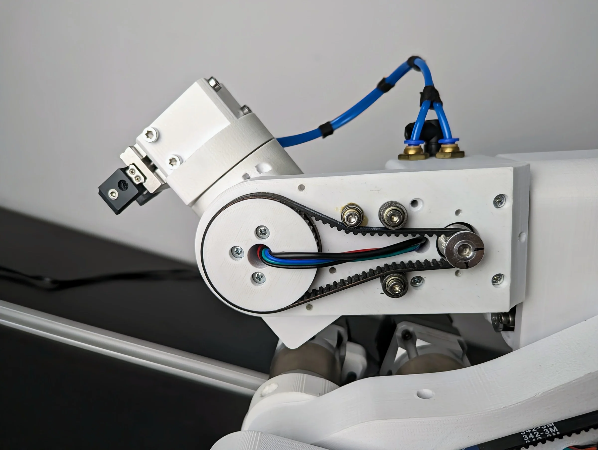
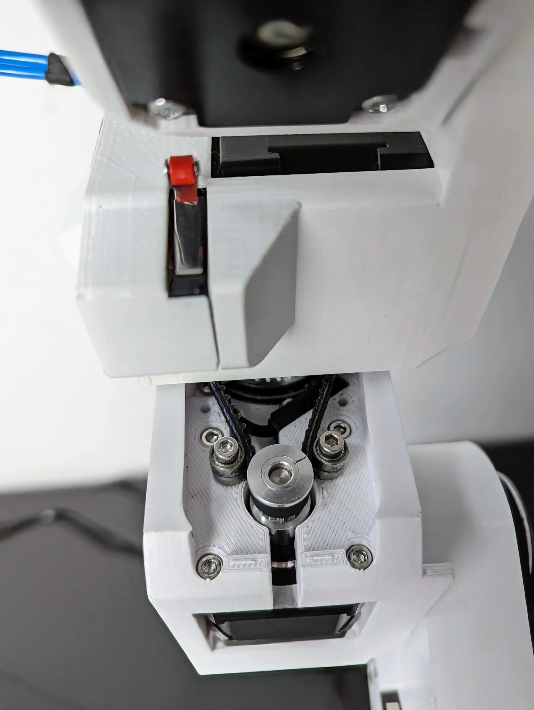
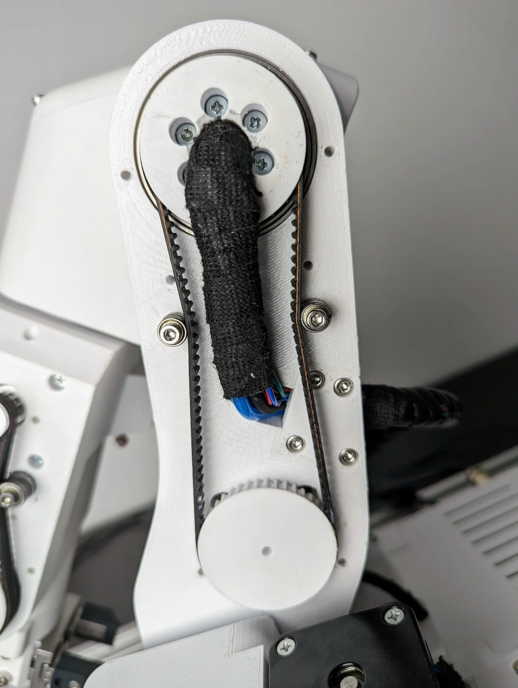
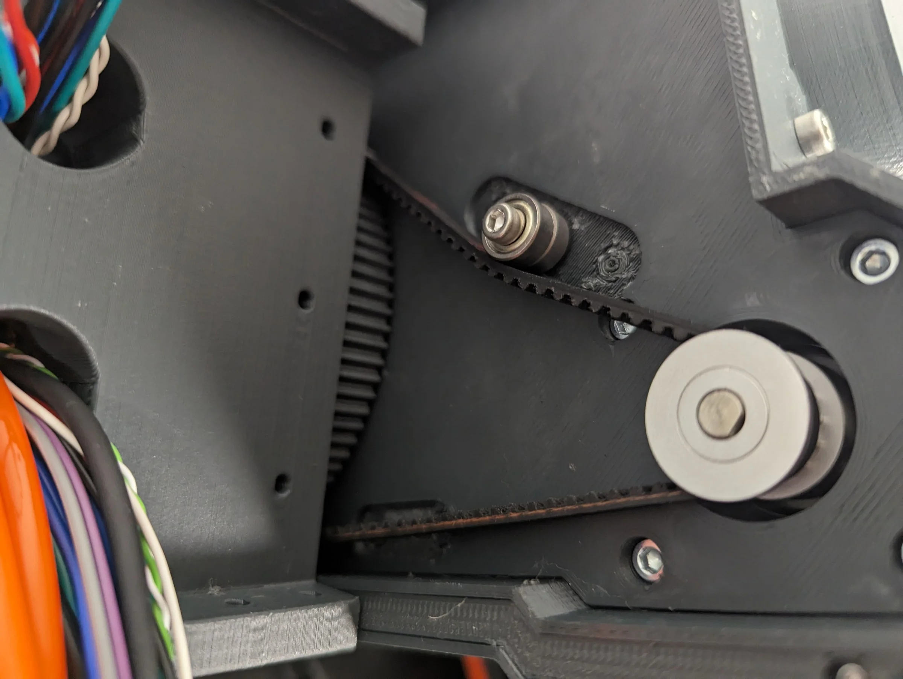

# Belts

Belts drive joints 1, 3, 4 and 5. Over time they stretch a little and the joint loses stiffness. A belt that slips
a tooth loses the robot's position.

## Tension

The reference is the [belt tension video](https://www.youtube.com/watch?v=v0PYfEoIr3k). In it, maximum hand force
is applied to the belt:

| Joints | Tension |
|---|---|
| 3 and 5 | The video's: maximum hand force |
| 1 and 4 | Slightly less |

A belt is tensioned by adding or moving the small tension bearings (3 × 8 × 4 mm and 3 × 10 × 4 mm) that press on
its back. If a belt is not tight enough, add another bearing as in the photos.

!!! note "A tensioner only where it is needed"
    You may or may not need a tensioner on a given joint: it depends on your belts and printed parts, so fit one
    only where the belt is not tight enough without it.

=== "Joint 5"

    { width="550" }

=== "Joint 4"

    { width="450" }

=== "Joint 3"

    { width="450" }

=== "Joint 1"

    { width="550" }

## Grease

A thin film of grease on the belts' teeth reduces noise and wear. Reapply when it dries out.

## Replacement

| Joint | Belt |
|---|---|
| Joint 1 | HTD3 396 mm, 6 mm wide |
| Joint 3 | HTD3 342 mm |
| Joint 4 | HTD3 201 mm |
| Joint 5 | HTD3 246 mm |

1. Open the joint as in the assembly manual, and replace the belt.
2. Home the robot.
3. Check the witness marks, and master if they do not line up.
