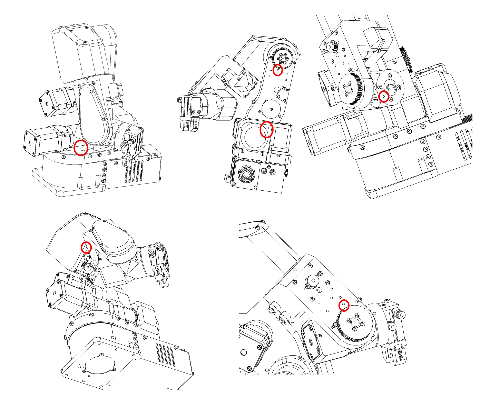

# Checking the homing

Homing is the robot's only position reference. Check it:

- after any mechanical work;
- after a collision;
- whenever the robot's accuracy seems off.

## The check

1. Home the robot and watch each joint. It must reach its switch, back off, re-approach slowly, and move on.
2. At the end, try the pin at the witness marks of each joint ([Mastering](../05-operation/mastering.md)). It
   should slide in, or nearly.
3. Home three times in a row and compare the witness marks each time. The pose should repeat exactly.
4. Jog to a taught pose from a program, and check that the tool is where it was taught.

{ width="700" }

## What the result means

| What you see | What it means |
|---|---|
| A joint grinds at a stop, or re-approaches at full speed | It has a switch problem ([Homing failures](../08-troubleshooting/homing-failures.md)) |
| A joint is off by more than a degree at the witness marks | It was knocked, slipped, or its switch moved |
| The pose does not repeat over three homings | The switch or the sensor triggers inconsistently, or something in the joint moves |

| The joint homes | Then |
|---|---|
| Repeatably, but to the wrong place | Master it |
| Not repeatably | Repair it |
