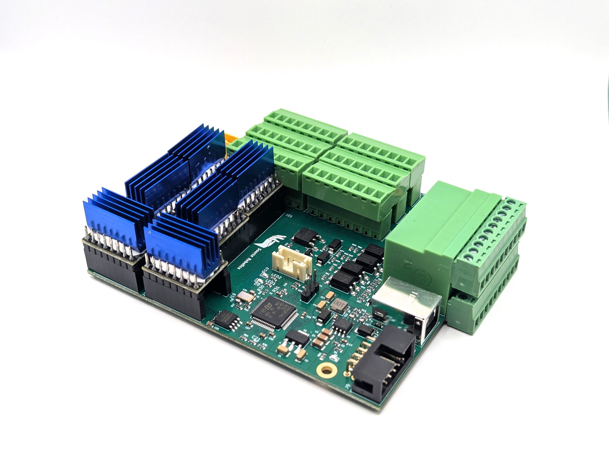
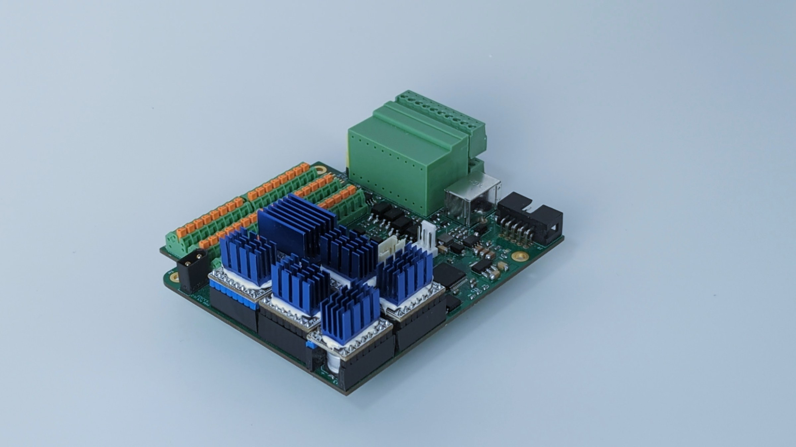

# 1. Overview

The control board sits in the base of PAROL6 and does the low-level work: it generates the step pulses for six
stepper motors, runs the homing sequence, reads the limit switches, the inputs and the E-stop, switches the
outputs, drives an electric gripper over CAN, and exchanges a data packet with the PC over USB 100 times a
second. It plans nothing: the PC computes every trajectory and sends the board the joint speeds and positions
to execute, cycle by cycle.

{ width="750" }

It works out of the box with PAROL6 and the commander software or the Python API, and it drives any six-axis
stepper arm that is wired like PAROL6.

## Versions

| Version | Status | Difference |
|---|---|---|
| **v2.0** | Current, in the shop | Pluggable terminal block connectors |
| v1.2 | Discontinued | Spring-loaded Phoenix contacts |

The two are functionally identical and run the same firmware.

{ width="600" }

{ width="600" }

## Testing

Every board is tested end to end before it ships, and comes with the test firmware preloaded, so that you can
check the wiring of your robot before the main firmware goes on ([The test firmware](09-test-firmware.md)).

## Where it is published

The firmware, main and test, is in the robot repository:
[PAROL6 control board main software](https://github.com/Source-Robotics/PAROL6-Desktop-robot-arm/tree/main/PAROL6%20control%20board%20main%20software)
and [PAROL6 control board test code](https://github.com/Source-Robotics/PAROL6-Desktop-robot-arm/tree/main/PAROL6%20control%20board%20test%20code).
The board is sold [in the shop](https://source-robotics.com/products/parol6-control-board); its design files are
not published.
