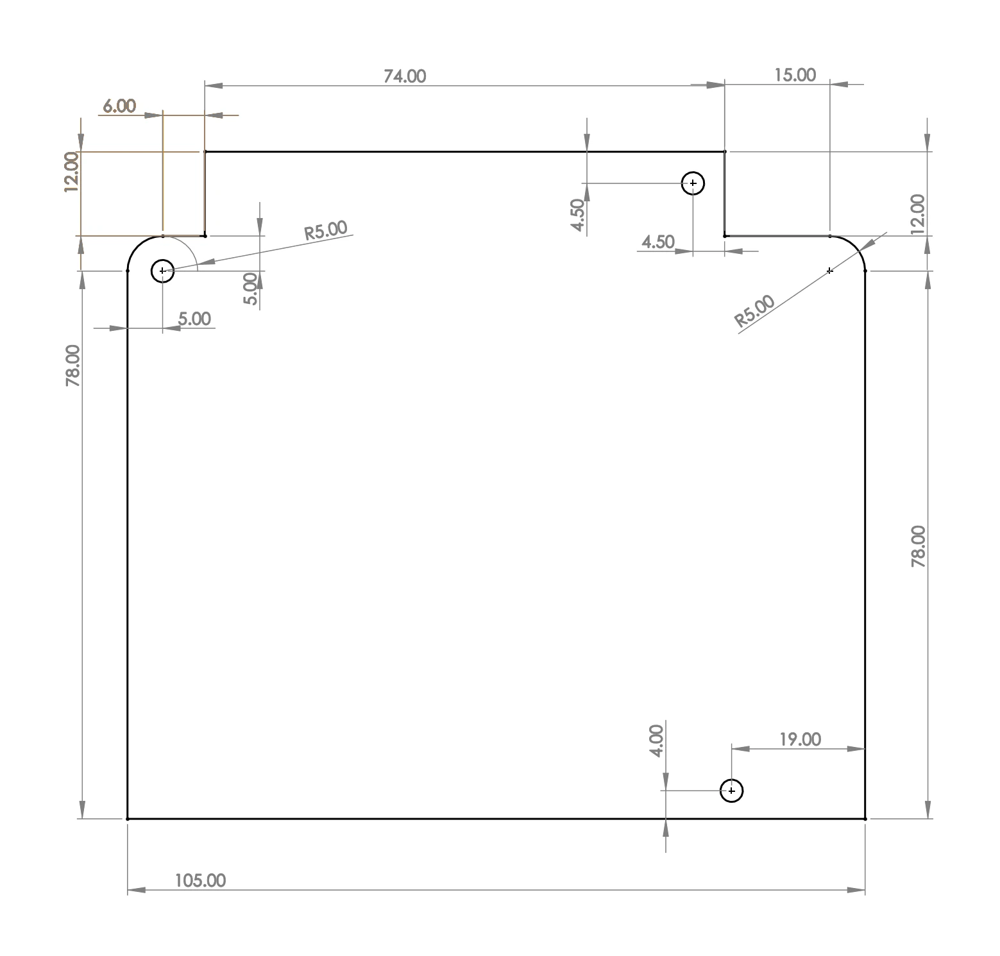

# 3. Technical data

## Hardware

| | |
|---|---|
| Microcontroller | STM32F446RE: Arm Cortex-M4 with DSP and FPU, 180 MHz, 512 KB flash |
| Stepper drivers | 6 × TMC5160 modules, SPI configured, 10 to 35 V, with stall, short and temperature protection; currents below |
| Microstepping | 32 (set by the firmware) |
| Inputs | 2, isolated, 12 to 50 V, 24 V nominal |
| Outputs | 2, isolated, 48 V maximum, 0.5 A continuous, 1 A peak; 2 A fuse for the non-isolated mode |
| E-stop | One input on a dedicated pin, two connectors in parallel, normally closed contact |
| CAN | 2 controllers; CAN 1 with its transceiver, CAN 2 transceiver not populated |
| USB | USB 2.0 full speed, a virtual serial port; the PC software opens it at 3 000 000 baud, a setting USB ignores |
| Additional memory | W25Q64FV SPI flash, 64 Mbit |
| Programming | SWD through the 2×5-pin header (ST-Link with the programming adapter) |
| Fan | 5 V, 3-pin header, 0.3 A maximum, not PWM |
| Power button | Soft switch: the button tells the firmware to switch the 24 V stage on and off |
| Supply voltage | 18 V minimum, 24 V maximum; 24 V is recommended for optimal robot performance |
| Supply voltage sense | The firmware reads the supply voltage (VBUS) |
| Size | Three M3 mounting holes; dimensions in the drawing below |

## Operating limits

| | |
|---|---|
| Stepper driver rated current | 2.5 A per motor |
| Stepper driver maximum current | 3.6 A, short bursts or with extreme cooling only |
| Driver overtemperature | The driver shuts its outputs down and its joint goes limp; firmware 1 does not tell the PC |
| Isolated input voltage | 12 V minimum, 24 V nominal, 50 V maximum |
| Isolated output voltage | 48 V maximum |
| Isolated output current | 1 A maximum |
| Fan current | 0.3 A maximum; around 0.1 A recommended |

The PAROL6 firmware runs the motors well below the drivers' ratings: 0.8 to 1.7 A ([Currents and temperatures](../03-technical-data/operating-temperatures.md)).

## Dimensions

{ width="700" }

## Mounting and cooling

Three M3 holes. The drivers need active cooling: a 40 × 40 × 20 mm 5 V fan, a Noctua NF-A4x20 or any 5 V fan of
that size that is not PWM controlled, blowing over the heatsinks. In PAROL6 the fan sits in the base's fan cover.
