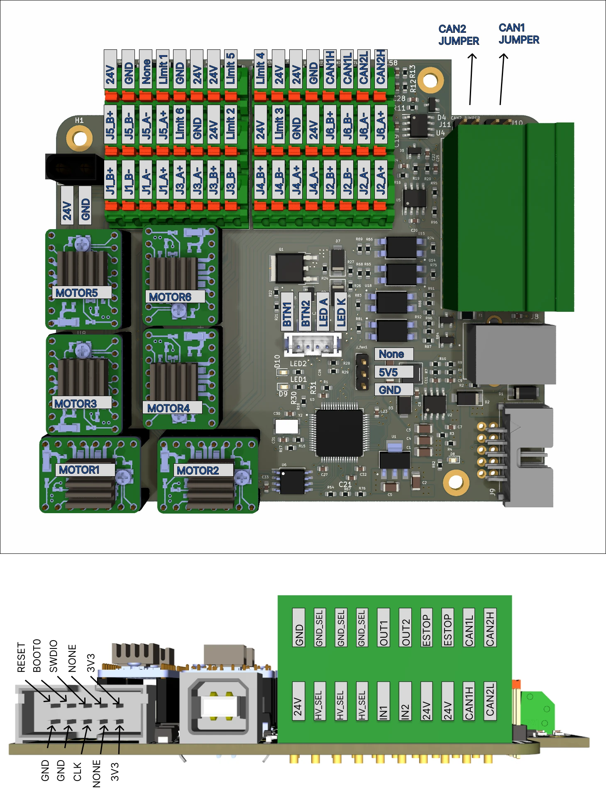
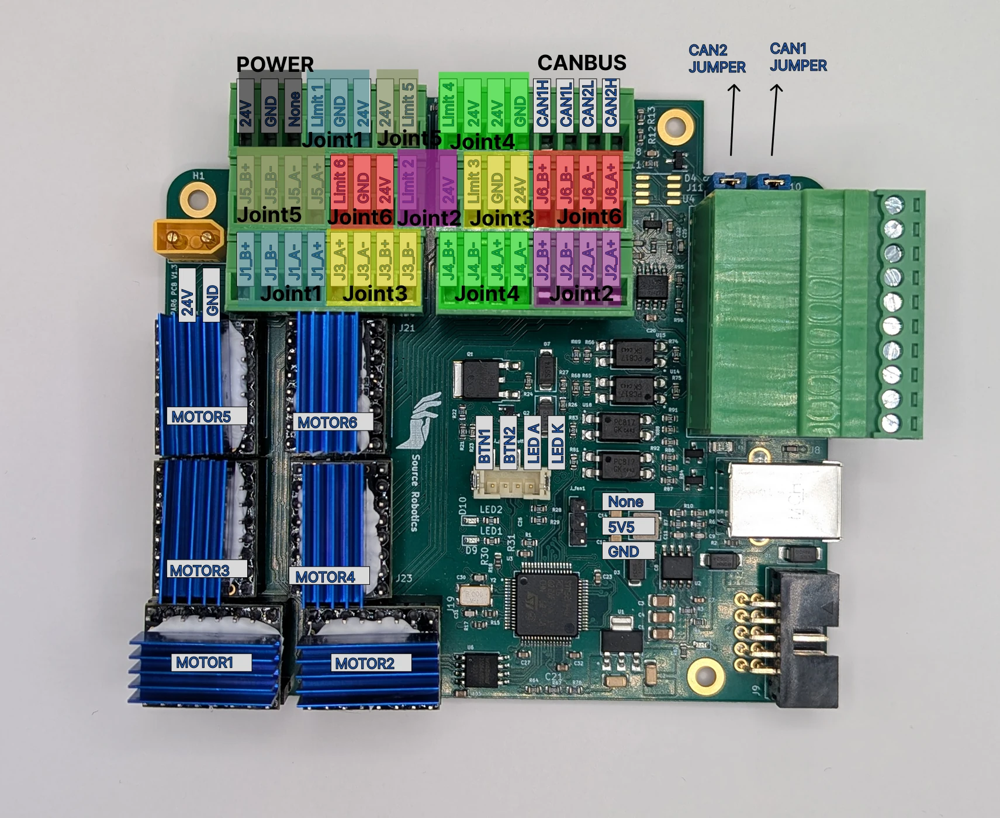
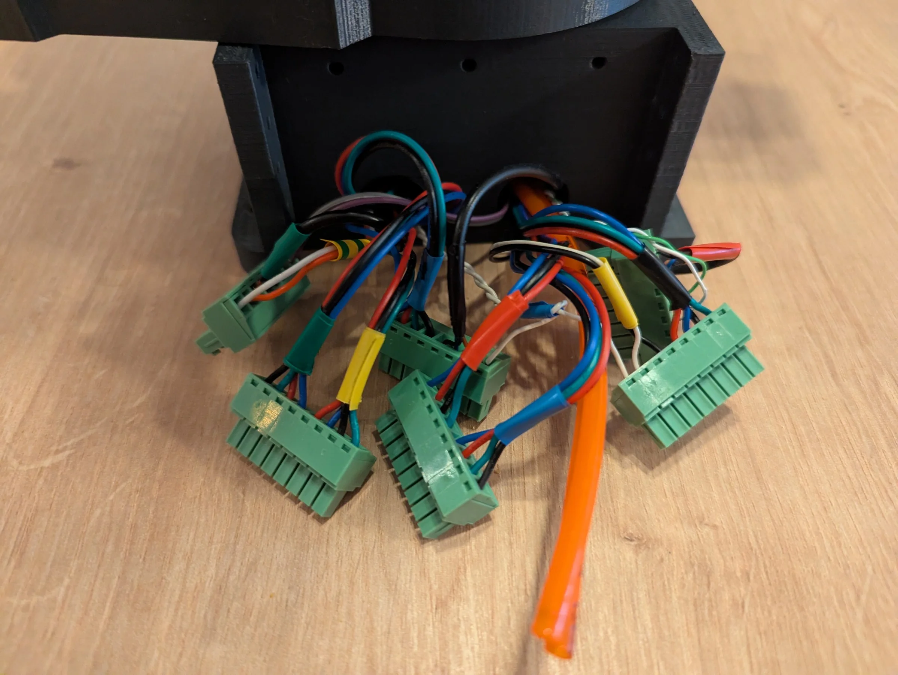
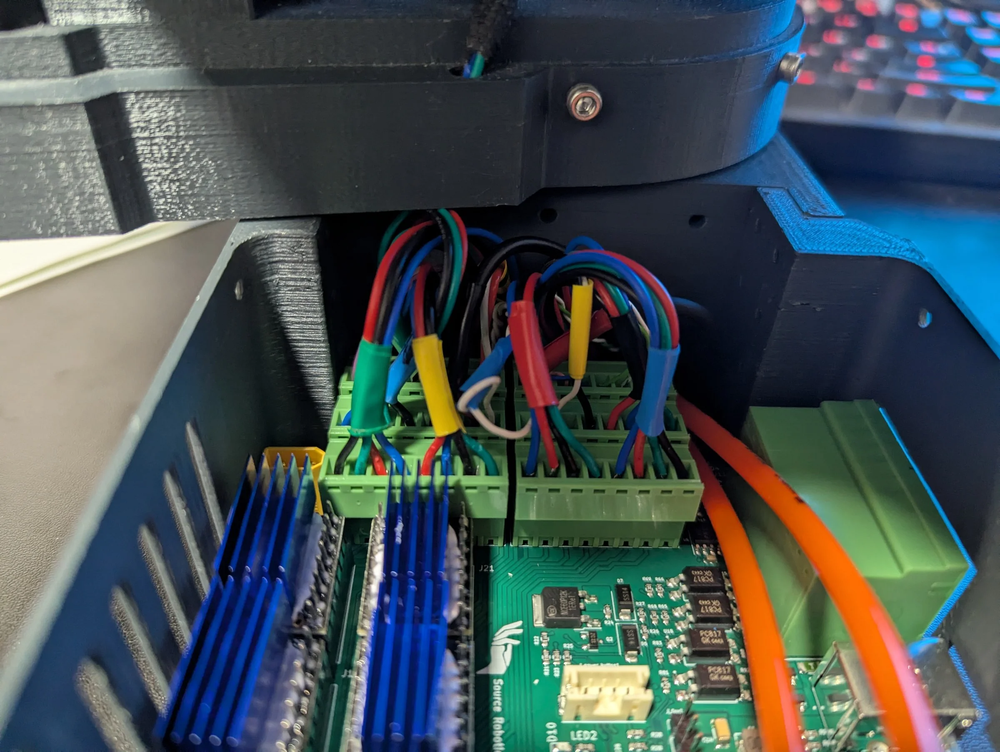

# 4. Connectors and pinout

{ width="750" }

## Connectors

| Connection | Connector |
|---|---|
| 24 V power | XT30 male |
| Cooling fan | 3-pin, 2.54 mm pitch, 5 V |
| Power button | JST PH 4-pin (B4B-PH-SM4-TB) |
| USB | USB type B |
| Programming | 2×5-pin, 2.54 mm pitch (SWD) |
| Motors | 6 × 4-pin terminal blocks, one per driver |
| Limit switches, inputs, outputs, E-stop, CAN, 24 V out, GND, HV_SEL, GND_SEL | Pluggable terminal blocks along the edges |
| CAN termination | Two jumpers, CAN1 JUMPER and CAN2 JUMPER: on, each connects a 120 Ω resistor across its bus ([CAN bus](07-can.md)) |

## Pin definitions

The microcontroller pins as the firmware defines them (`iodefs.h`), for anyone who writes firmware or probes the
board:

```c
#define PUL1 PC6     // step, joint 1          #define DIR1 PB15    // direction, joint 1
#define PUL2 PA10    // step, joint 5          #define DIR2 PA1     // direction, joint 5
#define PUL3 PC0     // step, joint 6          #define DIR3 PC1     // direction, joint 6
#define PUL4 PC3     // step, joint 4          #define DIR4 PA0     // direction, joint 4
#define PUL5 PC9     // step, joint 3          #define DIR5 PA8     // direction, joint 3
#define PUL6 PC5     // step, joint 2          #define DIR6 PB1     // direction, joint 2

#define SELECT1 PC7  // SPI chip select of driver 1 (joint 1)
#define SELECT2 PA9  // driver 2 (joint 5)
#define SELECT3 PC15 // driver 3 (joint 6)
#define SELECT4 PC2  // driver 4 (joint 4)
#define SELECT5 PC8  // driver 5 (joint 3)
#define SELECT6 PC4  // driver 6 (joint 2)
#define GLOBAL_ENABLE PA3   // ENABLE of all drivers

#define LIMIT1 PC12  // limit input of joint 6      #define LIMIT4 PD2   // limit input of joint 4
#define LIMIT2 PB3   // limit input of joint 2      #define LIMIT5 PB4   // limit input of joint 5
#define LIMIT3 PA15  // limit input of joint 3      #define LIMIT6 PC11  // limit input of joint 1

#define MISO PA6, MOSI PA7, SCK PA5   // SPI to the six drivers and the flash
#define FLASH_SELECT PA4              // chip select of the flash memory

#define LED1 PB2, LED2 PB10           // the two LEDs
#define SUPPLY_ON_OFF PC10            // switches the 24 V power stage
#define SUPPLY_BUTTON_STATE PC14      // reads the power button
#define INPUT1 PB6, INPUT2 PB5        // IN1, IN2 terminals
#define OUTPUT1 PC13, OUTPUT2 PB7     // OUT1, OUT2 terminals
#define ESTOP PB14                    // E-stop terminals
#define VBUS PB0                      // supply voltage sense
#define USB_D_PLUS PA12, USB_D_MINUS PA11
#define CAN1TX PB9, CAN1RX PB8        // CAN 1 (the gripper bus)
#define CAN1TX PB13, CAN1RX PB12      // CAN 2's pins (transceiver not populated)
```

`iodefs.h` defines `CAN1TX` and `CAN1RX` twice, the second time with CAN 2's pins, PB13 and PB12. The CAN driver
does not use these names: `CANInit()` in `CAN.cpp` picks the pins itself.

## Wiring the robot

{ width="750" }

Limit switches to 24 V and their LIMIT terminal; inductive sensors to 24 V, GND and the LIMIT terminal (brown,
blue, black). The gripper's M8 socket to 24 V, GND, CAN H and CAN L. The finished wiring in PAROL6's base:

{ width="650" }

{ width="650" }
