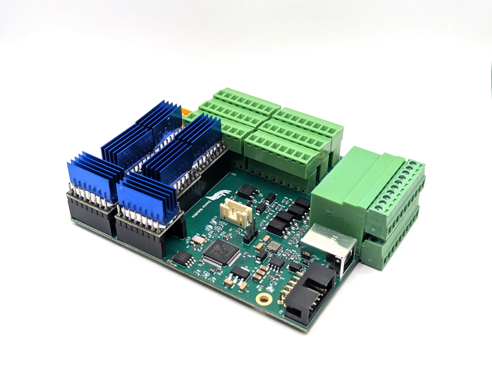

---
hide:
  - toc
---

# PAROL6 Control Board Manual

{ .hero }

<!-- doc-meta: board -->

The PAROL6 control board is the controller of the PAROL6 arm: a 32-bit microcontroller, six stepper drivers, the
inputs and outputs, the E-stop input, CAN and USB on a board the size of a pack of playing cards, which is what
lets PAROL6 run without a control cabinet. This manual covers the board itself: its specifications, connectors
and pinout, the stepper drivers and their installation, the I/O and E-stop wiring, the CAN bus, uploading the
firmware, the test firmware, and the serial protocol the PC software uses. How the robot is used is in the
[Robot Manual](../index.md); how it is programmed in the [Programming Guide](../programming/index.md).

-   :material-chip:{ .lg .middle } **The board**

    ---

    [Overview](01-overview.md), [Safety](02-safety.md), [Technical data](03-technical-data.md),
    [Connectors and pinout](04-connectors.md), [Stepper drivers](05-stepper-drivers.md).

-   :material-electric-switch:{ .lg .middle } **Wiring**

    ---

    [Inputs, outputs and E-stop](06-io-and-estop.md), [CAN bus](07-can.md).

-   :material-upload:{ .lg .middle } **Firmware**

    ---

    [Uploading the firmware](08-firmware.md), [the test firmware](09-test-firmware.md),
    [the serial protocol](10-serial-protocol.md), [troubleshooting](11-troubleshooting.md).

