# Bill of materials

!!! note "This is a copy"
    The original is [BOM/BOM.md](https://github.com/Source-Robotics/PAROL6-Desktop-robot-arm/blob/main/BOM/BOM.md) in the robot's repository; this page is that
    file as of 2026-10-02 (commit `45a7502`), with the reference images shown inline. If a link is broken or a part
    is wrong, [open an issue](https://github.com/Source-Robotics/PAROL6-Desktop-robot-arm/issues/new) there, and the fix lands here with the next sync.

Most items have links where you can buy the item, and some of them are affiliate links. Items like screws, belts and bearings can be bought locally or from many other vendors.

!!! note
    If any product links are broken, unavailable, or no longer point to the correct item, please [open an issue](https://github.com/Source-Robotics/PAROL6-Desktop-robot-arm/issues/new). You can also use the reference images to find the same or an equivalent part from another supplier.

## Screws and Nuts

| Diameter / Type | Length | Quantity | Description |
| :--- | :--- | :--- | :--- |
| M4 | 10 mm | 20 | DIN 912 / ISO 4762 (hexagon socket head cap) |
| M3 | 8 mm | 10 | 2 mm head height |
| M3 | 8 mm | 50 | DIN 912 / ISO 4762 (hexagon socket head cap) |
| M3 | 14 mm | 30 | DIN 912 / ISO 4762 (hexagon socket head cap) |
| M3 nut | — | 10 | DIN 912 / ISO 4762 (hexagon socket head cap) |
| M3 | 25 mm | 10 | DIN 912 / ISO 4762 (hexagon socket head cap) |
| M2 | 10 mm | 10 | DIN 912 / ISO 4762 (hexagon socket head cap) |
| M3 | 16 mm | 10 | DIN 912 / ISO 4762 (hexagon socket head cap) |
| M3 | 6 mm | 10 | Pan head phillips |
| M3 | 12 mm | 30 | DIN 912 / ISO 4762 (hexagon socket head cap) |
| M3 | 35 mm | 10 | DIN 912 / ISO 4762 (hexagon socket head cap) |
| M4 | 16 mm | 30 | DIN 912 / ISO 4762 (hexagon socket head cap) |
| M4 | 14 mm | 10 | DIN 912 / ISO 4762 (hexagon socket head cap) |
| M4 | 50 mm | 10 | DIN 912 / ISO 4762 (hexagon socket head cap) |
| M3 | 15 mm | 2 | Tapered screw head |

## Gearboxes

!!! note
    For cheaper gearbox options you can use MG series planetary gearboxes. They have bigger backlash but are cheaper. [Link](https://www.omc-stepperonline.com/mg-series-planetary-gearbox) — [Aliexpress Link](https://s.click.aliexpress.com/e/_oBYBoUP)

| Name | Type | Quantity | Description | Link | ALT link | Reference Image |
| :--- | :--- | :--- | :--- | :--- | :--- | :--- |
| Gearbox 20:1 | Nema 17 20:1 | 2 | EG precision planetary | [Link](https://www.omc-stepperonline.com/eg-series-planetary-gearbox-gear-ratio-20-1-backlash-20-arc-min-for-nema-17-stepper-motor-eg17-g20?tracking=6543849d6ff69) | [Alt Link](https://s.click.aliexpress.com/e/_oEhMNU5) | 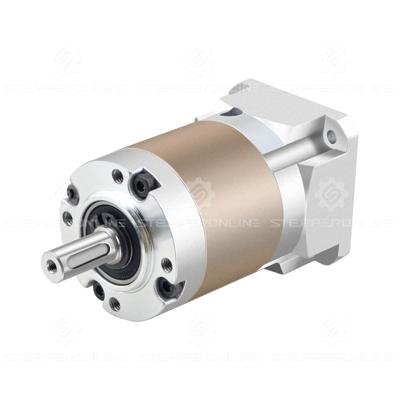{ width="120" } |
| Gearbox 10:1 | Nema 17 10:1 | 1 | EG precision planetary | [Link](https://www.omc-stepperonline.com/eg-series-planetary-gearbox-gear-ratio-10-1-backlash-15-arc-min-for-nema-17-stepper-motor-eg17-g10?tracking=6543849d6ff69) | [Alt Link](https://s.click.aliexpress.com/e/_oEhMNU5) | 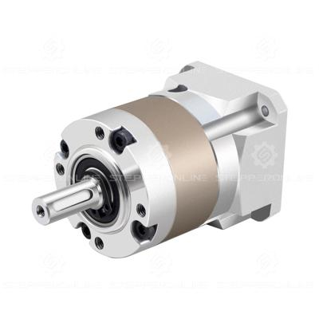{ width="120" } |

## Motors

| Name | Type | Quantity | Description | Link | ALT link | Reference Image |
| :--- | :--- | :--- | :--- | :--- | :--- | :--- |
| Stepper 1 | Nema 17 | 1 | 16Ncm, 42x42x20mm | [Link](https://www.omc-stepperonline.com/nema-17-bipolar-1-8deg-16ncm-22-6oz-in-1a-3-7v-42x42x20mm-4-wires-17hs08-1004s?tracking=6543849d6ff69) | [Alt Link](https://s.click.aliexpress.com/e/_oo1LTs7) | 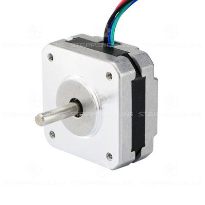{ width="120" } |
| Stepper 2 | Nema 17 | 3 | 45Ncm, 42x42x40mm | [Link](https://www.omc-stepperonline.com/nema-17-bipolar-45ncm-64oz-in-2a-42x42x40mm-4-wires-w-1m-cable-connector-17hs16-2004s1?tracking=6543849d6ff69) | [Alt Link](https://s.click.aliexpress.com/e/_oC1Ii0v) | 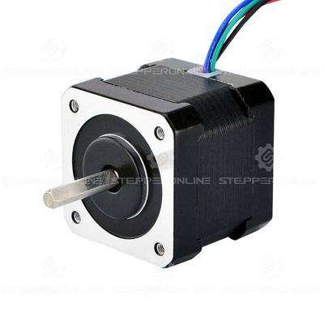{ width="120" } |
| Stepper 3 | Nema 17 | 2 | 65Ncm, 42x42x60mm | [Link](https://www.omc-stepperonline.com/nema-17-bipolar-1-8deg-65ncm-92oz-in-2-1a-3-36v-42x42x60mm-4-wires-17hs24-2104s?tracking=6543849d6ff69) | [Alt Link](https://s.click.aliexpress.com/e/_opq2ugp) | 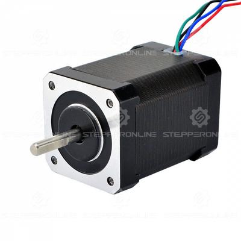{ width="120" } |

## Belts

| Name | Type | Quantity | Description | Link | ALT link | Reference Image |
| :--- | :--- | :--- | :--- | :--- | :--- | :--- |
| Joint 1 belt | HTD3 396 | 1 | 6 mm width | [Link](https://s.click.aliexpress.com/e/_c3LnffKl) | | 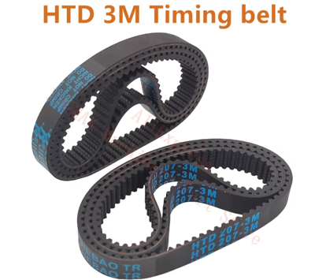{ width="120" } |
| Joint 3 belt | HTD3 342 | 1 | 6 mm width | [Link](https://s.click.aliexpress.com/e/_c4O7CHOd) | | { width="120" } |
| Joint 4 belt | HTD3 201 | 1 | 6 mm width | [Link](https://s.click.aliexpress.com/e/_c4NiUycd) | | { width="120" } |
| Joint 5 belt | HTD3 246 | 1 | 6 mm width | [Link](https://s.click.aliexpress.com/e/_c4DlcQaD) | | { width="120" } |

## Pulleys

| Name | Type | Quantity | Description | Link | ALT link | Reference Image |
| :--- | :--- | :--- | :--- | :--- | :--- | :--- |
| J4 pulley, J5 pulley | HTD3M 12 tooth | 2 | 5mm bore, 10mm width | [Link](https://s.click.aliexpress.com/e/_DFYERWX) | | 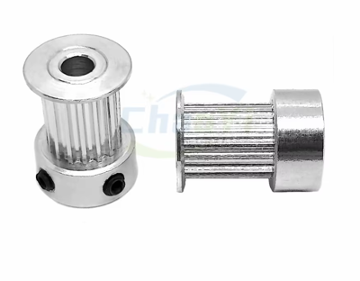{ width="120" } |
| J1 pulley | HTD3M 15 tooth | 1 | 5mm bore, 10mm width | [Link](https://s.click.aliexpress.com/e/_DBVgkVp) | | { width="120" } |

## Shaft couplers

| Name | Type | Quantity | Description | Link | ALT link | Reference Image |
| :--- | :--- | :--- | :--- | :--- | :--- | :--- |
| Shaft coupler | Shaft coupler | 3 | 8 mm hole shaft, M4 screw holes | [Link](https://s.click.aliexpress.com/e/_c2xnQgI7) | | 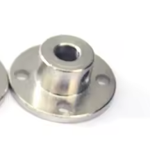{ width="120" } |

## Bearings

| Name | Type | Quantity | Description | Link | ALT link | Reference Image |
| :--- | :--- | :--- | :--- | :--- | :--- | :--- |
| Bearing 1 | AXK3552 | 1 | 35X52X4, needs to have top and bottom plate | [Link](https://s.click.aliexpress.com/e/_Dk4bHg7) | | 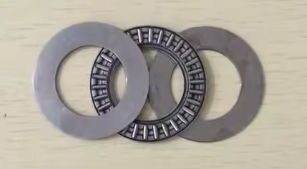{ width="120" } |
| Bearing 2 | NSK HR32906J | 5 | Joint 5, 4 and 3 | [Link](https://s.click.aliexpress.com/e/_DcJMtBl) | | 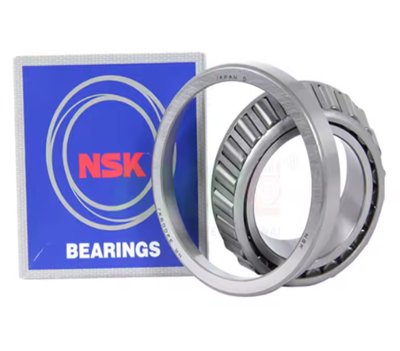{ width="120" } |
| Bearing 3 | NSK HR32907J | 4 | Joint 1 and 2 | [Link](https://s.click.aliexpress.com/e/_DcJMtBl) | | { width="120" } |
| Tension bearing | Ball bearing 3x8x4 | 20 | Used for belt tension | [Link](https://s.click.aliexpress.com/e/_DCjfgFV) | | 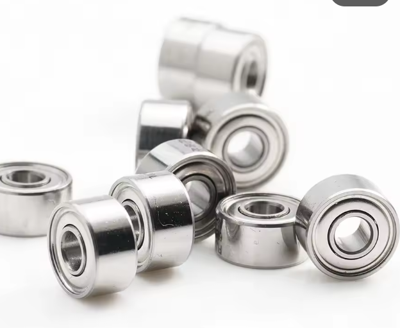{ width="120" } |
| Tension bearing | Ball bearing 3x10x4 | 20 | Used for belt tension | [Link](https://s.click.aliexpress.com/e/_DlA33Af) | | { width="120" } |

## Electronics

| Name | Type | Quantity | Description | Link | ALT link | Reference Image |
| :--- | :--- | :--- | :--- | :--- | :--- | :--- |
| PAROL control board | | 1 | [source-robotics.com](http://source-robotics.com/) | [Link](https://source-robotics.com/products/parol6-control-board) | | |
| TMC5160 | | 6 | Drivers from the links are tested. Use any other at own risk | [Link](https://s.click.aliexpress.com/e/_c3Jc52V9) | [Alt Link](https://s.click.aliexpress.com/e/_Dd8Cjkb) | |
| Thermal paste / cement | | 2 | Needed only if your control board has no drivers! | [Link](https://s.click.aliexpress.com/e/_c2u86OEn) | | 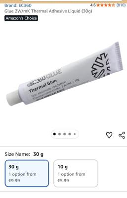{ width="120" } |
| On/Off button | | 1 | 12mm 3-6V | [Link](https://s.click.aliexpress.com/e/_DBpZV3h) | | 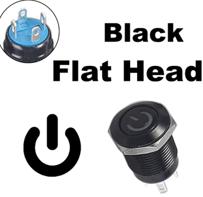{ width="120" } |
| JST PH 2.0mm 200mm 4PIN | | 1 | For power button | [Link](https://s.click.aliexpress.com/e/_DeObQ1D) | | 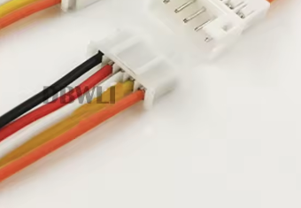{ width="120" } |
| Noctua NF-A4x20 5V 40mm | | 1 | or any 40mm 5V fan| | | |
| Power connector - male + female | | 1 | GX16 2PIN | [Link](https://s.click.aliexpress.com/e/_DcHjMfN) | | 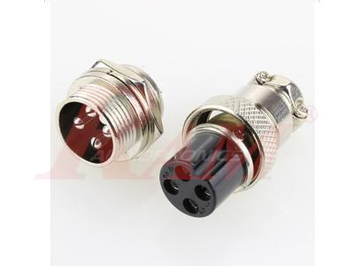{ width="120" } |
| Gripper connector (electric) | | 1 | M8 sensor Female 4 pin | [Link](https://s.click.aliexpress.com/e/_DDQz9iP) | | 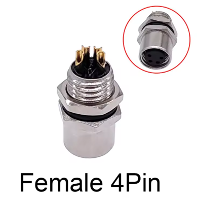{ width="120" } |
| Power supply | | 1 | Any 24V 5A supply | [Link](https://www.omc-stepperonline.com/edr-120-24-mean-well-120w-24vdc-5a-115-230vac-din-rail-power-supply-edr-120-24?tracking=6543849d6ff69) | [Alt Link](https://s.click.aliexpress.com/e/_olFOM5Z) | |
| Limit switches | | 3 | Type ZW12-3 | [Link](https://s.click.aliexpress.com/e/_DBq6eeF) | | 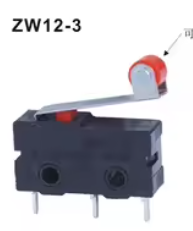{ width="120" } |
| Inductive sensor 1 | | 1 | 4mm NPN NO | [Link](https://s.click.aliexpress.com/e/_c40MRkk5) | [Alt Link](https://s.click.aliexpress.com/e/_c3CMbO1h) | 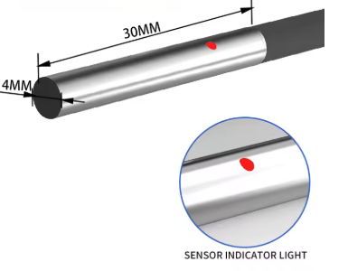{ width="120" } |
| Inductive sensor 2 | | 1 | GX-F8A | [Link](https://s.click.aliexpress.com/e/_c4VxLtW3) | | 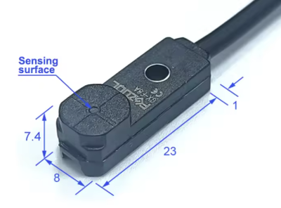{ width="120" } |
| Inductive sensor 3 | | 1 | M5, NPN NO | [Link](https://s.click.aliexpress.com/e/_c3zGvxrP) | [Alt Link](https://s.click.aliexpress.com/e/_c3CMbO1h) | 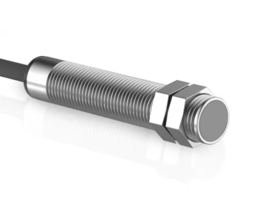{ width="120" } |
| Estop | | 1 | Any NC estop | [Link](https://s.click.aliexpress.com/e/_c3Bn4RR5) | | 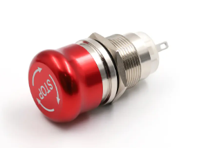{ width="120" } |
| Cable gland for estop | | 1 | PG7 type | [Link](https://s.click.aliexpress.com/e/_DdJj62p) | | 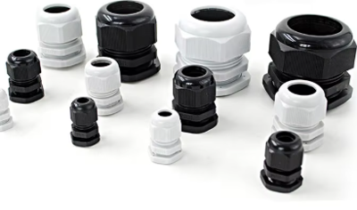{ width="120" } |
| M3 brass insert | | 4 | M3, 6mm lenght | [Link](https://s.click.aliexpress.com/e/_DmZR9AN) | | 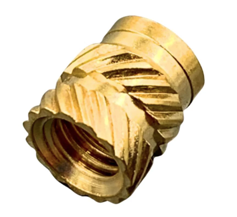{ width="120" } |
| Pneumatic connector - robot | | 4 | 4 mm type PM | [Link](https://s.click.aliexpress.com/e/_c3GpN5cR) | | 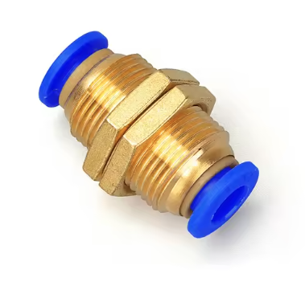{ width="120" } |
| Pneumatic Gripper | | 1 | MHZ2-16D | [Link](https://s.click.aliexpress.com/e/_c4EJl0Qr) | | 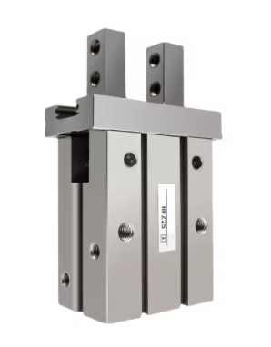{ width="120" } |
| Pneumatic gripper connector | | 2 | PC4 - M5 | [Link](https://s.click.aliexpress.com/e/_DkCJqUL) | | 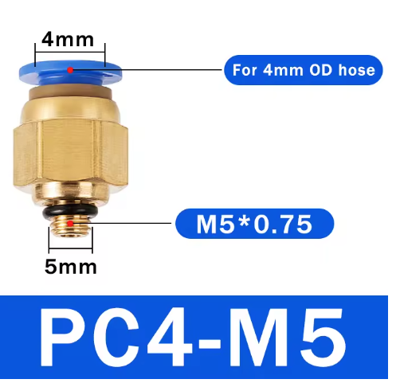{ width="120" } |
| Pneumatic tube | | 5 meters | 1 meter, 4x2.5mm | [Link](https://s.click.aliexpress.com/e/_DEhvFyJ) | | 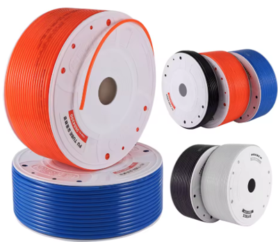{ width="120" } |
| xt30 connector female | | 1 | Used to deliver power to PAROL6 PCB | [Link](https://s.click.aliexpress.com/e/_DllR7eL) | | |
| Stlink / programming adapter | | 1 | Use our [Official programming adapter](https://source-robotics.com/products/parol6-programming-adapter) for ease of use! Pin order needs to be: SWCLK, SWDIO, GND, 3V3, 5V | [Link](https://s.click.aliexpress.com/e/_c38Ao641) | | |
| USB B cable | | 1 | Comms to the PC | | | |
| 5/2 solenoid air valve | | 1 | 4mm tube connectors, 5/2, 24V | [Link](https://s.click.aliexpress.com/e/_DDrw0Ux) | | 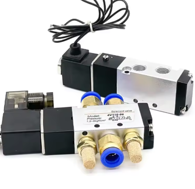{ width="120" } |

## Vacuum gripper

| Name | Type | Quantity | Description | Link | ALT link | Reference Image |
| :--- | :--- | :--- | :--- | :--- | :--- | :--- |
| Suction cup gripper | | 1 | | [Link](https://www.aliexpress.com/item/4000538850003.html) | | |
| Vacuum generator | | 1 | | [Link](https://s.click.aliexpress.com/e/_c44Degkz) | | |
| 4mm to 6mm coupler | | 1 | | [Link](https://s.click.aliexpress.com/e/_DeEEqHR) | | |

## Small print bed modification

!!! note
    These parts are only needed if your printer bed is too small for `J1_turret_rework_blocker` and `Upper_arm`. Both parts are split in two and joined with dowel pins and epoxy after printing. STL files are in [STL/SMALL_PRINT_BED](https://github.com/Source-Robotics/PAROL6-Desktop-robot-arm/tree/main/STL/SMALL_PRINT_BED). Nothing else in the build changes.

| Name | Type | Quantity | Description | Link | ALT link | Reference Image |
| :--- | :--- | :--- | :--- | :--- | :--- | :--- |
| J1 turret dowel pin | Dowel pin 4 x 18 mm | 3 | Solid cylindrical, stainless or hardened steel | [Link](https://www.aliexpress.com/item/1005009401701158.html) | | |
| Upper arm dowel pin | Dowel pin 6 x 22 mm | 4 | Solid cylindrical, stainless or hardened steel | [Link](https://www.aliexpress.com/item/1005009401701158.html) | | |
| Two part epoxy | Epoxy adhesive | 1 | 1:1 mix, slow setting | [Link](https://www.aliexpress.com/item/1005012397836514.html) | | |
