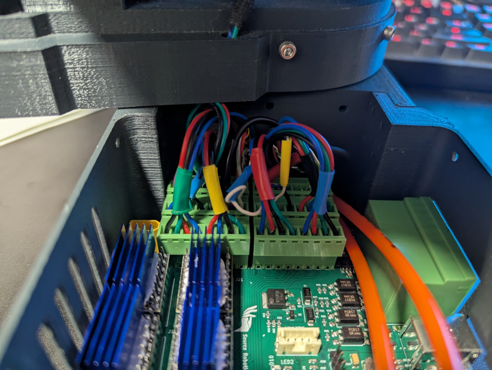

# Electronics and wiring

The control board goes into the base with its fan and its six driver modules; the motors, switches, sensors,
the gripper connector, the E-stop and the power connector are wired to it.

## The control board

Everything about the board itself is in the [Control Board Manual](../board/index.md): the connectors, the pin
map, the drivers. The two things that destroy boards, both on the [Stepper drivers](../board/05-stepper-drivers.md)
page: a driver module inserted the wrong way round, and a driver without its heatsink cemented on. Read that
page before you plug anything in.

## Wiring the arm to the board

{ width="750" }

- **Motors**: one four-wire cable per joint to its driver's terminal. The joint-to-terminal mapping is in
  [Connectors and pinout](../board/04-connectors.md): the drivers are not in joint order on the board.
- **Limit switches** (joints 2, 3, 5): one lead to 24 V, the other to the joint's LIMIT terminal; polarity does
  not matter.
- **Inductive sensors** (joints 1, 4, 6): brown to 24 V, blue to GND, black (signal) to the LIMIT terminal.
- **The gripper connector**: 24 V, GND, CAN H and CAN L from the board to the M8 socket at the forearm.
- **The E-stop**: the NC contact to the two E-stop terminals.
- **Power**: the GX16 socket on the base to the XT30 on the board, polarity checked twice.
- **The power button**: the JST PH cable to the button connector.
- **The fan**: 5 V, three-pin, on the fan header; not a PWM fan.

The finished base looks like this:

{ width="700" }

{ width="700" }

## Test before you close the base

Power the board with the test firmware and check every driver, switch, sensor, input and output from the serial
terminal ([The test firmware](../board/09-test-firmware.md)). It is far easier now than with the base closed and
the arm on top.
