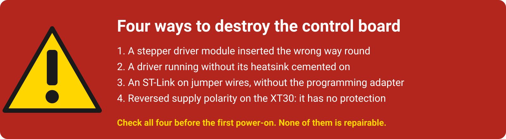
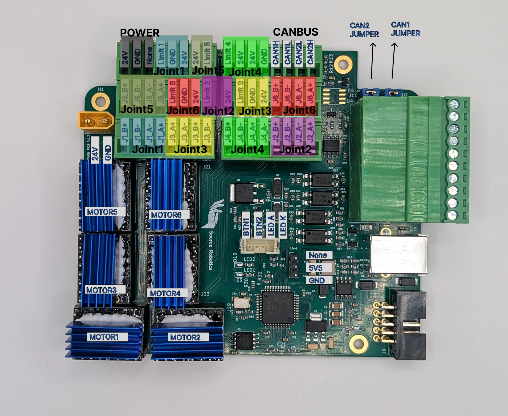
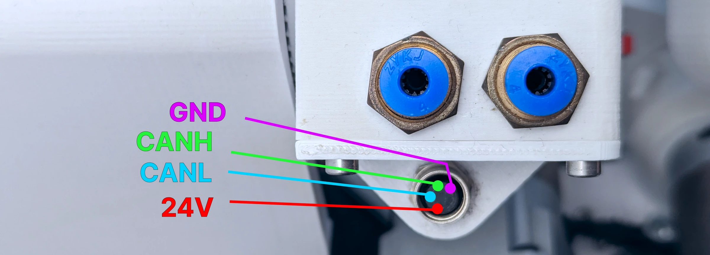
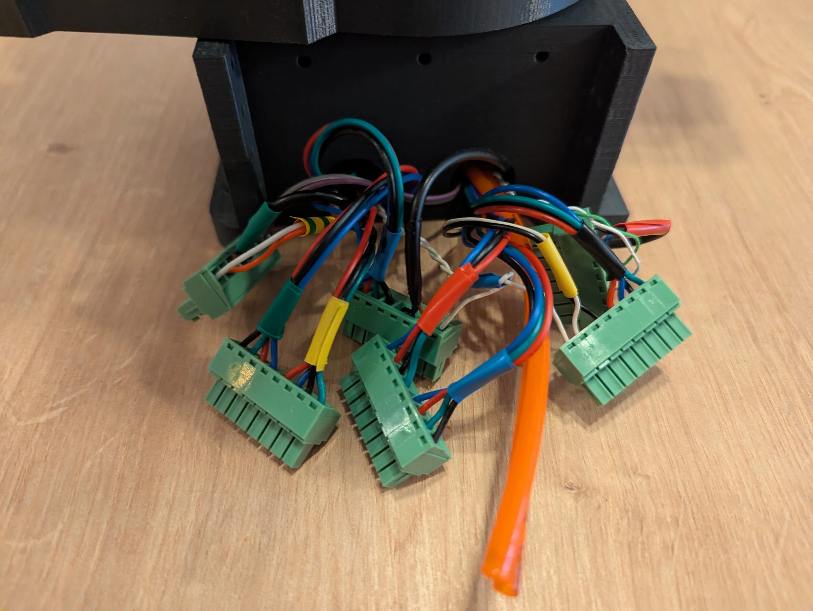
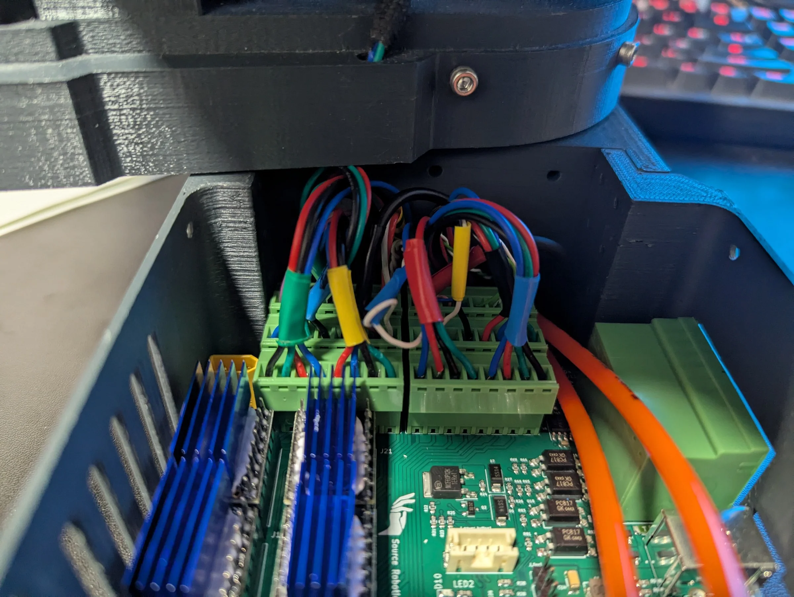

# Electronics and wiring

{ width="1000" }

The control board goes into the base with its fan and its six driver modules. The motors, switches, sensors, the
gripper connector, the E-stop and the power connector are wired to it.

## The control board

Everything about the board itself is in the [Control Board Manual](../board/index.md): the connectors, the pin
map, the drivers.

!!! danger "Read the Stepper drivers page before you plug anything in"
    The two things that destroy boards, both on the [Stepper drivers](../board/05-stepper-drivers.md) page: a
    driver module inserted the wrong way round, and a driver without its heatsink cemented on.

## Wiring the arm to the board

{ width="750" }

| What | Wires | To |
|---|---|---|
| **Motors** | One four-wire cable per joint | The terminals marked with its joint number (`J1_A+` to `J6_B-`) |
| **Limit switches** (joints 2, 3, 5) | One lead to 24 V; polarity does not matter | The other lead to the LIMIT terminal the wiring diagram shows in that joint's group |
| **Inductive sensors** (joints 1, 4, 6) | Brown to 24 V, blue to GND | Black (signal) to the LIMIT terminal the wiring diagram shows in that joint's group |
| **The gripper connector** | 24 V, GND, CAN H and CAN L from the board | The female M8 socket at the forearm ([below](#the-gripper-connector)) |
| **The E-stop** | The NC contact | The two E-stop terminals |
| **Power** | The GX16 socket on the base, polarity checked twice | The XT30 on the board |
| **The power button** | The JST PH cable | The button connector |
| **The fan** | 5 V, three-pin; not a PWM fan | The fan header |

The GX16 has no fixed +24 V pin: choose one, wire the supply's plug the same way, and mark it.

Wire each switch and sensor to the terminal the diagram shows for its joint, joints 1 and 6 included. Check each
one with the test firmware's `#LIMIT` before you close the base.

### The gripper connector

The female M8 socket at the forearm, by the numbers moulded into it
([The gripper socket](../end-effectors/flange.md#the-gripper-socket)):

| Pin | Signal |
|---|---|
| 1 | GND |
| 2 | CAN H |
| 3 | 24 V |
| 4 | CAN L |

{ width="600" }

Solder it as the photo on page 32 of the assembly manual shows, the view from the back where the wires go.

!!! warning "The list next to that photo is wrong"
    The numbered list next to that photo has pins 1 and 3 the wrong way round for this socket: wired by the list,
    the PAROL6 gripper cable reverses the gripper's supply.

### The finished base

{ width="700" }

{ width="700" }

## Test before you close the base

1. Power the board with the test firmware.
2. Check every driver, switch, sensor, input and output from the serial terminal
   ([The test firmware](../board/09-test-firmware.md)).

It is far easier now than with the base closed and the arm on top. You can also test your motors here, before the
arm is assembled, to see that each one works.

Every control board sold by Source Robotics comes with the test firmware preloaded. It is the firmware every board
was tested with: each board is fully tested, every part of it, at the end of the production line.

[Next: 5. Firmware and first run :material-arrow-right:](firmware-and-first-run.md){ .md-button .md-button--primary }
