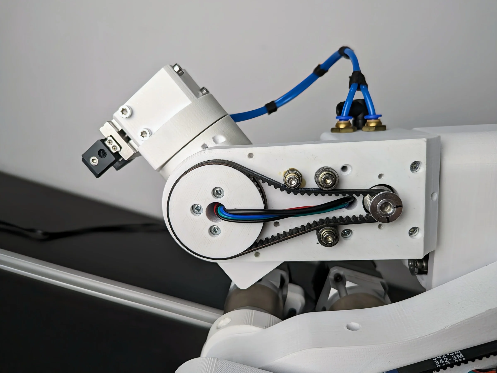

# Mechanical assembly

The assembly is documented step by step in the
[Parol building instructions PDF](https://github.com/Source-Robotics/PAROL6-Desktop-robot-arm/blob/main/Building%20instructions/Parol%20building%20instructions.pdf)
and shown in the [video playlist](https://www.youtube.com/playlist?list=PLSueoDrBt5MMTL9O8qAWZiJrNIf8-29Qz).
This page lists what to get right.

!!! warning "Read the whole manual once before you start"
    Some steps cannot be undone without taking the joint apart again.

## The building instructions

<object data="../../assets/pdf/PAROL6_building_instructions.pdf#view=FitH&amp;navpanes=0" type="application/pdf" width="100%" height="820">
  
Your browser does not show PDFs inline: <a href="../../assets/pdf/PAROL6_building_instructions.pdf">download the building instructions (PDF, 8 MB)</a>.

</object>

[Download the building instructions (PDF, 8 MB)](../assets/pdf/PAROL6_building_instructions.pdf){ .md-button }

## Things to get right

| Check | What right is | More |
|---|---|---|
| **Bearings seated square** | The tapered roller bearings carry the joint. A bearing that sits crooked makes the joint stiff in one direction and loose in the other. | |
| **Belt tension** | Maximum hand force for joints 3 and 5, slightly less for 1 and 4, with the tension bearings | The [belt tension video](https://www.youtube.com/watch?v=v0PYfEoIr3k), [Belts](../07-maintenance/belts.md) |
| **Threadlocker** | Blue, on every metal-to-metal screw and on all set screws. The couplers between motors, gearboxes and shafts are where a loose screw costs the most. | [Couplers and threadlocker](../07-maintenance/couplers.md) |
| **The limit switches and sensors** | Positioned so that the moving part presses the lever, or passes the sensor within a millimetre or two, before the joint reaches its mechanical stop | |
| **Joint 1's blockers** | Fitted. Without them joint 1 can spin a full turn and tear its wires. | |
| **Wires and tubes** | Enough slack through each joint for its full range, and fixed so that they cannot be pinched by the belts | |
| **Wire markings** | The print table spreadsheet's *Wire_markings* sheet lists the colour code of the motor and sensor cables used on the reference robots, which helps when the base is wired | |

{ width="500" }

## Small print beds

The J1 turret blocker and the upper arm come split in `STL/SMALL_PRINT_BED`, with a README.

1. Join the halves with the dowel pins and slow epoxy.
2. Clamp them straight.
3. Let them cure before the joint is assembled.

## Custom couplers and flanges

The repository's `custom_couplers.md` is a work in progress on machined alternatives to the shaft couplers, with
a press-fit flange. Use the BOM's couplers until it is finished.

## Before the electronics

Turn every joint by hand through its range.

!!! success "Check"
    Everything moves smoothly against the gearbox's resistance, with no clicks and no tight spots, and every
    switch clicks as its joint reaches it.

[Next: 4. Electronics and wiring :material-arrow-right:](electronics-and-wiring.md){ .md-button .md-button--primary }
