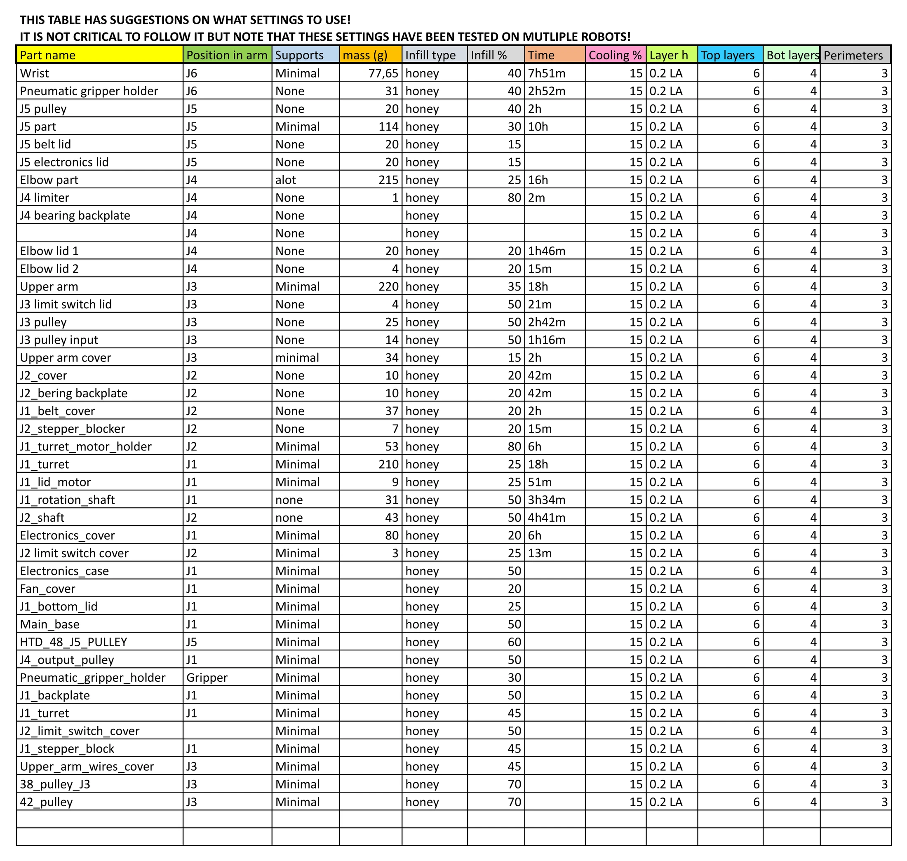

# Printing the parts

## Material

| Material | Use it | Why |
|---|---|---|
| **PETG** | Yes | It softens around 80 °C, prints without an enclosure, and bonds layers well |
| PLA | No | The motors run warm and the parts around them see 60 to 70 °C in long use, which PLA does not survive |
| ABS or ASA | With an enclosure | |

The repository's [PETG notes](https://github.com/Source-Robotics/PAROL6-Desktop-robot-arm/blob/main/Building%20instructions/PETG_printing.md)
give the printing basics:

| Setting | Value |
|---|---|
| Hot end | 220 to 250 °C |
| Bed | 60 to 90 °C, with glue |
| Layer fan | On |

The warping is small.

## The files

All parts are in the repository's [`STL`](https://github.com/Source-Robotics/PAROL6-Desktop-robot-arm/tree/main/STL)
folder, grouped by link:

- [`BASE`](https://github.com/Source-Robotics/PAROL6-Desktop-robot-arm/tree/main/STL/BASE)
- [`SHOULDER`](https://github.com/Source-Robotics/PAROL6-Desktop-robot-arm/tree/main/STL/SHOULDER)
- [`UPPER_ARM`](https://github.com/Source-Robotics/PAROL6-Desktop-robot-arm/tree/main/STL/UPPER_ARM)
- [`ELBOW`](https://github.com/Source-Robotics/PAROL6-Desktop-robot-arm/tree/main/STL/ELBOW)
- [`FOREARM`](https://github.com/Source-Robotics/PAROL6-Desktop-robot-arm/tree/main/STL/FOREARM)
- [`WRIST`](https://github.com/Source-Robotics/PAROL6-Desktop-robot-arm/tree/main/STL/WRIST)
- [`ESTOP`](https://github.com/Source-Robotics/PAROL6-Desktop-robot-arm/tree/main/STL/ESTOP)
- [`GRIPPER_ATTACHMENTS`](https://github.com/Source-Robotics/PAROL6-Desktop-robot-arm/tree/main/STL/GRIPPER_ATTACHMENTS)
- [`UTILITY`](https://github.com/Source-Robotics/PAROL6-Desktop-robot-arm/tree/main/STL/UTILITY)
- [`mounting plates`](https://github.com/Source-Robotics/PAROL6-Desktop-robot-arm/tree/main/STL/mounting%20plates)
- [`SMALL_PRINT_BED`](https://github.com/Source-Robotics/PAROL6-Desktop-robot-arm/tree/main/STL/SMALL_PRINT_BED), the
  split versions of the two largest parts

The print table below says how each was printed on the reference robots. It is a tested starting point, not a
rule.

## Print table

The print table from the robot's repository, as it is. It lists every printed part with the settings it was
printed with on the reference robots: supports, mass, infill, print time, cooling, layer height, top and bottom
layers, perimeters. Click the table to enlarge it.

The same table is in the repository as a
[PDF](https://github.com/Source-Robotics/PAROL6-Desktop-robot-arm/blob/main/Print%20table/Print_table.pdf) and as an
[Excel file](https://github.com/Source-Robotics/PAROL6-Desktop-robot-arm/blob/main/Print%20table/PR_EXCEL.xlsx).

{ width="1000" }

!!! tip "The pulleys"
    Print the pulleys with high infill and slow outer walls: their teeth carry the load. Check the first printed
    pulley against a belt before printing the rest.

## Tolerances

Bearing seats and shafts are designed for a well-calibrated printer.

| If a seat is | Then |
|---|---|
| Too tight | Ream it |
| Too loose | Shim it with tape or a drop of epoxy |

Test the fit of the tapered bearings in their seats before assembling a joint.

## Inserts

Four M3 brass inserts are melted into their holes with a soldering iron. Everything else screws directly into the
plastic.

[Next: 3. Mechanical assembly :material-arrow-right:](mechanical-assembly.md){ .md-button .md-button--primary }
