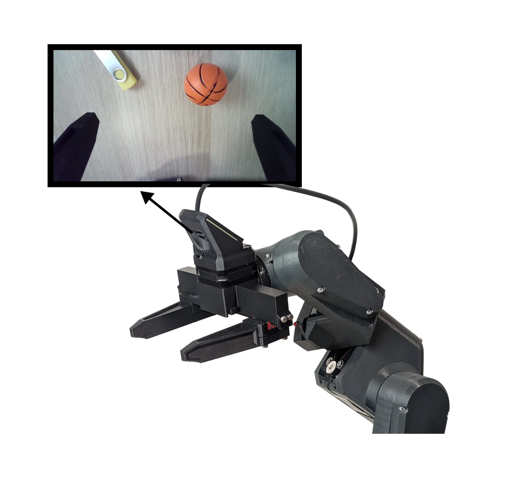

---
hide:
  - toc
---

# PAROL6 End Effectors Guide

{ .hero }

<!-- doc-meta: end_effectors -->

What goes on PAROL6's flange and how to set it up: the pneumatic and vacuum grippers from the robot's own files,
Source Robotics' SSG-48 and MSG electric grippers, and a tool of your own.

Each page says how the end effector mounts, how it connects, what to tell the firmware and the software, and how
the commander software and the Python API drive it. The electric grippers have manuals of their own; here is only
what is PAROL6-specific.

| End effector | Driven by | Mounts with | Commander | Python API | Manual |
|---|---|---|---|---|---|
| [Pneumatic gripper](pneumatic-gripper.md), SMC MHZ2-16D | a 5/2 valve on OUTPUT1, 5 to 7 bar | a printed holder on the joint 6 shaft coupler | `Output(1,HIGH)`, `Output(1,LOW)` | `select_tool("PNEUMATIC")` | this guide |
| [Vacuum gripper](vacuum-gripper.md) | the same valve and an ejector | a printed holder | `Output(1,HIGH)`, `Output(1,LOW)` | `select_tool("VACUUM")` | this guide |
| [SSG-48](ssg-48.md) adaptive electric gripper | CAN and 24 V through the M8 connector | `coupler_connector_PAROL6` | the Gripper tab, `Gripper()` | `select_tool("SSG-48")` | [SSG-48 manual](https://docs.source-robotics.com/SSG48-gripper-docs/) |
| [MSG](msg.md) compliant AI stepper gripper | CAN and 24 V through the M8 connector | `ring_cover-PAROL6` | the Gripper tab, `Gripper()` | `select_tool("MSG")` | [MSG manual](https://docs.source-robotics.com/MSG-gripper-docs/) |
| [Your own tool](custom-tools.md) | 24 V and CAN, two air lines, two inputs and two outputs | the shaft coupler, or the coupler template | `Output(1,HIGH)`, `Output(1,LOW)`; the inputs in the IO tab | `set_tcp_offset()`, a `ToolConfig` | this guide |

!!! tip "Robot first, then the gripper"
    Get the robot working before you attach a gripper: troubleshooting both at once is hard.

## In this guide

| Page | What it covers |
|---|---|
| [The flange](flange.md) | The 8 mm shaft of joint 6, the connections at the forearm, the payload, the tool in the software |
| [Pneumatic gripper](pneumatic-gripper.md) | The parts, the tubes and the valve, the TCP, driving it |
| [Vacuum gripper](vacuum-gripper.md) | The parts, mounting, the air, driving it |
| [SSG-48](ssg-48.md) | Mounting, the cable, the TCP, the joint 5 homing offset, calibrating and driving it |
| [MSG](msg.md) | Mounting, the cable and the camera, the TCP, the joint 5 homing offset, calibrating and driving it |
| [Your own tool](custom-tools.md) | Mounting, the joint 5 homing feature, the connections, the tool frame |
