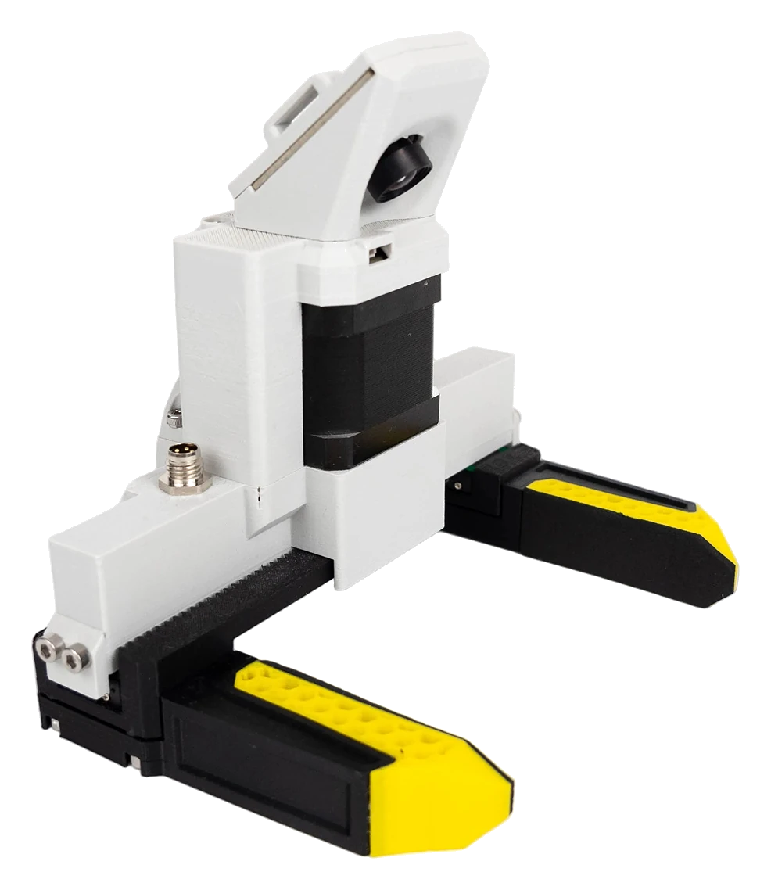
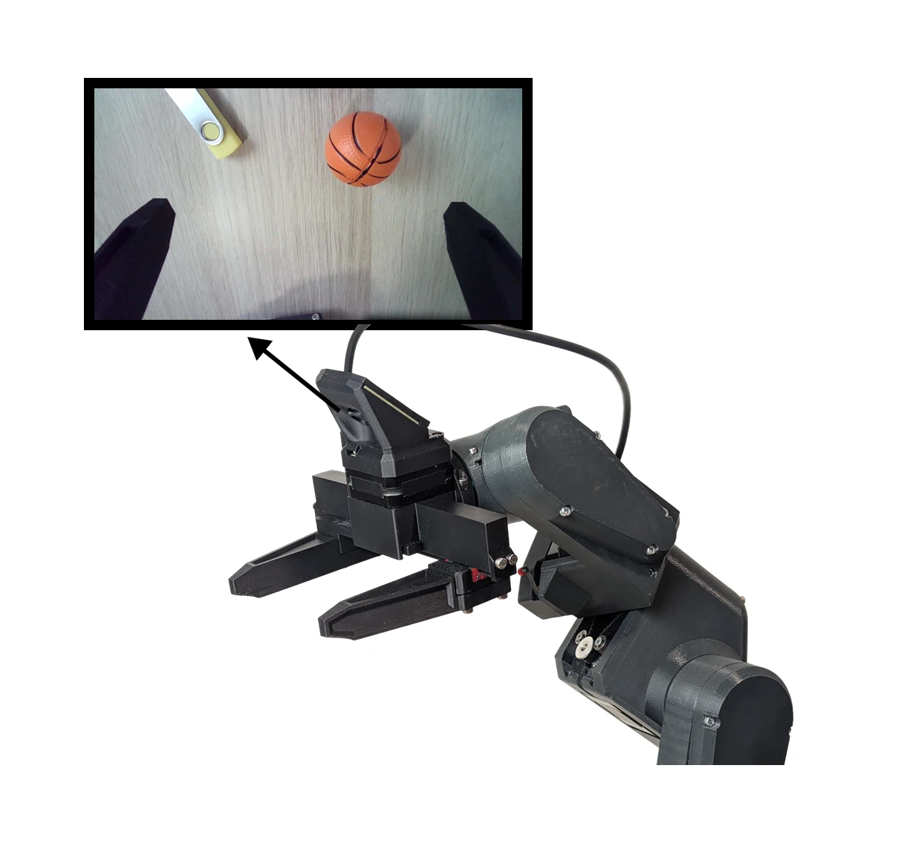

# MSG compliant AI stepper gripper

{ .hero }

Source Robotics' modular stepper gripper: a STEPFOC driver in gripper mode, three rail lengths, three stepper
lengths and a camera mount. It plugs into the M8 connector at the forearm, and the control board drives it over
CAN with the same commands as the SSG-48.

Its own manual, [MSG-gripper-docs](https://docs.source-robotics.com/MSG-gripper-docs/), covers the gripper; this
page covers PAROL6.

| | |
|---|---|
| Stroke | 55, 105 or 155 mm, with the 100, 150 or 200 mm rail |
| Grip force | about 20, 25 or 36 N per ampere with the 21.5, 40 or 60 mm stepper; up to about 31, 50 or 76 N |
| Mass | about 380 g plus the camera: mind the [payload](flange.md#payload) at full reach |
| Shop | [MSG gripper](https://source-robotics.com/products/msg-gripper) |

## Mounting

1. Replace the gripper's `ring_cover` with `ring_cover-PAROL6` from the repository's `Common parts`. It bolts to
   the robot's last joint, and the coupler plate's shaft coupler (8 mm bore, two M4 clamp screws) takes the joint 6
   shaft ([Mounting on a robot](https://docs.source-robotics.com/MSG-gripper-docs/latest/04-installation/mounting/)).
2. Slide the gripper onto the shaft, and orient it with the camera looking down between the jaws.
3. Tighten the two clamp screws with blue threadlocker ([Couplers and threadlocker](../07-maintenance/couplers.md)).
4. Connect the [PAROL6 gripper cable](https://source-robotics.com/products/gripper-cable) between the gripper and
   the M8 connector at the forearm.
5. The camera is a plain USB camera with its own cable. Route it outside the arm, with slack for joints 4, 5 and
   6, and fix it so the arm cannot catch it.

{ width="600" }

!!! danger "Only the PAROL6 cable"
    PAROL6 and PAR6 put the four signals on different pins. The PAR6 cable reverses the gripper's supply, and a
    self-made cable with a wrong pin can put 24 V on a CAN pin; either destroys the gripper's driver. The
    socket's pins are in [The gripper socket](flange.md#the-gripper-socket), the cable's in the gripper
    manual's cable page.

Leave the gripper's CAN node ID at 0 and its termination switch, reachable through the stepper cover, on: it is
the last node on the robot's bus ([CAN bus](../06-peripherals/can-bus.md)).

## Tool centre point

| | MSG, both jaw variants |
|---|---|
| a6, from the joint 6 centre along the tool axis | 134.3 mm |
| a7, to the side | 28.35 mm |

Both jaw variants share one TCP: an operating point, not a measured grasp centre.

=== "Solid jaws"

    { width="600" }
    { width="600" }

=== "Soft TPU jaws"

    { width="600" }
    { width="600" }

The sheet is the robot's model from [robot_descriptions](https://github.com/Source-Robotics/robot_descriptions)
(version <!-- version: models.robot_descriptions -->) with every joint at 0. Tell the software about the tool
([Tools and the TCP](../programming/02-python-api/tools-and-tcp.md)); every tool is compared on
[Dimensions and kinematics](../03-technical-data/kinematics.md).

## The joint 5 homing offset

Joint 5 homes against the tool, and the MSG's ring cover is not the pneumatic gripper holder that the firmware's
default offset (8900) assumes.

1. After the first homing, check joint 5 with the pin through the witness marks.
2. If it is off, measure the offset and set `j5_homing_offset` in `main.cpp`, as
   [Mastering](../05-operation/mastering.md) describes.

## Driving it

The gripper must be calibrated after every power-up: it opens fully and closes fully to find its end stops, and
does not move before that.

1. Clear any error.
2. Calibrate.
3. Wait until the gripper reports itself calibrated before the first move: about 5 to 6 s on the longer rails.

=== "Commander software"

    In the **Gripper** tab, after homing the robot:

    1. Press **Clear gripper error**.
    2. Press **Calibrate gripper**, and wait until the tab shows `Calibration status is: 1`.
    3. Set position, speed and current with the sliders.
    4. Press **Move GoTo**.

    The feedback section shows the current, the position and the status ([The GUI](../gui/commander/the-gui.md)).

    { width="700" }

    In RBTscript, after clearing the error in the tab: `Gripper_cal()`, `Delay(7)`, then
    `Gripper(position, speed, current)` ([RBTscript](../programming/03-commander/rbtscript.md#gripper)).

=== "Python API"

    ```python
    rbt.select_tool("MSG", variant_key="150mm")           # 100mm, 150mm or 200mm: the rail
    rbt.tool.calibrate()                                   # queued; the API counts it done after 2 s
    rbt.delay(5)                                           # the rest of the calibration, with a margin
    rbt.tool.set_position(0.8, speed=0.5, current=0.4)     # fractions of the ranges; 0.4 is 1180 mA
    rbt.tool.close(current=0.4)
    rbt.tool.open()
    rbt.tool.release()                                     # drop the grip, the jaws stay
    rbt.tool.stop()                                        # immediate: halt where the jaws are
    ```

    - Tool actions are queued with the motion, so a move after `close()` waits for the grip.
    - A `move` on a gripper that was never calibrated is refused when its turn comes.
    - The API does not read the calibrated bit and has no clear-error action at this version: clear an error in the
      commander's Gripper tab or with Motor GUI ([Tools and the TCP](../programming/02-python-api/tools-and-tcp.md#calibrating),
      [Tools](../reference/python/tools.md)).

## Current and force

The current limit is the grip force, and the slope depends on the stepper:

| Stepper | Grip force per ampere | Maximum current | Highest `current=` fraction in the Python API |
|---|---|---|---|
| 21.5 mm | About 20 N | 1.5 A | 0.51 |
| 40 mm | About 25 N | 2.0 A | 0.70 |
| 60 mm | About 36 N | 2.1 A | 0.74 |

Stay within the stepper's maximum. The gripper manual's
[Force and speed](https://docs.source-robotics.com/MSG-gripper-docs/latest/03-technical-data/force-and-speed/)
has the curves.

| Program | Takes the current as | Within every stepper's maximum? |
|---|---|---|
| Commander software | Milliamps, 100 to 1000 mA | Yes |
| Python API | A fraction of 100 to 2800 mA | No: keep the fraction at or below the value for your stepper, in the table above |

## Status

The robot passes the gripper's status byte through: calibrated, in motion, object detected (while closing, while
opening, or none), and its error bits.

| Program | Shows |
|---|---|
| Commander, Gripper tab | The calibrated and E-stop error bits, and the whole status byte as a number (labelled *Gripper object detection is*) |
| Python API, `tool.status()` | The jaw position and the current. Its `engaged` and `part_detected` do not follow the status byte's bits at this version ([Tool status](../programming/02-python-api/tools-and-tcp.md#tool-status)) |

The gripper manual's errors page says what each error needs:
[Errors and recovery](https://docs.source-robotics.com/MSG-gripper-docs/latest/06-operation/errors/).
