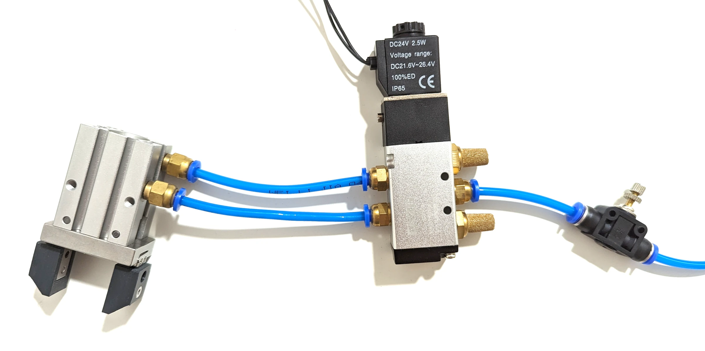
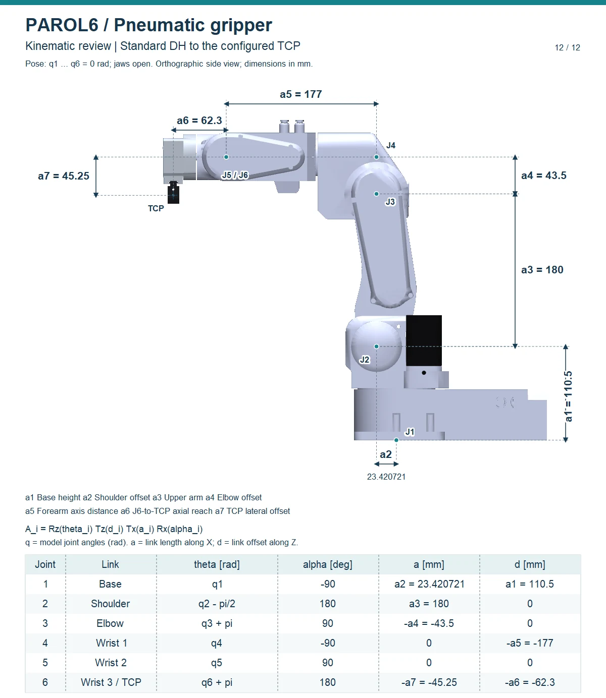

# Pneumatic gripper

The standard tool: an SMC MHZ2-16D parallel gripper in a printed holder, driven by a 5/2 solenoid valve from one
of the control board's outputs.

## Parts

| | |
|---|---|
| Gripper | MHZ2-16D, two PC4-M5 push-in fittings |
| Holder | `GRIPPER_ATTACHMENTS/Pneumatic_gripper_holder.STL` (vertical) or `Pneumatic_gripper_holder_horizontal.stl`; `Gripper_ARMS.STL` for the fingers |
| Valve | 5/2 solenoid valve, 24 V, 4 mm tube ports |
| Tube | 4 × 2.5 mm pneumatic tube, 5 m |
| Air | 6 to 8 bar, as in industry; every example in the videos uses that |

## Connections

The two tubes from the gripper leave the forearm and are joined to the two tubes that run through the arm to the
base; the valve's two outputs go to the two fittings at the base. **Swapping the two tubes swaps normally open
and normally closed**: choose the state the gripper should take without power.

{ width="700" }

The valve's coil goes between **GND_SEL** and **OUTPUT1** on the control board, with the output supply set to the
robot's 24 V or an isolated one ([Inputs and outputs](../06-peripherals/io.md)).

## Tool centre point

The tool centre point (TCP) is a6 = 62.3 mm from the joint 6 centre along the tool axis and a7 = 45.25 mm to the
side. The TCP is the reference point of the original MHZ2-10D gripper, not a newly measured grasp centre. The sheet
is the robot's model from [robot_descriptions](https://github.com/Source-Robotics/robot_descriptions) (version
2.13.0) with every joint at 0. Tell the software about the tool ([Tools and the
TCP](../programming/02-python-api/tools-and-tcp.md)); every tool is compared on [Dimensions and
kinematics](../03-technical-data/kinematics.md).

{ width="600" }

## Driving it

=== "RBTscript"
    ```
    Output(1,HIGH)    // the valve switches: close
    Delay(0.5)
    Output(1,LOW)     // open
    ```

=== "Python API"
    ```python
    rbt.select_tool("PNEUMATIC")
    rbt.tool.close()
    rbt.tool.open()
    rbt.write_io(0, 1)            # the same, as a plain output
    ```
    The tool's action lasts its estimated stroke, so a move queued after `close()` waits for the gripper.

## Orientation

The vertical holder puts the gripper along the axis of joint 6; the horizontal holder turns it 90°, which
reaches a table from the side. The Python API has a variant for each (`vertical`, `horizontal`); with the
commander, remember that the DH dimensions a6 and a7 assume the vertical holder.
