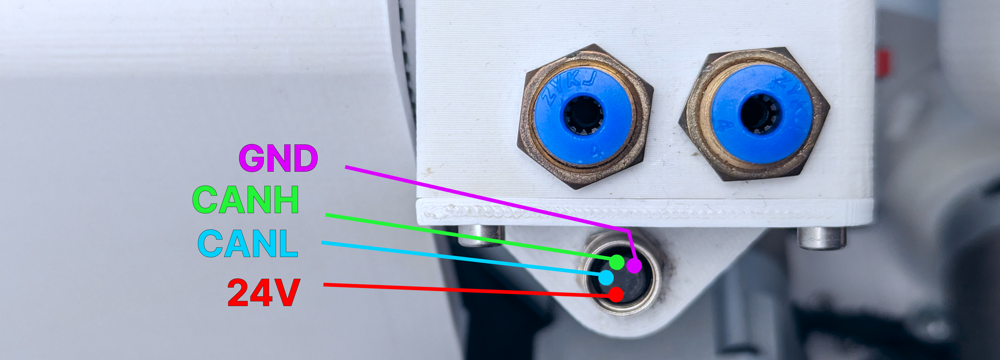

# SSG-48 adaptive electric gripper

Source Robotics' 48 mm electric gripper: a Spectral Micro BLDC driver in gripper mode. It plugs into the M8
connector at the forearm and the control board drives it over CAN; the commander software and the Python API
both know it. Its own manual, [SSG48-gripper-docs](https://docs.source-robotics.com/SSG48-gripper-docs/), covers
the gripper; this page covers PAROL6.

| | |
|---|---|
| Stroke | 48 mm |
| Grip force | about 54 N per ampere, 5 to 80 N |
| Fingers | fin-ray or pinch, printed: `finger` and `pinch` in the Python API |
| Shop | [SSG-48](https://source-robotics.com/products/compliant-gripper) |

## Mounting

1. Fit `coupler_connector_PAROL6` from the gripper's repository to the gripper. It carries a shaft coupler with an
   8 mm bore and two M4 clamp screws for the joint 6 shaft, and the homing tab that joint 5 homes against: the
   tab goes on the same side as the gripper's cable connector, with an M3 × 12 screw in the marked hole, as the
   gripper's [assembly manual](https://github.com/Source-Robotics/SSG-48-adaptive-electric-gripper/blob/main/Assembly%20manual/Gripper_assembly_manual.pdf)
   shows on its last pages.
2. Slide the gripper onto the joint 6 shaft, orient it, and tighten the two clamp screws, one on each side, with
   blue threadlocker ([Couplers and threadlocker](../07-maintenance/couplers.md)).
3. Connect the [PAROL6 gripper cable](https://source-robotics.com/products/gripper-cable) between the gripper
   and the M8 connector at the forearm.

{ width="600" }

!!! danger "Only the PAROL6 cable"
    PAROL6 and PAR6 put the four signals on different pins. The PAR6 cable, or a self-made cable with a wrong
    pin, puts 24 V on the CAN pins and destroys the gripper's driver. The gripper manual's cable page has the
    pinout to check your own against.

Leave the gripper's CAN node ID at 0 and its termination switch on: it is the last node on the robot's bus
([CAN bus](../06-peripherals/can-bus.md)).

## The joint 5 homing offset

Joint 5 homes against the tool, and the SSG-48's coupler sits differently from the pneumatic gripper holder. Set
`j5_homing_offset` to **8035** in `main.cpp` of the control board firmware (the default, 8900, is for the
pneumatic gripper) and upload ([Firmware](../board/08-firmware.md)). Check with the pin through the joint 5
witness marks after the first homing, and master if needed ([Mastering](../05-operation/mastering.md)).

## Driving it

The gripper calibrates after every power-up: it opens fully and closes fully to find its end stops, and does
not move before that.

=== "Commander software"
    The **Gripper** tab: after homing the robot press **Calibrate Gripper**, then **Clear Gripper Error**, set
    position, speed and current with the sliders and press **Move GoTo**. The feedback section shows the current,
    the position and the status ([The GUI](../gui/commander/the-gui.md)). In RBTscript: `Gripper_cal()` then
    `Gripper(position, speed, current)` ([RBTscript](../programming/04-commander/rbtscript.md#gripper)).

=== "Python API"
    ```python
    rbt.select_tool("SSG-48"                              # or variant_key="pinch")
    rbt.tool.calibrate()                                   # queued; lasts a few seconds
    rbt.tool.set_position(0.8, speed=0.5, current=0.4)     # fractions of the ranges
    rbt.tool.close(current=0.6)
    rbt.tool.open()
    rbt.tool.release()                                     # drop the grip, the jaws stay
    rbt.tool.stop()                                        # immediate: halt where the jaws are
    ```
    Tool actions are queued with the motion, so a move after `close()` waits for the grip; a `move` on a gripper
    that was never calibrated is refused when its turn comes ([Tools and the TCP](../programming/03-python-api/tools-and-tcp.md),
    [Tools](../reference/python/tools.md)).

## Current and force

The current limit is the grip force, about 54 N per ampere: 300 mA is about 16 N, 1.5 A about 80 N. Start low
and raise it for a firmer grip; a high current with a high speed slams the jaws into the part. The gripper
manual's [Force and speed](https://docs.source-robotics.com/SSG48-gripper-docs/latest/03-technical-data/force-and-speed/)
has the curve and the heat limits.

## Status

The robot passes the gripper's status through: calibrated, in motion, object detected (while closing, while
opening, or none), and its error bits. The commander shows them in the Gripper tab; the Python API in
`tool.status()` and the status stream's `tool_status`. The gripper manual's errors page says what each error
needs: [Errors and recovery](https://docs.source-robotics.com/SSG48-gripper-docs/latest/06-operation/errors/).
