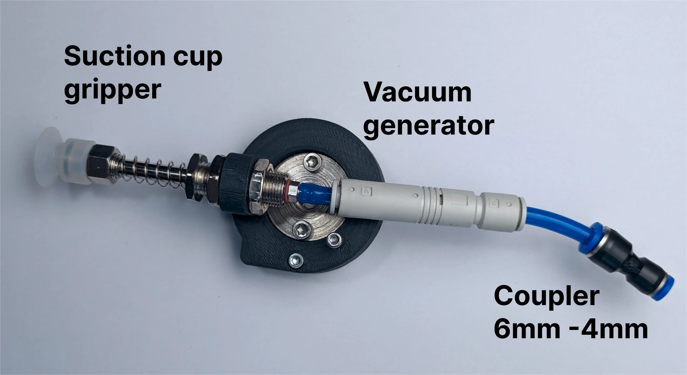
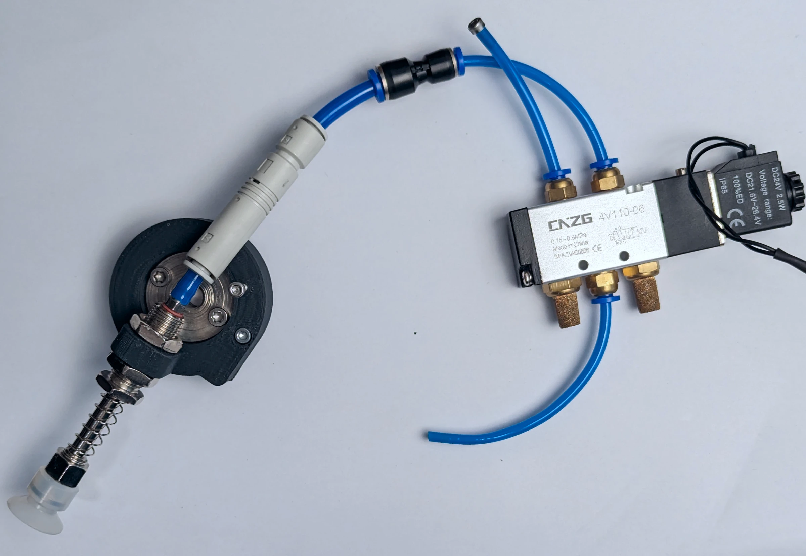

# Vacuum gripper

A suction cup on a vacuum generator, fed by the same valve and tubes as the pneumatic gripper.

## Parts

The BOM's vacuum section:

- a suction cup gripper;
- a vacuum generator (ejector);
- a 4 mm to 6 mm coupler.

The holder is `GRIPPER_ATTACHMENTS/vacuum_gripper_holder.STL`.

## Mounting

1. Print the holder.
2. Bolt the gripper to it.
3. The gripper spins freely in the holder by default. To fix its orientation, tie it with a zip tie to the screw
   shown in the figure.

{ width="700" }

## Air

A vacuum generator needs one supply line, so one of the valve's two ports is blocked. A short piece of tube with an
M3 screw and threadlocker screwed into it does the job.

{ width="700" }

## Driving it

The valve switches the air to the ejector, which pulls the vacuum. With the tubing above:

| | Holds the part | Drops it |
|---|---|---|
| RBTscript | `Output(1,HIGH)` | `Output(1,LOW)` |
| Python API, after `select_tool("VACUUM")` | `tool.open()`, which switches output 1 high | `tool.close()`, which switches it low |
| Python API, as a plain output | `write_io(0, 1)` | `write_io(0, 0)` |

!!! warning
    The part drops the moment the air stops, with the E-stop, a valve fault or a power failure. Do not carry
    anything over something it can damage.
