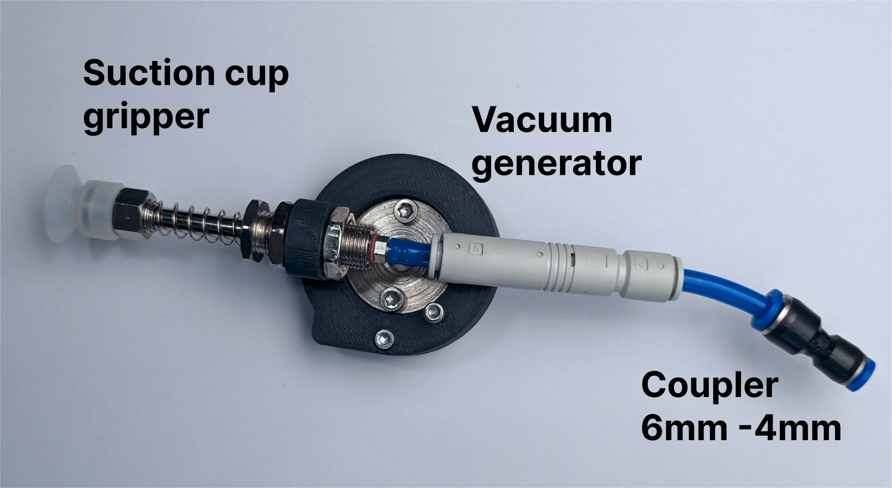
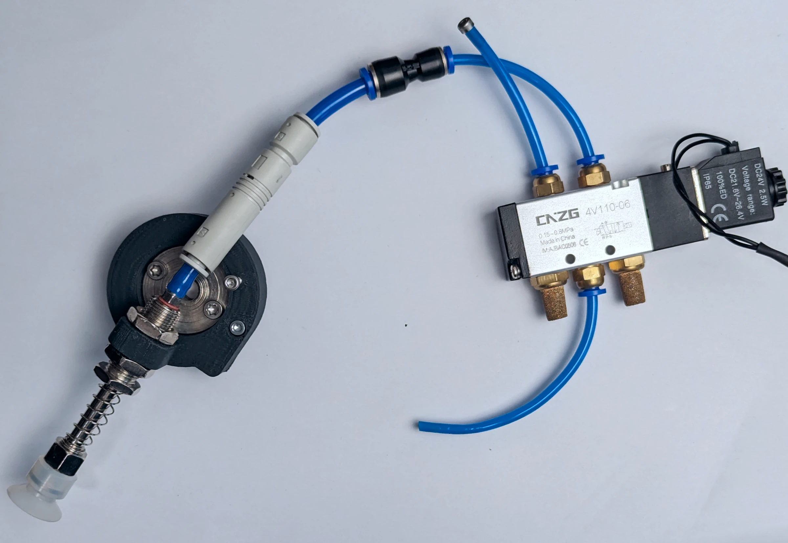

# Vacuum gripper

A suction cup on a vacuum generator, fed by the same valve and tubes as the pneumatic gripper.

## Parts

The BOM's vacuum section: a suction cup gripper, a vacuum generator (ejector) and a 4 mm to 6 mm coupler. The
holder is `GRIPPER_ATTACHMENTS/vacuum_gripper_holder.STL`.

## Mounting

Print the holder and bolt the gripper to it. The gripper spins freely in the holder by default; to fix its
orientation, tie it with a zip tie to the screw shown in the figure.

{ width="700" }

## Air

A vacuum generator needs one supply line, so one of the valve's two ports is blocked: a short piece of tube with
an M3 screw and threadlocker screwed into it does the job.

{ width="700" }

## Driving it

The valve switches the air to the ejector, which pulls the vacuum: `Output(1,HIGH)` holds, `Output(1,LOW)`
drops. In the Python API, `select_tool("VACUUM")` gives `tool.close()` and `tool.open()` on the output.

!!! warning
    The part drops the moment the air stops, with the E-stop, a valve fault or a power failure. Do not carry
    anything over something it can damage.
