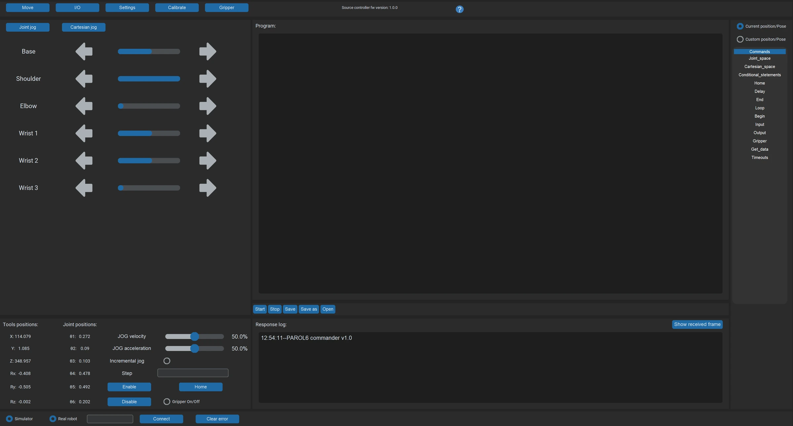

# The commander software

The PAROL6 commander software is the desktop program for using the robot by hand, and the program to start with.

{ width="800" }

| It has | |
|---|---|
| Jogging | Joint and Cartesian |
| A 3D simulator | It mirrors the robot |
| A response log | What the robot and the program are doing |
| A program editor and interpreter | For RBTscript |
| Tabs | The I/O tab and the gripper tab |

It is written in Python with customtkinter and the Robotics Toolbox, and runs a 100 Hz loop to the control board.

## In this guide

| Page | What it covers |
|---|---|
| [Installation](installation.md) | Installing it, the first run, checking the loop |
| [The GUI](the-gui.md) | The windows, the menus, connecting, jogging, the tabs |

Its program language, RBTscript, is in the Programming Guide: [RBTscript](../../programming/03-commander/rbtscript.md),
[Examples](../../programming/03-commander/examples.md).

## What it is and is not

| Use it for | It has no |
|---|---|
| The first day | Blending |
| Teaching poses | Collision checking |
| Demos | Network interface |
| Simple sequences | Tool selection: its kinematic model is the one with the pneumatic gripper |

For programs that need those, the [Python API](../../programming/02-python-api/index.md). The two cannot be
connected to the robot at the same time.

!!! warning "The experimental kinematics branch"
    The repository's `experimental_kinematics` branch resolves most Cartesian jogging errors but can command
    dangerous motion. The `main` branch is the safe one; use the other at your own risk.
