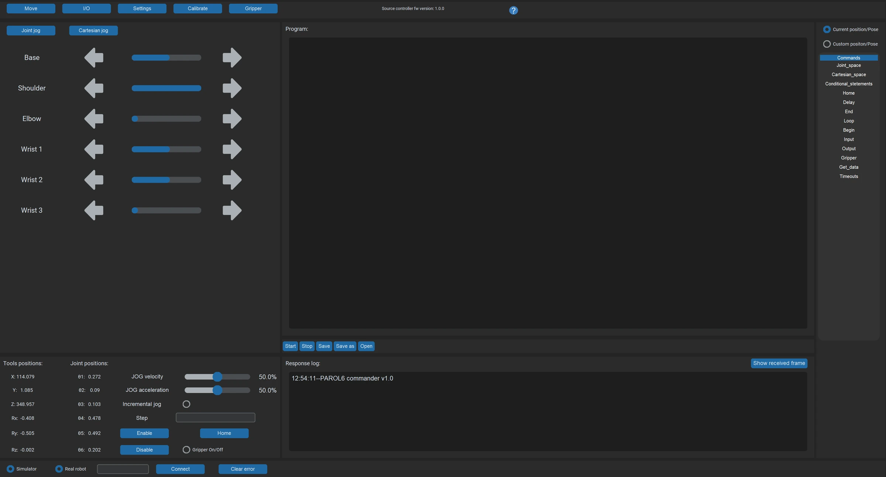
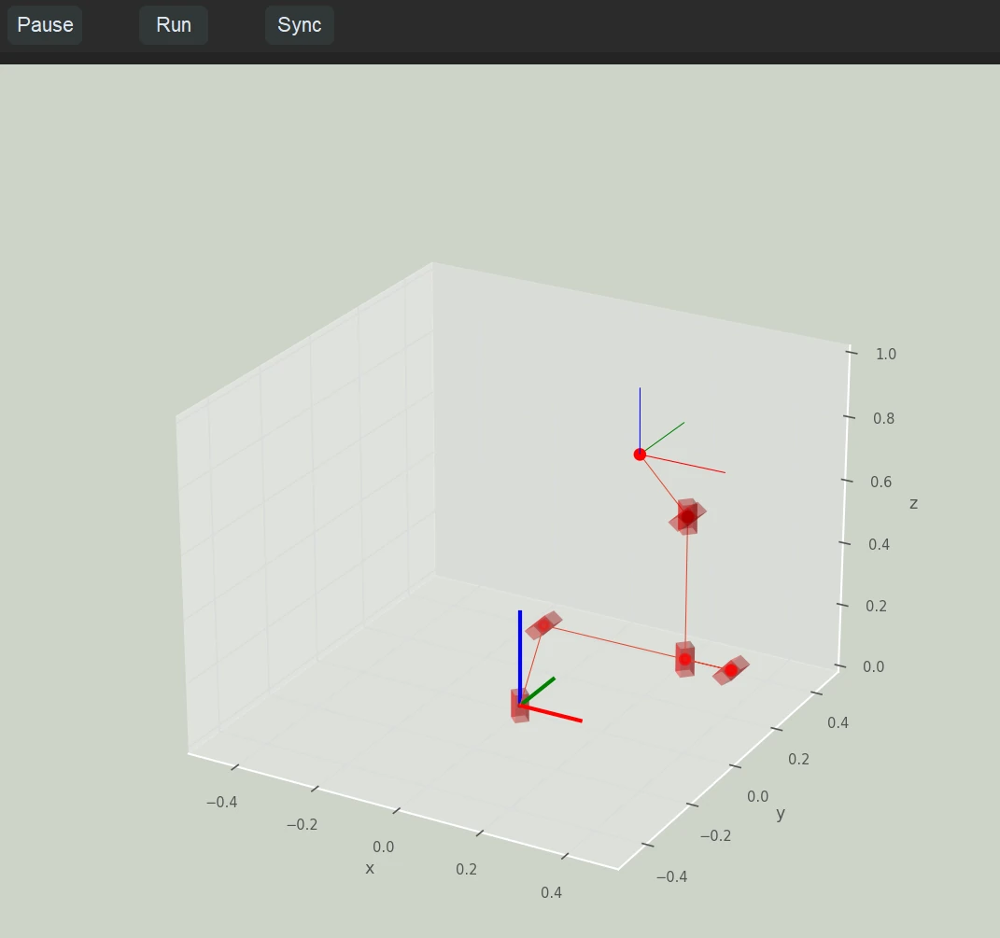
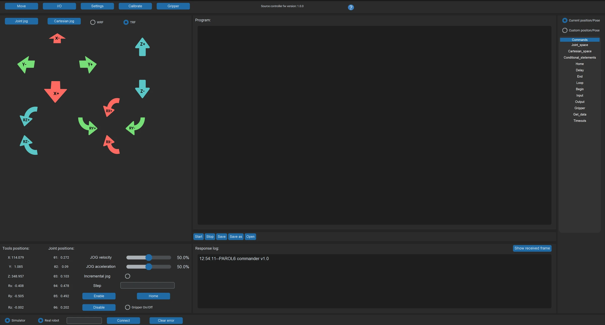

# The GUI

Two windows: the **commander**, where everything is done, and the **simulator**, a 3D view of the robot that
follows it once the robot is connected and homed.

{ width="800" }

{ width="400" }

## Connecting

{ width="800" }

At the bottom: the serial port field and **Connect**. `COMx` on Windows, `ttyACMx` on Linux. The response log
starts showing the robot's data when the connection is up; press Connect again if it does not. The **Simulator**
and **Real robot** buttons have no function at present. **Clear error** resets the homing state; unlike
**Enable** it does not re-enable a disabled robot.

## The Move menu

The left part of the window is the jog menu, with two variants:

**Joint jog**: six pairs of arrows, left for the positive direction and right for the negative. The speed slider
below sets the jog speed as a percentage; it affects jogging only, not programs. Works before homing.

**Cartesian jog**: X, Y, Z and the rotations, in the **WRF** (the base) or the **TRF** (the tool), chosen with the
switch; **TRF** is the default. The rotation buttons only work in the TRF: in the WRF they do nothing. Home the
robot first (the software does not check), and the jog stops at a singularity ([Configurations and singularities](../../theory/configurations-and-singularities.md)).

{ width="800" }

## The robot position

{ width="800" }

The six joint angles and the tool pose in the WRF, live. **Home** starts the homing sequence; **Enable** clears
errors and enables the robot; **Disable** disables it, the motors still holding. **Park** does not move the
robot: it inserts a three-line program at the cursor of the program window, `Begin()`, a `MoveJoint` to the park
pose with `t=4`, and `End()`, which you then run with **Start**.

## The program window

{ width="800" }

An RBTscript program, one command per line ([RBTscript](../../programming/03-commander/rbtscript.md)). **Start** runs it from `Begin()`,
**Stop** halts it. **Start** first saves the editor's text: into the file you opened, if any, overwriting it,
and into `Programs/execute_script.txt`.

{ width="350" }

The command list inserts a command at the cursor: with *Current* selected, a motion command is inserted with the
robot's current joint angles or pose as its arguments, which is how you teach a pose; with *Custom* the
arguments are left for you.

{ width="250" }

## The response log

{ width="800" }

What the robot and the program are doing, and why a command was refused: the first place to look when something
does not happen ([Errors and recovery](../../05-operation/errors-and-recovery.md)).

## The IO tab

{ width="650" }

The state of the two inputs, and buttons for the two outputs.

## The Gripper tab

{ width="650" }

For the SSG-48 and MSG grippers: **Calibrate gripper** after homing, **Clear gripper error**, then the position,
speed and current sliders and **Move GoTo**. The feedback section shows the gripper's position, current and
status.

## The Settings tab

{ width="650" }

Dark or light mode, and the scaling of the GUI for your display.

## The terminal

The terminal the program was started from prints a block of data every few seconds: the positions and speeds
from the robot, the homed, I/O and error bytes, the timing, the gripper data, the commanded data and the GUI's
state. `Time between 2 commands in ms` is the one to watch: near 0.010 is right.
