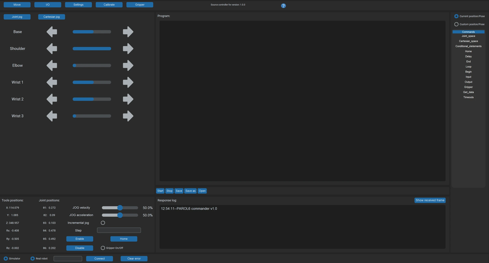
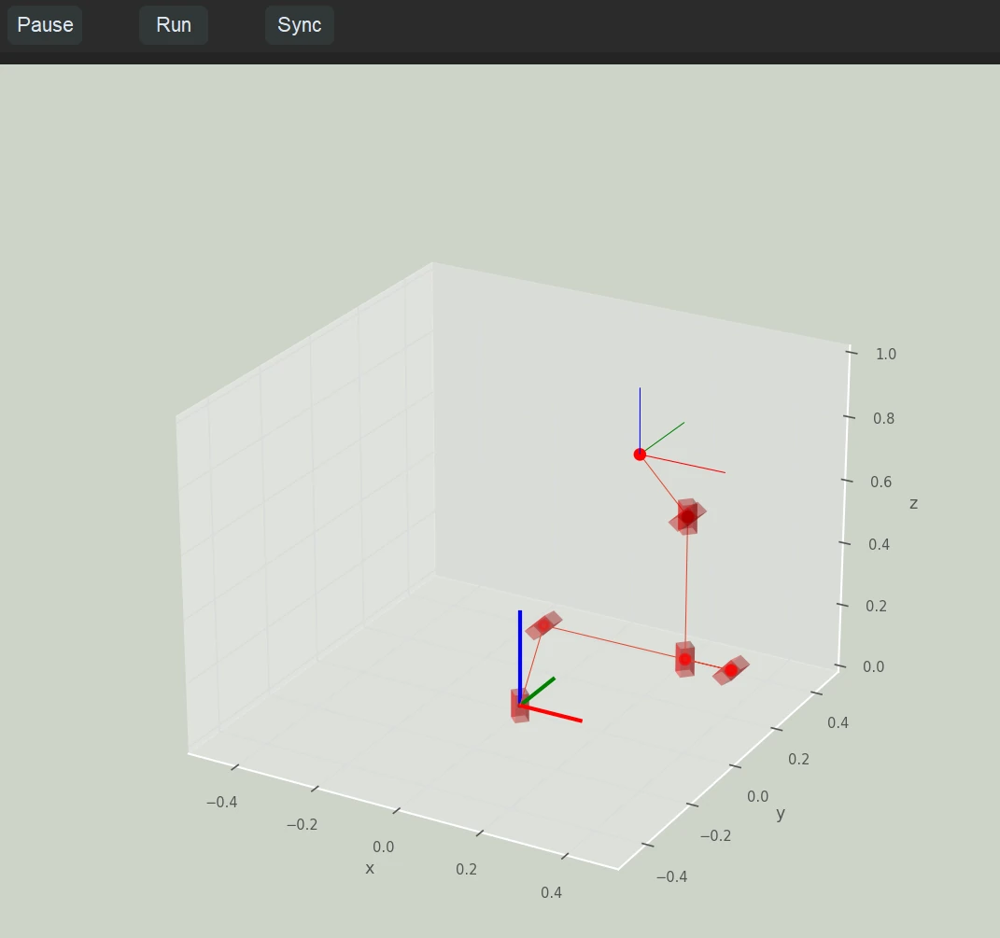
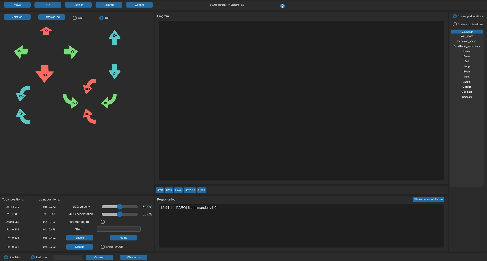

# The GUI

Two windows:

| Window | What it does |
|---|---|
| The **commander** | Everything is done here |
| The **simulator** | A 3D view of the robot that follows it once the robot is connected and homed |

{ width="800" }

{ width="400" }

## Connecting

{ width="800" }

At the bottom: the serial port field and **Connect**. `COMx` on Windows, `ttyACMx` on Linux. The response log
starts showing the robot's data when the connection is up; press Connect again if it does not.

| Button | What it does |
|---|---|
| **Connect** | Connects to the port in the field |
| **Simulator**, **Real robot** | Nothing at present |
| **Clear error** | Resets the homing state. Unlike **Enable**, it does not re-enable a disabled robot. |

## The Move menu

The left part of the window is the jog menu, with two variants:

| | Joint jog | Cartesian jog |
|---|---|---|
| Buttons | Six pairs of arrows: left for the positive direction, right for the negative | X, Y, Z and the rotations |
| Frame | | The **WRF** (the base) or the **TRF** (the tool), chosen with the switch; **TRF** is the default |
| Before homing | Works | Home the robot first: the software does not check |

- The speed slider below the arrows sets the jog speed as a percentage. It affects jogging only, not programs.
- The rotation buttons only work in the TRF: in the WRF they do nothing.
- A Cartesian jog stops at a singularity ([Configurations and singularities](../../theory/configurations-and-singularities.md)).

{ width="800" }

## The robot position

{ width="800" }

The six joint angles and the tool pose in the WRF, live.

| Button | What it does |
|---|---|
| **Home** | Starts the homing sequence |
| **Enable** | Clears errors and enables the robot |
| **Disable** | Disables it, the motors still holding |
| **Park** | Does not move the robot: it inserts a three-line program at the cursor of the program window, `Begin()`, a `MoveJoint` to the park pose with `t=4`, and `End()`, which you then run with **Start** |

## The program window

{ width="800" }

An RBTscript program, one command per line ([RBTscript](../../programming/03-commander/rbtscript.md)).

| Button | What it does |
|---|---|
| **Start** | Runs it from `Begin()`. It first saves the editor's text: into the file you opened, if any, overwriting it, and into `Programs/execute_script.txt`. |
| **Stop** | Halts it |

{ width="350" }

The command list inserts a command at the cursor:

| Selected | A motion command is inserted with |
|---|---|
| *Current* | The robot's current joint angles or pose as its arguments: this is how you teach a pose |
| *Custom* | Its arguments left for you |

{ width="180" }

## The response log

{ width="800" }

What the robot and the program are doing, and why a command was refused. It is the first place to look when
something does not happen ([Errors and recovery](../../05-operation/errors-and-recovery.md)).

## The IO tab

{ width="650" }

The state of the two inputs, and buttons for the two outputs.

## The Gripper tab

{ width="650" }

For the SSG-48 and MSG grippers. After homing:

1. Press **Clear gripper error**.
2. Press **Calibrate gripper**.
3. Wait until the tab shows `Calibration status is: 1`: about 3 s for the SSG-48, 5 to 6 s for the MSG on its
   longer rails.
4. Set the position, speed and current with the sliders.
5. Press **Move GoTo**.

| Part of the tab | Shows or does |
|---|---|
| The feedback section | The gripper's position and current, its calibrated and E-stop error bits, and its whole status byte as a number (labelled *Gripper object detection is*) |
| **Change gripper ID** | Sets the CAN ID the board addresses, 0 as the grippers ship |

## The Calibrate and Plot buttons

The menu also has **Calibrate** and **Plot**. Both open the same panel, with **Disable motor**, **Enable motor**,
**Go to limit** and a joint menu. None of them does anything in the current version.

## The Settings tab

{ width="650" }

Dark or light mode, and the scaling of the GUI for your display.

## The terminal

The terminal the program was started from prints a block of data every few seconds: the positions and speeds from
the robot, the homed, I/O and error bytes, the timing, the gripper data, the commanded data and the GUI's state.

`Time between 2 commands in ms` is the one to watch: near 0.010 is right. The value is in seconds, whatever the
label says: 0.010 is the 10 ms cycle.
