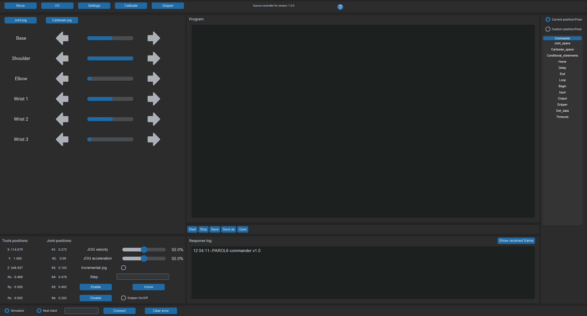

---
hide:
  - toc
---

# PAROL6 GUI Guide

{ .hero }

<!-- doc-meta: gui -->

The graphical programs for PAROL6 and its grippers: which one to open for which job, how to install it, and
what is on its screen. Programming the robot, in RBTscript or Python, is in the
[Programming Guide](../programming/index.md).

| | Commander software | Waldo Commander | Motor GUI |
|---|---|---|---|
| What it is | Source Robotics' desktop program: jogging, a 3D simulator, the RBTscript editor, the I/O and gripper tabs | A community browser interface on the Python API: a simulator, Python programs, teaching by demonstration, an MCP server for LLMs | Source Robotics' browser tool for the drivers inside the electric grippers |
| For | the first day, teaching poses, demos, simple sequences | remote use, programs in the browser, AI-driven control | setting up, testing and updating an SSG-48 or MSG gripper |
| Runs | on the PC at the robot, Python 3.10 or 3.11 | a server at the robot, any browser | any Chromium browser, with the CANvas adapter |
| Talks to | the control board over USB | the Python API's controller | the gripper's driver over CAN |

## In this guide

- The commander software: [Installation](commander/installation.md), [The GUI](commander/the-gui.md)
- [Waldo Commander](waldo-commander.md)
- [Motor GUI](motor-gui.md)

One program owns the control board at a time: the commander and the Python API's controller cannot be connected
together ([Control ownership](../programming/02-concepts/control-ownership.md)).
