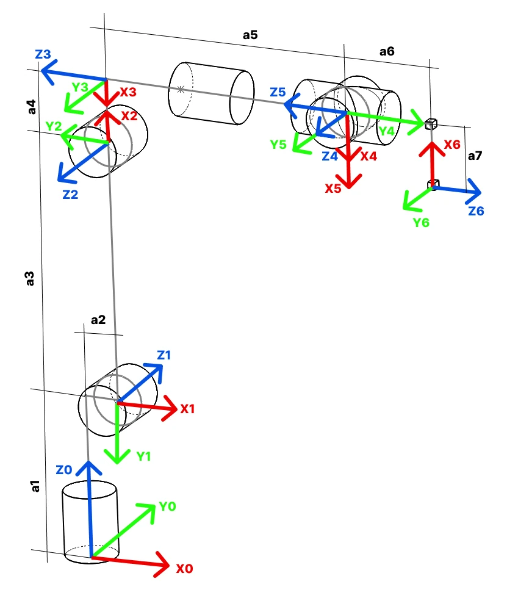

# Forward and inverse kinematics

Kinematics is the geometry of the arm: how the joint angles decide where the tool is, and the other way round.

## The kinematic diagram and the DH table

A kinematic diagram shows the links and joints without the shapes: six revolute joints, their axes, and the
distances between them. The Denavit-Hartenberg convention writes that down as four numbers per joint, a link
length, a link offset, a joint angle and a link twist, and PAROL6's table is in the Robot Manual
([Dimensions and kinematics](../../03-technical-data/kinematics.md)). The commander software's robot model is
built from this table; the Python API loads the robot's URDF, which carries the same geometry, and computes the
kinematics numerically with Pinocchio.

{ width="500" }

## Forward kinematics

From six joint angles to the pose of the tool. It is a chain of transformations, one per joint, multiplied
together, and it always has exactly one answer: the software runs it every cycle to show you where the tool is.
`rbt.pose()` is forward kinematics of the current angles plus the tool's transform.

## Inverse kinematics

From a pose of the tool to the joint angles that reach it. It is the hard direction. The spherical wrist helps:
the first three joints decide where the wrist centre is, and the last three decide the orientation from there,
so the problem splits in two. Even so:

- A pose can have **several solutions**: elbow up or down, wrist flipped or not, the base turned the other way.
  The software picks the one nearest the current configuration.
- A pose can have **no solution**: out of reach, or an orientation the wrist cannot make from that position.
  The move is refused (`IK_TARGET_UNREACHABLE` in the API, an inverse kinematics error in the commander).
- Near a **singularity** the solution exists but demands enormous joint speeds; the next page.

The Python API solves the inverse kinematics numerically, which is general but can fail on poses a closed-form
solver would find, especially around joint 4; re-planning from a slightly different pose or starting posture
usually helps. `MovePose` in RBTscript and `move_j(pose=...)` in the API solve the kinematics once, at the target,
and move in joint space; `MoveCart` and `move_l` solve it all along a straight line, which is where the next
page matters.
