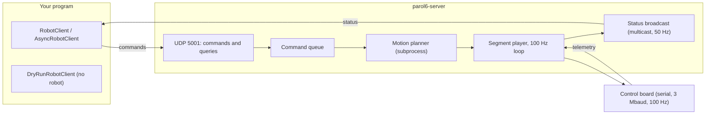

# 3. The Python API

The Python API, package `parol6`, is two things: a **controller** process that owns the robot, talks to the
control board over serial at 100 Hz, plans the motion and checks collisions; and a **client library** that sends
it commands over UDP, from the same PC or any other on the network, with a blocking interface for scripts and an
asynchronous one for applications. A **dry-run client** runs the same planning without a robot, for tests.

This chapter walks through it in the order you use it. The reference lists every method:
[Python API reference](../../reference/python/index.md), read from the API's source at the version this site
describes.

## In this chapter

- [Installation](installation.md)
- [The controller](controller.md): starting it, the serial port, simulator mode, the environment variables
- [Clients](clients.md): the sync client, the async client, the dry-run client, the `Robot` lifecycle helper
- [Motion](motion.md): joint, linear, circular, spline and process moves, speed and duration, blending, profiles
- [Jogging and servoing](streaming.md): streamed velocity and position targets
- [Tools and the TCP](tools-and-tcp.md): selecting a tool, gripper actions, the TCP transform
- [I/O, delays and checkpoints](io-and-delays.md)
- [Status and waiting](status-and-waiting.md): queries, the status stream, waiting for commands
- [Errors](errors.md)
- [Examples](examples.md)

## In three lines

```python
from parol6 import RobotClient
with RobotClient() as rbt:            # the controller runs already: parol6-server --serial COM5
    rbt.home(wait=True); rbt.move_j([90, -90, 180, 0, 0, 180], speed=0.5)
```

## Architecture



The controller is the only process that touches the serial port. The planner runs in a subprocess so that a
long plan never delays the 100 Hz loop; the loop plays the planned segments and streams the jog and servo
targets. Status goes out as multicast, so any number of listeners see the robot's state without asking.
