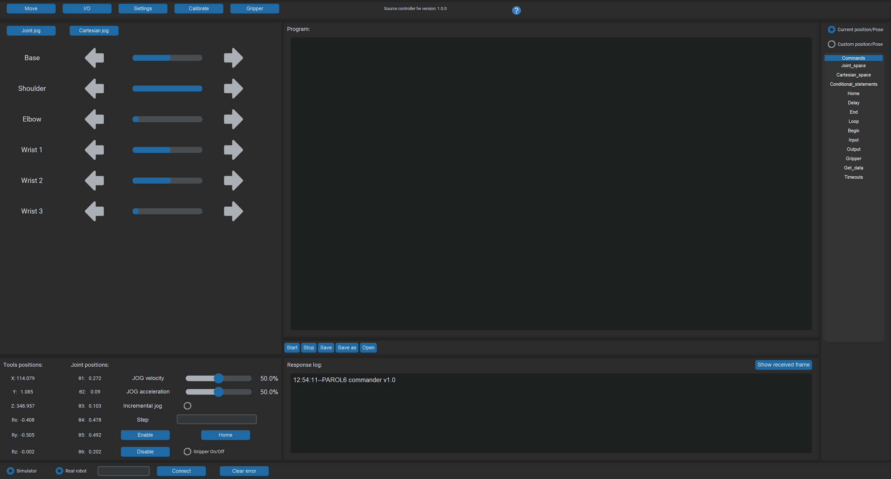

# 4. The commander software

The PAROL6 commander software is the desktop program for using the robot by hand: a GUI with joint and
Cartesian jogging, a 3D simulator that mirrors the robot, a response log, a program editor and interpreter for
RBTscript, the I/O tab and the gripper tab. It is written in Python with customtkinter and the Robotics Toolbox,
runs a 100 Hz loop to the control board, and is the program to start with.

{ width="800" }

## In this chapter

- [Installation](installation.md)
- [The GUI](the-gui.md): the windows, the menus, connecting, jogging, the tabs
- [RBTscript](rbtscript.md): the language, its units, every command
- [Examples](examples.md)

## What it is and is not

It is the tool for the first day, for teaching poses, for demos and for simple sequences. It has no blending, no
collision checking, no network interface and no tool selection: its kinematic model is the one with the pneumatic
gripper. For programs that need those, the [Python API](../03-python-api/index.md). The two cannot be connected
to the robot at the same time.

!!! warning "The experimental kinematics branch"
    The repository's `experimental_kinematics` branch resolves most Cartesian jogging errors but can command
    dangerous motion. The `main` branch is the safe one; use the other at your own risk.
