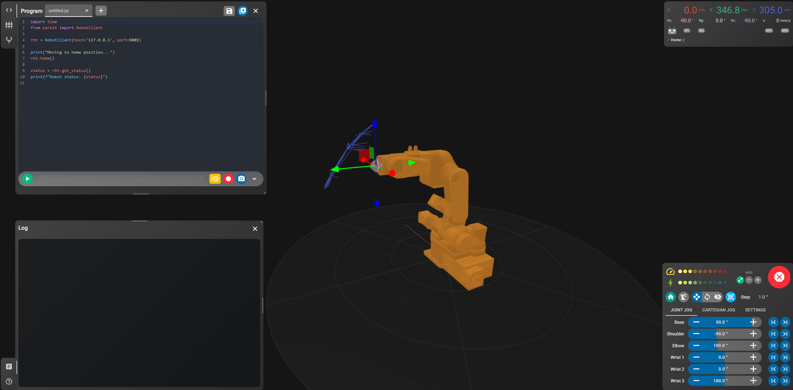

# 6. Other interfaces

## Waldo Commander (web)

[Waldo Commander](https://github.com/Jepson2k/PAROL-Web-Commander), by a member of the community, is a browser
interface on top of the Python API: control from any device on the network, Python programs with an editor and
step-through debugging, a 3D simulation to preview paths, teaching by demonstration recorded as Python, and a
built-in MCP server through which an LLM can read the robot's status, write and run programs and drive the arm
with your approval. It runs in simulator mode without a robot.

```
git clone https://github.com/Jepson2k/Waldo-Commander.git
cd Waldo-Commander
pip install -e ".[parol6]"
waldo-commander
```

{ width="800" }

It is built on [waldoctl](https://github.com/Jepson2k/waldoctl), the abstraction layer the Python API implements,
so what it offers tracks the API's features. Its documentation is at [jepson2k.github.io/Waldo-Commander](https://jepson2k.github.io/Waldo-Commander/).

## The serial protocol directly

Anything that frames the packets of [the serial protocol](../board/10-serial-protocol.md) and keeps the 100 Hz
cadence can drive the control board from any language. The Python API's serial transport and the commander's
`Serial_sender_good_latest.py` are the two reference implementations.

## The legacy Python API

[PAROL6-python-API-Alvar](https://github.com/PCrnjak/PAROL6-python-API-Alvar) was the first Python API: a
headless commander (`headless_commander.py`) on the PC at the robot, listening for text commands over UDP on
port 5001, and a thin client (`robot_api.py`) with functions like `move_robot_joints`, `move_robot_pose`,
`control_electric_gripper`. It is frozen and kept for the projects built on it, including the Gemini vision
demo. New work belongs on the current API.

## AI agents

The current API's typed client, its dry-run preview and the MCP server in Waldo Commander are the paths for
LLM-driven control: an agent writes Python against the client, previews it dry, and runs it with a human at the
E-stop. The community list has examples ([Community projects](../appendix/community.md)).
