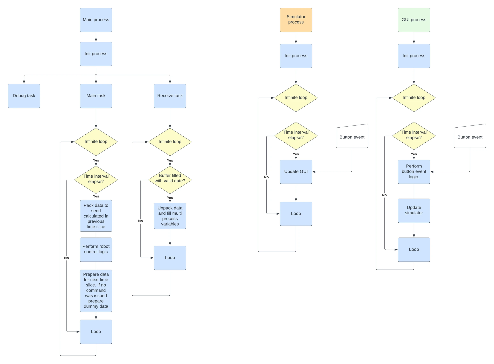

---
hide:
  - toc
---

# PAROL6 Programming Guide

{ .hero }

<!-- doc-meta: programming -->

This guide is for everyone who makes PAROL6 do something: from a first RBTscript program in the commander
software to a Python application on the API, a ROS 2 pipeline, or a program that an AI agent writes. It starts
with the interfaces and how to choose, explains the concepts the software is built on, the units, the frames,
the kinematics, the motion profiles, the queue, in the order you meet them, then walks through the Python API
and the commander software, and ends with ROS 2 and the other interfaces. The [API reference](../reference/index.md)
is where every method and command is listed, read from the API's source at the version named above.

-   :material-compass:{ .lg .middle } **Start here**

    ---

    [The interfaces at a glance](01-interfaces.md): which program for which job, and what they have in common.

-   :material-school:{ .lg .middle } **Concepts**

    ---

    [Units](02-concepts/units.md), [joints and poses](02-concepts/joints-and-poses.md),
    [frames](02-concepts/reference-frames.md), [kinematics](02-concepts/kinematics.md),
    [singularities](02-concepts/configurations-and-singularities.md), [motion profiles](02-concepts/motion-profiles.md),
    [blending](02-concepts/blending.md), [control ownership](02-concepts/control-ownership.md), and more.

-   :material-language-python:{ .lg .middle } **The Python API**

    ---

    [Installation](03-python-api/installation.md), [the controller](03-python-api/controller.md),
    [clients](03-python-api/clients.md), [motion](03-python-api/motion.md), [jogging and servoing](03-python-api/streaming.md),
    [tools](03-python-api/tools-and-tcp.md), [status](03-python-api/status-and-waiting.md), [errors](03-python-api/errors.md),
    [examples](03-python-api/examples.md).

-   :material-script-text:{ .lg .middle } **RBTscript**

    ---

    [RBTscript](04-commander/rbtscript.md), the commander software's program language, and [examples](04-commander/examples.md);
    the commander itself is in the [GUI Guide](../gui/index.md).

-   :material-robot:{ .lg .middle } **ROS 2 and others**

    ---

    [ROS 2 and MoveIt](05-ros2.md), [other interfaces](06-other-interfaces.md): the serial protocol directly, the
    legacy API, AI agents.

-   :material-book-search:{ .lg .middle } **API reference**

    ---

    [Every Python method](../reference/python/index.md), [RBTscript](../reference/rbtscript.md),
    [the serial protocol](../reference/serial-protocol.md), [firmware parameters](../reference/firmware-parameters.md).

