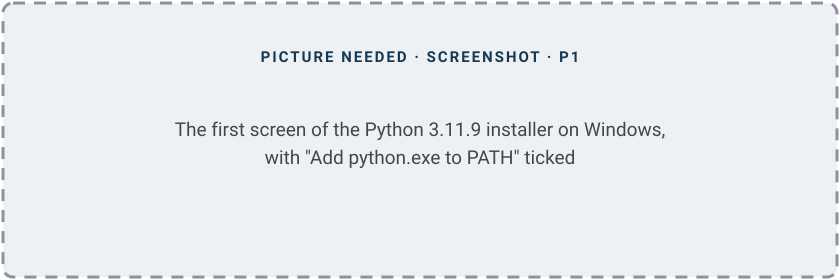

# 1. Install the software

The robot software is written in Python, and Git downloads it. You type the commands on this page into a
**terminal**: the window where you type one line, press Enter, and wait until it finishes.

Pick your operating system in the first tab. The other tabs on these pages follow it.

## 1. Install Python and Git

=== "Windows"

    1. Download **Python 3.11.9** from [python.org](https://www.python.org/downloads/release/python-3119/): the
       "Windows installer (64-bit)". It is the last 3.11 release with an installer.
    2. Run it. On its first screen, tick **Add python.exe to PATH**.

        { width="560" }

    3. Press **Install Now**.
    4. Download **Git** from [git-scm.com](https://git-scm.com/downloads/win). Install it with the settings it
       proposes.
    5. Open a terminal: press the Windows key, type `cmd` and press Enter. A black window opens.
    6. Type each line and press Enter:

        ```
        python --version
        git --version
        ```

    ??? info "If Windows cannot find your Documents folder later"
        The commands on these pages start with `cd %USERPROFILE%\Documents`, which takes the terminal to your
        Documents folder. If Windows answers that it cannot find the path, your Documents folder is kept in
        OneDrive: type `cd %USERPROFILE%\OneDrive\Documents` instead.

        To open a terminal in any folder, open the folder in File Explorer, click the address bar, type `cmd` and
        press Enter.

=== "Linux"

    1. Open a terminal: Ctrl+Alt+T on Ubuntu, or Terminal in the applications menu.
    2. Install Git. It asks for your password:

        ```
        sudo apt install git
        ```

    3. Install Python 3.11 next to Ubuntu's own Python, with its virtual environments and its window toolkit:

        ```
        sudo add-apt-repository ppa:deadsnakes/ppa
        sudo apt install python3.11 python3.11-venv python3.11-tk
        ```

    4. Type each line and press Enter:

        ```
        python3.11 --version
        git --version
        ```

    ??? info "Why Python 3.11"
        The commander runs on Python 3.10 or 3.11 only, the Python API on 3.11 or newer. Ubuntu's own Python is
        3.10 on Ubuntu 22.04 and 3.12 on Ubuntu 24.04, so 3.11 is installed next to it.

        Each program below gets its own virtual environment made with Python 3.11. Inside it, `python` is that
        Python 3.11.

=== "macOS"

    1. Download **Python 3.11.9** from [python.org](https://www.python.org/downloads/release/python-3119/): the
       "macOS 64-bit universal2 installer". Run it.
    2. Open a terminal: press Cmd+Space, type `Terminal` and press Enter.
    3. Install Git with the Xcode command line tools. Confirm the window that opens:

        ```
        xcode-select --install
        ```

    4. Type each line and press Enter:

        ```
        python3.11 --version
        git --version
        ```

    Each program below gets its own virtual environment made with Python 3.11. Inside it, `python` is that
    Python 3.11.

!!! success "Check"
    The terminal answers `Python 3.11` and a number, and `git version` and a number. If it says a command is not
    found, install that program again (on Windows, tick **Add python.exe to PATH**), then open a new terminal.

## 2. Install the robot software

Choose one, or install both.

| Program | What it is |
|---|---|
| **Commander software** | A window with buttons, a program editor and a 3D simulator |
| **Python API** | Drives the robot from Python programs you write |

To install both, do this step once in each tab.

=== "Commander software"

    === "Windows"

        1. Download the [commander software](https://github.com/Source-Robotics/PAROL-commander-software) into
           your Documents folder:

            ```
            cd %USERPROFILE%\Documents
            git clone https://github.com/Source-Robotics/PAROL-commander-software.git
            ```

        2. Make its virtual environment and switch it on:

            ```
            cd PAROL-commander-software
            python -m venv .venv
            .venv\Scripts\activate
            ```

            The prompt now starts with `(.venv)`.

        3. Install what it needs. This takes a few minutes:

            ```
            python -m pip install -r requirements.txt
            ```

    === "Linux"

        1. Download the [commander software](https://github.com/Source-Robotics/PAROL-commander-software) into
           your Documents folder:

            ```
            cd ~/Documents
            git clone https://github.com/Source-Robotics/PAROL-commander-software.git
            ```

        2. Make its virtual environment and switch it on:

            ```
            cd PAROL-commander-software
            python3.11 -m venv .venv
            source .venv/bin/activate
            ```

            The prompt now starts with `(.venv)`.

        3. Install what it needs. This takes a few minutes:

            ```
            python -m pip install -r requirements.txt
            ```

    === "macOS"

        1. Download the [commander software](https://github.com/Source-Robotics/PAROL-commander-software) into
           your Documents folder:

            ```
            cd ~/Documents
            git clone https://github.com/Source-Robotics/PAROL-commander-software.git
            ```

        2. Make its virtual environment and switch it on:

            ```
            cd PAROL-commander-software
            python3.11 -m venv .venv
            source .venv/bin/activate
            ```

            The prompt now starts with `(.venv)`.

        3. Install what it needs. This takes a few minutes:

            ```
            python -m pip install -r requirements.txt
            ```

=== "Python API"

    === "Windows"

        1. Download the [Python API](https://github.com/PCrnjak/PAROL6-python-API) into your Documents folder
           and switch to version <!-- version: software.python_api -->:

            ```
            cd %USERPROFILE%\Documents
            git clone https://github.com/PCrnjak/PAROL6-python-API.git
            cd PAROL6-python-API
            git checkout v<!-- version: software.python_api -->
            ```

            Git reports a "detached HEAD" after the checkout. That is expected.

        2. Make its virtual environment and switch it on:

            ```
            python -m venv .venv
            .venv\Scripts\activate
            ```

            The prompt now starts with `(.venv)`.

        3. Install it. This takes a few minutes:

            ```
            python -m pip install .
            ```

    === "Linux"

        1. Download the [Python API](https://github.com/PCrnjak/PAROL6-python-API) into your Documents folder
           and switch to version <!-- version: software.python_api -->:

            ```
            cd ~/Documents
            git clone https://github.com/PCrnjak/PAROL6-python-API.git
            cd PAROL6-python-API
            git checkout v<!-- version: software.python_api -->
            ```

            Git reports a "detached HEAD" after the checkout. That is expected.

        2. Make its virtual environment and switch it on:

            ```
            python3.11 -m venv .venv
            source .venv/bin/activate
            ```

            The prompt now starts with `(.venv)`.

        3. Install it. This takes a few minutes:

            ```
            python -m pip install .
            ```

    === "macOS"

        1. Download the [Python API](https://github.com/PCrnjak/PAROL6-python-API) into your Documents folder
           and switch to version <!-- version: software.python_api -->:

            ```
            cd ~/Documents
            git clone https://github.com/PCrnjak/PAROL6-python-API.git
            cd PAROL6-python-API
            git checkout v<!-- version: software.python_api -->
            ```

            Git reports a "detached HEAD" after the checkout. That is expected.

        2. Make its virtual environment and switch it on:

            ```
            python3.11 -m venv .venv
            source .venv/bin/activate
            ```

            The prompt now starts with `(.venv)`.

        3. Install it. This takes a few minutes:

            ```
            python -m pip install .
            ```

??? info "Why each program has its own virtual environment"
    Each program goes into its own folder with its own **virtual environment** (`.venv`), a private copy of
    Python for that program. The two need different versions of the same packages, so they cannot share one.

!!! success "Check"
    The install ends without an `ERROR` line. If one appears, see [Commander installation](../gui/commander/installation.md)
    or [Python API installation](../programming/02-python-api/installation.md).

[Next: 2. Upload the firmware :material-arrow-right:](2-firmware.md){ .md-button .md-button--primary }
