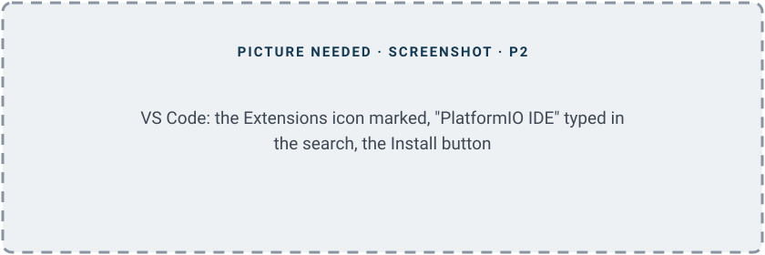
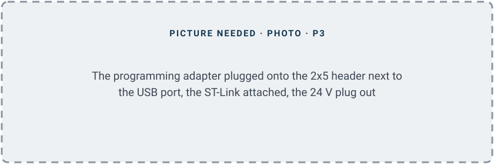
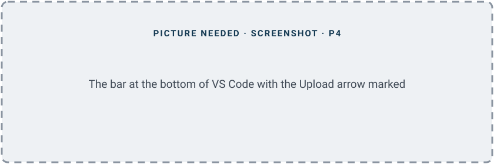
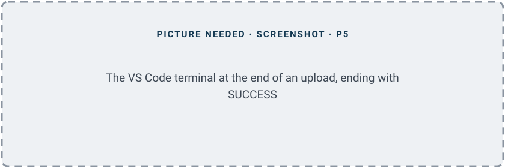

# 2. Upload the firmware

!!! warning "Do this before you switch on the assembled robot"
    A control board from the shop comes with the **test firmware**, which turns all six motors as soon as the board
    starts. Put the **main firmware** on it first. You do this once.

You need the ST-Link programmer and the programming adapter.

## 1. Get the firmware and the tools

1. Download the [robot repository](https://github.com/Source-Robotics/PAROL6-Desktop-robot-arm) into your
   Documents folder:

    === "Windows"

        ```
        cd %USERPROFILE%\Documents
        git clone https://github.com/Source-Robotics/PAROL6-Desktop-robot-arm.git
        ```

    === "Linux"

        ```
        cd ~/Documents
        git clone https://github.com/Source-Robotics/PAROL6-Desktop-robot-arm.git
        ```

    === "macOS"

        ```
        cd ~/Documents
        git clone https://github.com/Source-Robotics/PAROL6-Desktop-robot-arm.git
        ```

2. Install [VS Code](https://code.visualstudio.com/) and open it.
3. Click the **Extensions** icon on the left. Search for **PlatformIO IDE** and install it.

    { width="560" }

4. Restart VS Code when it asks.

!!! info "Windows only: install the ST-Link driver"
    1. In File Explorer, open `PAROL6-Desktop-robot-arm` in your Documents folder.
    2. Right-click `en.stsw-link009.zip` and choose **Extract All**.
    3. Run `dpinst_amd64.exe` from the extracted folder.

## 2. Connect the programmer

1. **Unplug the 24 V supply** from the robot.
2. Plug the programming adapter onto the 2×5 header next to the USB port.

    { width="560" }

3. Plug the ST-Link into the PC.

The adapter powers the board's microcontroller, not the motors.

## 3. Upload

1. In VS Code, choose **File**, then **Open Folder**.
2. Choose `PAROL6 control board main software` inside `PAROL6-Desktop-robot-arm`.
3. Wait until the bar at the bottom is quiet. The first time, PlatformIO downloads its tools for a few minutes.
4. Click the **→** arrow (Upload) in the bar at the bottom of VS Code.

    { width="560" }

5. When it has finished, unplug the programming adapter.

!!! success "Check"
    The terminal at the bottom of VS Code ends with `SUCCESS`. If not, see the [Firmware](../board/08-firmware.md)
    page and [Control board troubleshooting](../board/11-troubleshooting.md).

    { width="560" }

More: [Firmware](../board/08-firmware.md) · [Firmware and first run](../build/firmware-and-first-run.md).
