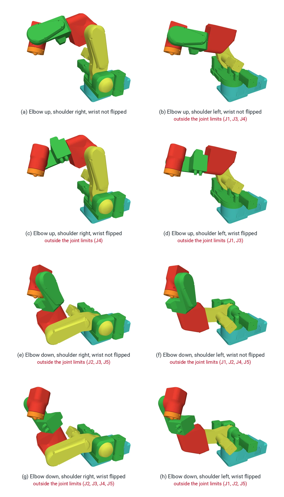

# Configurations and singularities

## Configurations

The same tool pose can be reached with the elbow up or down, the wrist flipped or not, the base facing the
target or turned 180° with the arm reaching backwards. Each combination is a **configuration**. A joint move
keeps the configuration it is in unless the target is in another; a Cartesian move cannot change configuration
at all, because that would mean passing through a pose where two configurations meet, which is a singularity.

Three choices with two answers each make eight configurations. The figure shows all eight for one tool pose:
PAROL6 with nothing on the flange, the tool centre point 250 mm in front of the base and 230 mm up, the tool
tilted 30° from vertical. The flange is in exactly the same place and orientation in every picture; only the
joints differ. The colours mark the links: base turquoise, joint 1 green, upper arm yellow, elbow red, forearm
green, wrist red, flange orange.

- **Shoulder right or left**: the wrist centre in front of the joint 1 axis, or behind it with joint 1 turned
  about 180° and the arm reaching back over itself.
- **Elbow up or down**: the elbow above or below the line from the shoulder to the wrist centre.
- **Wrist flipped or not**: joint 5 positive or negative; joints 4 and 6 turn by 180° to keep the tool where it
  is.

{ width="700" }

Mathematically all eight reach the pose. On the real robot, the joint limits rule most of them out: for this pose
only (a) is within every limit the software enforces ([Joint limits and directions](../03-technical-data/joint-limits.md)),
and a red caption names the joints that would have to go beyond theirs. Several of the others would also hit the
robot itself. The poses were solved and drawn from PAROL6's model in
[robot_descriptions](https://github.com/Source-Robotics/robot_descriptions) and checked against the limits on that
page.

The practical rule: teach the poses of a program in the configuration you want, and make the move between two
configurations a joint move (`MoveJoint`, `move_j`), never a Cartesian one.

## Singularities

When the arm moves in Cartesian space, the software converts a tool velocity into six joint velocities every
cycle. In most poses that works. In some poses two joint axes line up, and a motion of the tool in a certain
direction would need infinite joint speed, or the joints can turn without the tool moving: a **singularity**. The
maths divides by something that goes to zero. Near it, small tool motions ask for huge joint speeds; at it, the
move is impossible.

The three singularities of a six-axis arm with a spherical wrist:

| | When | Looks like |
|---|---|---|
| Wrist | Joint 5 at 0°, so joints 4 and 6 line up | The wrist straight; the standby pose is a wrist singularity |
| Shoulder | The wrist centre directly above the joint 1 axis | The arm reaching straight up |
| Elbow | The arm fully stretched | The elbow straight at full reach |

## What PAROL6 does

- **The commander software** stops a Cartesian move or jog when it reaches a singularity; the robot stays where
  it stopped. It does not deviate from the path to go around.
- **The Python API** refuses a Cartesian command whose path it cannot solve, before anything moves, and a jog
  that would enter a singular region stops.

Some industrial controllers can bend the path slightly to pass a singularity; PAROL6 keeps the path and stops
instead. The [demonstration video](https://www.youtube.com/watch?v=BJnZvwAE0PY) shows what singularities look
like on an industrial arm.

## Avoiding them

Singularities are a property of the geometry, so they are avoided by design, with trial and error:

- Keep the wrist bent: a few degrees of joint 5 away from 0° at the poses where you work.
- Place the parts so that the arm reaches them with a bent elbow, not at full stretch, and off the axis of
  joint 1.
- Mount the gripper at an angle, or on a plate that turns it, so that the working orientation needs a bent
  wrist.
- When a move keeps failing, make it a joint move, or add an intermediate pose.
- Run the program in the simulator: a stop or a refusal in the simulator is a singularity you can see.
