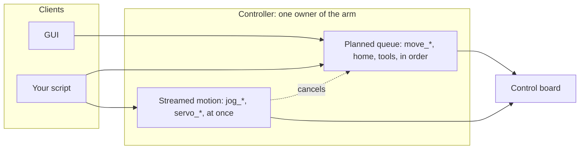

# Control ownership

Only one program can own the control board, and inside the Python API only one source can drive the arm at a
time. Knowing who is in charge saves confusion and collisions.

## One host on the serial port

The control board executes whatever packets arrive on its USB port. The commander software and the Python API's
controller each take the port exclusively; the second one to try gets an error or silence. Stop one before you
start the other.

## Inside the Python API

The **controller** owns the arm. **Clients** send it commands; it accepts commands from any number of clients on
the network, without authentication, so a GUI and a script can both be connected. What happens when they both
command motion:

- **Planned motion** (`move_*`, `home`, `delay`, tool actions, checkpoints) goes into one **queue**, in the order
  it arrives, and runs in that order. Every queued command gets an index; `wait_command(index)` waits for that
  one.
- **Streamed motion** (`jog_*`, `servo_*`) takes the arm at once: it cancels the planned queue (every discarded
  command fails with `MOTN_CANCELLED`) and drives the arm while targets keep coming; about a quarter of a second
  after the last target the arm brakes to rest and holds.
- **`stop()`** cancels the active move and clears the queue, from any client. **`estop()`** does the same and
  latches a protective stop until `reset()`.
- **`pause()`** holds the queue where it is; `resume()` continues it; `set_execution_speed()` scales it between
  10 and 100 %.
- **System commands** (`simulator`, `connect_hardware`, `select_tool`, `set_shapes`) change the controller's state
  for everyone.

The rule for a program that shares the controller: own the arm for the duration of a task by queuing it, wait for
your indices, and expect `MotionError` if someone else stopped you.

## The firmware

The firmware's enable and disable commands (101, 102) decide whether it accepts motion at all; the E-stop makes
the PC software send disable or latch a stop ([Emergency stop](../02-safety/emergency-stop.md)). Between
packets the firmware keeps the last speeds it was given, which is why a host must never stop sending while a
joint is in motion.

## Simulator versus hardware

The controller runs against the hardware or in **simulator mode**, where the same planner drives a virtual arm
and the status stream reports it. `simulator(True)` switches; `is_simulator()` tells; `teleport()` sets the
virtual arm's pose. The **dry-run client** goes further: it runs the planner in the client's own process, with no
controller at all, for tests and previews ([Clients](../programming/02-python-api/clients.md)).
