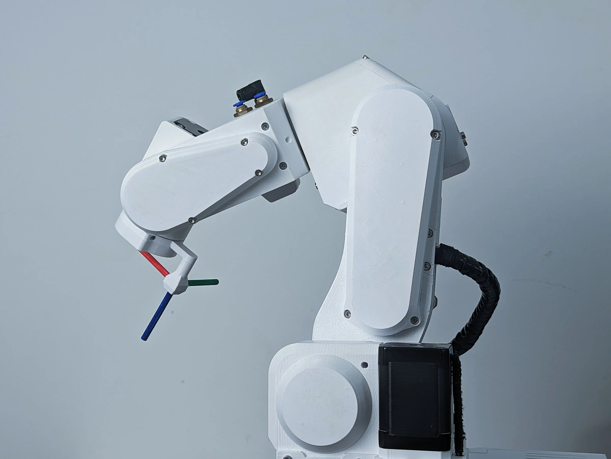

# Reference frames

A frame is a coordinate system: an origin and three axes, X, Y and Z, at right angles. A position is three
numbers in a frame; the same point has different numbers in different frames. PAROL6's software uses two frames
you choose between, and several it keeps to itself.

## The right-hand rule

All frames are right-handed: with the right hand's thumb along X and the index finger along Y, the middle finger
points along Z. For rotations, the thumb along the axis, the fingers curl in the positive direction. Every
orientation angle in the software follows this rule.

## WRF, the world reference frame

Fixed to the robot's base: the origin on the axis of joint 1 at the base's mounting surface, Z up, X and Y along
the base. Everything that does not move with the arm is described in it: the table, the parts, the positions a
program teaches. `MoveCart` in RBTscript and `move_l` in the API take WRF poses by default.

## TRF, the tool reference frame

Fixed to the tool: the origin at the tool centre point, Z along the tool's approach direction, X and Y across it.
It moves with the arm. A move **in** the TRF is relative to where the tool is now: "100 mm forward along the
tool" is `MoveCartRelTRF(0,0,100,0,0,0)` or `move_l([0,0,100,0,0,0], frame="TRF", rel=True)`, and it goes in a
different world direction every time, depending on the tool's orientation. Approaching a part along the
gripper's axis, retreating after a grip, and rotating the tool about its own axis are TRF moves.

{ width="600" }

## Jogging in a frame

The commander's Cartesian jog and the API's `jog_l` take the frame: WRF jogs move the tool along the base's
axes, TRF jogs along the tool's own. Switch to TRF to go straight in or out of a part whatever its angle.

## The frames inside

The kinematic model keeps a frame at every joint, each defined relative to the previous one by the
Denavit-Hartenberg parameters, and a frame at the flange. The tool frame is the flange frame moved by the
tool's transform; the Python API's tool definitions and `set_tcp_transform()` set that transform
([Tools and the TCP](../programming/02-python-api/tools-and-tcp.md)). The commander's model has the pneumatic gripper's
transform built in.
